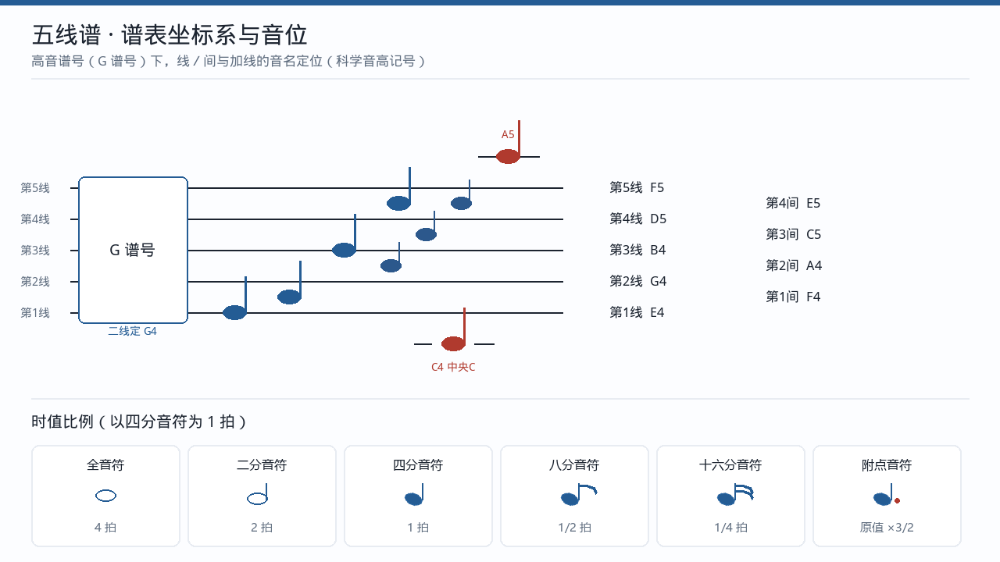

# 五线谱：从“认音”到“读谱即音乐”

## README · 导览

### README_1 本库定位与能力边界

五线谱是通用性最强的记谱法：它以二维坐标同时编码音高与时间，不依附任何特定乐器，因而成为跨声部、跨调性、跨谱表协作的基准语言。其能力结构按解码层级展开：由符号辨识、关系解码到结构化内化，逐级可训练、可验收、可复核。

精通的标准不是认识更多记号，而是符号向内心声音或演奏指令的**转化速度与保真度**：一眼扫过谱面即形成调性预期、节奏框架与乐句走向，手与耳先于逐音辨识而启动。

| 能力层 | 认知对象 | 可交付输出 | 典型失效表现 |
| :--- | :--- | :--- | :--- |
| 辨识 | 单个符号 | 说出线间音名、时值、记号名称 | 逐音数线，离开谱号即失准 |
| 解码 | 符号组合 | 完整唱出或奏出一段旋律 | 音高对、节奏散，拍感不稳 |
| 结构化 | 规则体系 | 判定调性、和弦、乐句边界 | 认得每个音却听不出乐句 |
| 内化 | 谱面整体 | 流畅视奏、移调译谱、曲式与和声分析 | 换调或换谱表后需重新学 |

适用对象：器乐与声乐学习者、视奏与视唱练耳训练者、编曲与音乐分析从业者、记谱法教学与知识库维护人员。前置要求仅为基本音高概念，不要求固定乐器。

治理信息（版本／修订记录／图版规范／待修登记）集中见 `../../music_notation_process/_meta/版本与图版规范.md`。

### README_2 三阶进阶总览

| 阶段 | 核心任务 | 知识域 | 跃迁条件 | 达标信号 |
| :--- | :--- | :--- | :--- | :--- |
| 入门 | 建立符号与基本元素的对应 | 谱表坐标、谱号、音名唱名、时值、拍号 | 任一谱表位置可在 1 秒内报出音名 | 陌生单声部旋律可慢速读通 |
| 进阶 | 掌握音乐的语言规则 | 音程、和弦、调式调号、常用记号 | 能把音高序列归并为和弦与调性 | 看谱即知调性与和声骨架 |
| 精通 | 走向流畅视奏与深度分析 | 复拍子、移调译谱、曲式与和声、内心听觉 | 视觉提前量大于演奏位置 | 陌生谱一次性视奏且能预判走向 |

```text
[「1」符号辨识] --> [「2」谱表坐标定位] --> [「3」时值与拍号解码]
                                                  |
                                                  v
[「6」移调与译谱] <-- [「5」和声与乐句预期] <-- [「4」音程／和弦／调式规则]
                                |
                                v
                      [「7」流畅视奏与曲式分析]
```

三个阶段不是知识量的线性累加，而是**解码单位**的三次放大：由“一个音”到“一组音”，再到“一个调性空间内的整句”。

### README_3 体例与符号约定

- 序号一律使用「1」「2」「3」或“第1步”形式；章节层级为 `README_N`、`板块0`–`板块10` 与 `N_M`，`0_M` 为读前说明子节。
- 「1」「2」等序号在三种语境出现：README_2 流程图步骤、训练序列序号、实操工作流步骤；引用时写全语境，如“板块 4 工作流第 1 步”。
- 可量化关系用数学块给出，谱例与换算以数学块或等宽代码块呈现，流程用 ASCII 代码块重建。
- 图片统一归档于 `images` 子文件夹，正文以相对路径引用；本库路径均相对各文件所在目录，治理文件路径 `../../music_notation_process/_meta/` 需向上跳两层再横向进入 process 目录。
- 每个阶段末尾设“达标自检”，指标均给出测量方法，可直接用于训练验收与知识库审计。
- 表格中的音名采用科学音高记号，中央 C 记作 C4。

## 板块0 · 读前说明与检索路径

### 0_1 前置要求与术语门槛

本板块把正文隐含的阅读门槛显性化。若某项未满足，按“补足位置”直达对应板块，无须从头通读。

| 门槛 | 最低要求 | 补足位置 |
| :--- | :--- | :--- |
| 音高概念 | 能分辨谱表线间位置，知道中央 C 的概念 | 板块2 的 2_1 |
| 音名记号 | 科学音高记号，中央 C 记作 C4；音组随实际音名判定，不随谱式改变 | 板块8 的 8_1 |
| 计数口径 | 自检数字＝对应表行数／训练项数，计数范围见表下注 | 各阶段达标自检表 |
| 方法路径 | 换算口径见 8_1，异说条目见 7_2，实务应用见译谱与曲目实例 | 板块7、板块8～10 |

### 0_2 任务—板块速查

| 读者任务 | 直达板块 | 验收入口 |
| :--- | :--- | :--- |
| 认符号、建立第一层对应 | 板块2 | 2_3 达标自检 |
| 学规则、进入进阶 | 板块3 | 3_4 达标自检 |
| 练视奏／分析／精通 | 板块4 | 4_3 达标自检 |
| 查错纠偏 | 板块5 | 5_1 误区对照 |
| 查术语与速查卡 | 板块6 | 6_1／6_2 |
| 查结论口径与异说 | 板块7 | 7_1／7_2 |
| 查音名、音组与换算接口 | 板块8 | 8_1／8_2 |
| 查译谱与跨谱对照实务 | 板块9 | 9_1／9_2 |
| 查曲目实例与应用 | 板块10 | 10_1／10_2／10_3／10_4 |

### 0_3 加间计数口径与换算约定

本库对加线加间统一采用“自谱表向外计数”的口径，这是全篇音位判读的基础，须先行确认：

- **上加**：自第 5 线向上依次为上加一间 G5、上加一线 A5、上加二间 B5、上加二线 C6。
- **下加**：自第 1 线向下依次为下加一间 D4、下加一线 C4、下加二间 B3、下加二线 A3……下加五间 C3。
- **判定规则**：加间编号随其外侧紧邻的加线序号走——“下加一间”指第 1 线与下加一线之间的间（D4），不是“下加一线之下那个间”。

按此口径复核：B3 位于下加二线与下加一线之间，记作**下加二间**；C3 位于下加五线与下加四线之间，记作**下加五间**。2_1 音区表与 8_1 锚点表均据此定稿。

| 通用约定 | 取值 |
| :--- | :--- |
| 中央 C | C4（小字一组 c¹） |
| 时值比例 | 全 : 二分 : 四分 : 八分 : 十六分 ＝ 1 : 1/2 : 1/4 : 1/8 : 1/16 |
| 音组判定 | 由音名八度决定，不随谱表或调号改变 |

加线的书写规则（据公开乐理资料的通行书写惯例，非强制规范）：加线一般不超过五条，音区过高或过低时改用移动八度记号 8va／8vb 表示；加线须短而平，穿过线位音符的符头中心，间位音符不由加线穿过。这是书写层面的惯例，与前述加间计数口径互补，不改变音名的判定结果。

## 板块1 · 记谱本体与认知坐标

### 1_1 记谱原理与信息编码



图 1-1　五线谱谱表坐标系与音位。本库绘制；音名依据科学音高记号与十二平均律标准。

如图 1-1 所示，五线谱的本质是**二维坐标系 + 附加记号层**。纵向位置编码音高，横向排列与符形编码时间，第三层记号补足力度、速度、表情与演奏法。理解这一分层，才能解释为什么“认音”只是入门而非终点。

| 编码维度 | 载体 | 解码结果 | 常见误读 |
| :--- | :--- | :--- | :--- |
| 音高 | 五线四间、谱号、上加线／下加线 | 绝对音名与八度 | 把线间位置当成固定音名，忽略谱号 |
| 时间 | 符头、符干、符尾、附点、休止符 | 时值比例与起奏点 | 把符尾当作装饰而非时值减半 |
| 节拍 | 拍号、小节线、拍点 | 强弱周期与分句 | 把小节线等同于乐句边界 |
| 表现 | 力度、速度、表情术语、装饰音、演奏法、反复记号 | 语气、音色、结构 | 把连音线一律理解为延音 |

音高解码的关键约束是**谱号先行**：谱号定义某条线为某个音，其余线间按三度递进推出。因此“第几线是什么音”没有脱离谱号的答案。

### 1_2 工具属性与能力边界

五线谱属于通用音高记录体系。它给出的是可定位的绝对音高与相对时值，不绑定指法、不绑定调式唱名、不绑定某件乐器的把位。正因如此，它可以承载多声部、总谱与转调记谱，也正因如此，它把“如何发声”留给了演奏者。

| 记谱体系 | 主要记录对象 | 自带信息 | 主要缺口 |
| :--- | :--- | :--- | :--- |
| 五线谱 | 绝对音高 + 时值 | 音名、八度、节拍、多声部 | 指法、音色、微分音与力度量化 |
| 简谱 | 首调音高 + 时值 | 唱名关系、调号标记 | 绝对音高、复杂多声部 |
| 吉他 TAB | 弦序与品格 | 按弦位置与奏法 | 音名、严格时值、和声功能 |
| 减字谱 | 弦序、徽位、指法 | 动作指令 | 绝对音高、严格节奏 |
| 工尺谱 | 谱字与板眼 | 首调框架、节拍骨架 | 润腔细节、绝对音高 |

不同谱式各有侧重：简谱长于首调唱名与调式换算，TAB 直接编码指板动作，减字谱记录弦序徽位与指法，工尺谱以谱字板眼记首调框架；跨谱换算以科学音高为公共坐标对齐。

能力边界须明确：五线谱不记录音色的连续变化，力度与速度术语为约定性描述而非物理量；表情术语存在语种与时期差异；节奏精度受记谱规范与时代习惯影响。把这些“未编码项”当作谱面已给出，是进阶阶段最隐蔽的错误来源。

### 1_3 「精通」的可观测判据

精通即把读谱内化为近乎本能的能力，落到流畅视奏与准确的内心听觉。为可验收，需拆成可测指标。

| 指标 | 入门 | 进阶 | 精通 | 测量方法 |
| :--- | :--- | :--- | :--- | :--- |
| 单音定位 | 2 秒以上 | 约 1 秒 | 无需刻意识别 | 随机指认 30 个含加线音位 |
| 读取单位 | 单音 | 节奏型与音组 | 乐句与和声块 | 复述刚读过的一小节 |
| 视觉提前量 | 无 | 半小节 | 一至两小节 | 视奏中遮挡当前小节继续演奏 |
| 调性预判 | 不能 | 看调号判定 | 结合和声进行与风格预判 | 陌生谱准备 30 秒后口述调性与段落 |
| 移调译谱 | 不能 | 单旋律移调 | 换谱表、换调性、多声部 | 限时将一段移到指定调并改记谱表 |

精通的标志因此可归纳为两项：**流畅的视奏**与**深度的音乐分析能力**；二者共同依赖“符号—声音”通路已被压缩到近乎无延迟。

## 板块2 · 入门：建立符号与基本元素的对应

### 2_1 知识单元清单

| 单元 | 内容 | 验收要求 |
| :--- | :--- | :--- |
| 谱表结构 | 五线与四间；上加线、下加线及其延伸规则 | 能写出 C4 至 A5 的线间位置 |
| 谱号 | 高音谱号、低音谱号、中音谱号 | 说出各谱号的基准线与基准音 |
| 音名与唱名 | C D E F G A B；Do Re Mi Fa Sol La Si；音级 | 三种表述可互译 |
| 音区位置 | 中音区、高音区、低音区在谱表上的对应 | 指出各音区主要线间与加线区间 |
| 时值 | 全音符、二分、四分、八分、十六分及对应休止符 | 默写时值比例表 |
| 节拍 | 拍号、小节线、基本节奏型 | 按拍号击拍并读出节奏型 |

三种谱号的基准线与线间音名（自下而上）：

| 谱号 | 基准线 | 基准音 | 第1线至第5线 | 第1间至第4间 |
| :--- | :--- | :--- | :--- | :--- |
| 高音谱号（G 谱号） | 第2线 | G4 | E4 G4 B4 D5 F5 | F4 A4 C5 E5 |
| 低音谱号（F 谱号） | 第4线 | F3 | G2 B2 D3 F3 A3 | A2 C3 E3 G3 |
| 中音谱号（C 谱号） | 第3线 | C4 | F3 A3 C4 E4 G4 | G3 B3 D4 F4 |

高音谱表下加一线为 C4（中央 C），上加一线为 A5；低音谱表上加一线为 C4。

音区边界对照（高音谱表，科学音高记号）：

| 音区 | 对应音组 | 谱表区间 |
| :--- | :--- | :--- |
| 低音区 | 小字组 C3–B3 | 下加五间 C3 至下加二间 B3 |
| 中音区 | 小字一组 C4–B4 | 下加一线 C4 至第 3 线 B4 |
| 高音区 | 小字二组 C5–B5 | 第 3 间 C5 至上加二间 B5（上加一线为 A5） |

两谱表在大谱表中共用中央 C 作为接合音，同一音在两谱表上的线位不同（如高音谱表第 1 线为 E4，低音谱表第 1 线为 G2，两者相差大十三度而非固定八度）；音区命名以实际音组为准，不随谱表改变，这是多声部读谱的锚点。

时值与休止符的等比关系（以全音符为 1，四分音符为 1 拍）：

$$t_{\text{全}}:t_{\text{二分}}:t_{\text{四分}}:t_{\text{八分}}:t_{\text{十六分}}=1:\frac{1}{2}:\frac{1}{4}:\frac{1}{8}:\frac{1}{16}$$

$$t_{\text{附点}}=t\times\frac{3}{2},\qquad t_{\text{复附点}}=t\times\frac{7}{4}$$

| 名称 | 相对全音符 | 以四分音符为 1 拍 | 对应休止符 |
| :--- | :--- | :--- | :--- |
| 全音符 | 1 | 4 拍 | 全体止符 |
| 二分音符 | 1/2 | 2 拍 | 二分休止符 |
| 四分音符 | 1/4 | 1 拍 | 四分休止符 |
| 八分音符 | 1/8 | 1/2 拍 | 八分休止符 |
| 十六分音符 | 1/16 | 1/4 拍 | 十六分休止符 |

拍号分子为每小节拍数，分母为单位拍的音符时值类别，如 4/4 表示以四分音符为一拍、每小节四拍；6/8 通常以附点四分音符为一大拍、每小节两大拍，属复拍子，不可按六个单拍处理。

### 2_2 训练序列

「1」先固定谱号再读数。每张练习谱先看谱号与调号，口述基准线音名，然后才允许认音。

「2」以 C4 为锚点向上下扩展。先写下加一线 C4，再按“线—间—线”三度递进写出相邻音名，直至上下各覆盖一个加线区。

「3」时值与音高分离训练。同一组音位分别用全、二分、四分、八分、十六分记写并击拍唱读，确保时值错误不污染音高解码。

「4」休止符对位练习。把旋律中的若干音符替换为等长休止符，保持拍位不变，用手击拍、口数拍。

「5」节奏型卡片化。把常见节奏型（均等、附点、切分、前八后十六、三连音）做成独立单元，见形即读，不再逐拍拆解。

「6」换谱表复述。把同一段旋律分别抄写到高音谱表与低音谱表，验证音名不随线位改变而改变。

「7」短旋律整合。取 8 小节陌生单声部旋律，先口述谱号调号拍号，再慢速视唱，记录音高与节奏错误各若干处。

### 2_3 阶段达标自检

| 检查项 | 合格线 | 复核方式 |
| :--- | :--- | :--- |
| 含加线音位指认 | 30 个音位错 ≤2 | 随机抽查并计时 |
| 三种谱号基准音 | 全部正确 | 口头复述 |
| 时值比例默写 | 全表正确 | 闭卷填写 |
| 8 小节视唱 | 音高错 ≤2、节奏错 ≤2 | 录音回听 |
| 拍号与强弱 | 能说明 2/4、3/4、4/4、6/8 的拍感差异 | 击拍演示 |

入门达标不要求速度，只要求**映射无歧义**：任何符号都能唯一地落到音名、时值与拍位上。

## 板块3 · 进阶：掌握音乐的语言规则

### 3_1 知识单元清单

| 单元 | 内容 | 验收要求 |
| :--- | :--- | :--- |
| 音程 | 度数、音数、转位、协和性 | 给定两音即时报出度数与半音数 |
| 和弦 | 大三、小三、七和弦的构成与转位 | 写出各和弦的音程堆叠并标记转位 |
| 调式与调号 | 大调式、小调式、民族五声调式；升号调、降号调识别 | 看调号即报大调主音与关系小调 |
| 常用记号 | 力度、速度、表情术语、装饰音、反复记号、演奏法记号（连音线、断音等） | 分类默写并说明实际演奏含义 |

进阶的核心转变是：不再把音符当作孤立点，而把连续音高**归并为结构**——两个音构成音程，三个及以上构成和弦，一串和弦构成调性与进行，记号则规定这些结构的语气与重复方式。

### 3_2 规则关系与推导

音程度数由谱表上“线间位置数”决定，音数由半音数决定，二者必须分开计。转位前后度数互补为 9，半音数互补为 12：

$$d'=9-d,\qquad h'=12-h$$

| 音程 | 度数 | 半音数 | 协和性 | 转位结果 |
| :--- | :--- | :--- | :--- | :--- |
| 纯一度 | 1 | 0 | 完全协和 | 纯八度 |
| 小二度 | 2 | 1 | 不协和 | 大七度 |
| 大二度 | 2 | 2 | 不协和 | 小七度 |
| 小三度 | 3 | 3 | 不完全协和 | 大六度 |
| 大三度 | 3 | 4 | 不完全协和 | 小六度 |
| 纯四度 | 4 | 5 | 完全或不协和（依语境） | 纯五度 |
| 增四度／减五度 | 4 或 5 | 6 | 不协和 | 减五度／增四度 |
| 纯五度 | 5 | 7 | 完全协和 | 纯四度 |
| 小六度 | 6 | 8 | 不完全协和 | 大三度 |
| 大六度 | 6 | 9 | 不完全协和 | 小三度 |
| 小七度 | 7 | 10 | 不协和 | 大二度 |
| 大七度 | 7 | 11 | 不协和 | 小二度 |
| 纯八度 | 8 | 12 | 完全协和 | 纯一度 |

和弦由三度堆叠构成，根音位置决定原位或转位：

| 和弦 | 堆叠结构 | 半音距（根音起） | 常见标记 |
| :--- | :--- | :--- | :--- |
| 大三和弦 | 大三度 + 小三度 | 0, 4, 7 | C、CM |
| 小三和弦 | 小三度 + 大三度 | 0, 3, 7 | Cm |
| 减三和弦 | 小三度 + 小三度 | 0, 3, 6 | Cdim |
| 增三和弦 | 大三度 + 大三度 | 0, 4, 8 | Caug |
| 大小七和弦 | 大三和弦 + 小三度 | 0, 4, 7, 10 | C7 |
| 大七和弦 | 大三和弦 + 大三度 | 0, 4, 7, 11 | Cmaj7 |
| 小七和弦 | 小三和弦 + 小三度 | 0, 3, 7, 10 | Cm7 |
| 半减七和弦 | 减三和弦 + 大三度 | 0, 3, 6, 10 | Cm7b5 |
| 减七和弦 | 减三和弦 + 小三度 | 0, 3, 6, 9 | Cdim7 |

三和弦第一转位以三音为低音（六和弦），第二转位以五音为低音（四六和弦）；七和弦第三转位以七音为低音（二和弦）。转位不改变和弦功能，只改变低音线条与声部连接的平滑度。

调号识别依靠固定序列：升号依次为 F C G D A E B，降号依次为 B E A D G C F。

| 类别 | 序列 | 大调主音判定 | 关系小调 |
| :--- | :--- | :--- | :--- |
| 升号调 | F C G D A E B | 最后一个升号上方大二度 | 主音下方小三度 |
| 降号调 | B E A D G C F | 1 个降号即 F 大调；2 个及以上取倒数第二个降号 | 主音下方小三度 |
| 无升降 | C 大调 / a 小调 | C | a |

民族五声调式以宫、商、角、徵、羽为五个正音，相邻音程为大二度、大二度、小三度、大二度、小三度；以宫音为 1 时，五声骨干为 1 2 3 5 6，偏音为 4（清角）、7（变宫）、升 4（变徵）、降 7（闰）。调式判读须区分“调号相同”与“主音相同”：同一调号可对应大调、关系小调及多个五声调式。

十二平均律下，相距 $n$ 个半音的两音频率比为：

$$\frac{f_2}{f_1}=2^{n/12},\qquad \text{八度}=2^{12/12}=2$$

常用记号按功能归为四类，避免零散记忆：

| 类别 | 典型记号 | 作用层面 |
| :--- | :--- | :--- |
| 力度 | p、mp、mf、f、cresc.、dim.、sf | 音量层级与渐变 |
| 速度 | Grave、Andante、Allegro、rit.、a tempo、♩=数字 | 拍速与速度变化 |
| 表情与演奏法 | dolce、legato、连音线、断音、重音、保持音、琶音 | 语气与触音方式 |
| 装饰与结构 | 倚音、颤音、回音、波音；反复记号、跳跃记号、反复省略 | 音高装饰与段落重复 |

必须区分三种“线”：连音线连接不同音高时表示圆滑奏法，连接同音高时表示延音（时值合并），延音线跨小节时合并拍数；小节线是节拍边界，不是乐句边界。

### 3_3 训练序列

「1」音程听辨与视辨配对。谱面给出音程，先报度数与半音数，再听辨协和性，最后写出转位结果。

「2」和弦拆解。给定任意音为根音，写出大三、小三、大小七的构成音，并移写到高音谱表与低音谱表。

「3」调号速判。随机给出 1 至 7 个升号或降号的调号，口述大调主音、关系小调与首调唱名对应。

「4」调内和弦归类。在指定大调内写出七个顺阶三和弦，标注级数与功能（主、下属、属）。

「5」记号改写。取一段无记号旋律，分别加入力度梯度、断连对比、装饰音与反复结构，说明每处改动造成的听感差异。

「6」短句归并。把 4 小节旋律按和声归并，标出每小节主要和弦与终止式位置。

### 3_4 阶段达标自检

| 检查项 | 合格线 | 复核方式 |
| :--- | :--- | :--- |
| 音程判定 | 20 组错 ≤2 | 谱面与听辨双测 |
| 和弦构成与转位 | 指定 3 类（大三、小三、大小七）全部正确 | 闭卷书写 |
| 调号识别 | 15 组调号全对 | 计时速判 |
| 顺阶和弦与功能 | 指定大调全对 | 书面标注 |
| 记号释义 | 四类各举 3 例且演奏含义正确 | 口头说明 |

计数口径：和弦类数按 3_3 训练项「2」实际列出的三种和弦计（两种三和弦与一种七和弦），不按全部和弦种类计。

进阶达标的实质判据是**归并能力**：给一段陌生旋律，能在不长于读谱时间内说出调性、主要和弦与乐句落点。

## 板块4 · 精通：走向流畅的视奏与深度分析

### 4_1 能力构成与分化路径

| 能力项 | 输入 | 输出 | 依赖的前置能力 |
| :--- | :--- | :--- | :--- |
| 复杂节奏与复拍子／混合拍子视唱 | 6/8、9/8 为复拍子，5/4 为混合拍子；切分与连音组合 | 稳定拍感下的准确唱奏 | 时值体系、拍号分层 |
| 移调与译谱 | 原谱 + 目标调或目标谱表 | 新谱或首调唱名 | 音程、调号、谱号体系 |
| 曲式与和声分析 | 完整乐段或乐章 | 结构图与和声进行表 | 和弦、调式、终止式 |
| 走向预判 | 陌生乐谱首页 | 调性、风格、段落预期 | 以上三项的综合 |
| 流畅视奏与内心听觉 | 陌生乐谱 | 一次性演奏或默读成声 | 全部前置能力 |

精通阶段出现路径分化，但共用同一底座：器乐方向偏重视觉提前量与动作自动化，声乐方向偏重内心听觉先行，分析方向偏重结构与风格判定。三者都要求把“逐个音符解码”升级为“按结构块解码”。

### 4_2 实操工作流

视奏工作流（自准备到回放）：

```text
[「1」扫谱号／调号／拍号] --> [「2」定调性与拍感框架]
                                     |
                                     v
[「3」扫首尾音与音域] --> [「4」划乐句与终止式位置]
                                     |
                                     v
[「5」预读难点：加线／复节奏／转调] --> [「6」起速设定：宁慢勿断]
                                     |
                                     v
[「7」眼先行一至两小节，保持不断] --> [「8」回放核对：音高／节奏／分句]
```

分析工作流（自谱面到结论）：

```text
[「1」分句与分段] --> [「2」标调性与转调点] --> [「3」逐小节标和弦级数]
                                                       |
                                                       v
[「6」写出风格与走向判断] <-- [「5」归并曲式类型] <-- [「4」识别终止式与和声节奏]
```

移调与译谱的操作口径：按音程移调时保持音程关系整体平移并重写调号；改变谱号移调时利用同一线位在不同谱号下的音名差实现“不挪音符”的读谱转换；译谱到简谱时须先确定首调主音，再处理变化音与八度分组。三种方式都要求**调号、临时记号、八度标记三者同步更新**，缺一即产生错译。

半音化声部的读法（10_4 案例回指本节）：分析工作流第「4」步识别终止式时，若某声部出现连续半音下行，先按临时记号判定其是调内变化的经过音还是离调引线，再看它是否把和声导向该段主和弦；半音化不另立调性，只在终止式的语境中解释。

### 4_3 阶段达标自检

| 检查项 | 器乐／声乐向合格线 | 分析向合格线 | 测量方法 |
| :--- | :--- | :--- | :--- |
| 陌生 8 小节视奏 | 准备 30 秒后一次性完成，错 ≤2 处 | 口述视奏难点与调性预期 | 录音并逐音核对 |
| 遮挡当前小节续奏 | 不中断、不错拍 | 不作要求 | 视奏中遮挡测试 |
| 复拍子与混合拍子视唱 | 6/8（复拍子）与 5/4（混合拍子）段落拍感稳定 | 标出两类拍子的强弱层级 | 节拍器校验 |
| 移调 | 指定调内单旋律与双声部均正确 | 说明移调三要素的更新依据 | 限时书面移调 |
| 换谱表译谱 | 高音与低音谱表互换无误 | 标出同一音在两谱表的线位差及中央 C 接合关系 | 对照原谱复核 |
| 曲式与和声分析 | 标出段落、终止式与主要和弦级数 | 提交完整结构图并说明依据 | 提交结构图 |
| 走向预判 | 准备 30 秒后口述调性、风格与段落预期 | 结合和声与风格给出走势判断 | 与实际音响比对 |

精通的验收必须包含“陌生材料”与“限时”两个条件；在熟悉曲目上达成的高正确率不能作为判据。

## 板块5 · 常见误区与纠偏

### 5_1 误区—成因—纠偏对照

| 误区 | 成因 | 纠偏动作 | 复核指标 |
| :--- | :--- | :--- | :--- |
| 把线间位置当固定音名 | 未建立谱号优先的解码顺序 | 每张谱先口述谱号基准音 | 换谱表后音名正确率 |
| 逐个音符数线 | 解码单位停留在单音 | 按三度递进与音组记忆 | 单小节复述完整度 |
| 忽略调号直接读固定唱名 | 把调号当作装饰信息 | 读谱前强制报出调名 | 调号速判正确率 |
| 6/8 按六个单拍数 | 未区分单拍子与复拍子 | 以附点音符为一大拍击拍 | 节拍器下的拍感稳定度 |
| 连音线一律当延音 | 未区分同音高与不同音高 | 逐条判断连接音是否同高 | 记号释义正确率 |
| 把小节线当乐句边界 | 节拍单位与结构单位混同 | 单独训练分句与终止式 | 乐句划分吻合度 |
| 附点时值算成加半拍 | 未使用比例公式 | 统一按原值 ×3/2 计算 | 时值计算正确率 |
| 移调只挪音符不改调号 | 三要素未同步更新 | 建立调号／临时记号／八度检查表 | 译谱逐项核对 |
| 表情术语当作可忽略装饰 | 只解码音高与时值 | 每曲至少标注三类记号并说明听感 | 记号执行率 |
| 以熟悉曲目的流畅冒充精通 | 验收材料无陌生度约束 | 强制使用未见过的限时材料 | 陌生材料成绩 |

### 5_2 跨阶段衔接检查

| 衔接 | 放行条件 | 未达标时的回退动作 |
| :--- | :--- | :--- |
| 入门 → 进阶 | 单音定位与拍位映射无歧义 | 回到 2_2 的时值—音高分离练习 |
| 进阶 → 精通 | 能在读谱同时归并调性与和弦 | 回到 3_3 的调号速判与短句归并 |
| 精通 → 自由运用 | 陌生材料限时视奏与结构预判同时达标 | 交替执行 4_2 两条工作流各一周 |

阶段放行采用“全项合格制”：任一检查项未达标即不放行，避免以单点优势掩盖结构缺口。

## 板块6 · 术语索引与速查

### 6_1 术语对照

| 中文 | 英文／缩写 | 要点 |
| :--- | :--- | :--- |
| 谱号 | Clef | 定义某条线的音名，是音高解码的前提 |
| 大谱表 | Grand staff | 高音与低音谱表以中央 C 接合 |
| 加线 | Ledger line | 超出五线四间时使用的短横线 |
| 音级 | Scale degree | 调式内的相对位置，与音名不同层 |
| 时值 | Note value | 音符或休止符的相对长度 |
| 拍号 | Time signature | 分子为拍数，分母为单位拍类别 |
| 复拍子 | Compound meter | 每大拍可三分的拍子，如 6/8、9/8 |
| 混合拍子 | Mixed meter | 由不同单拍子组合的不对称拍子，如 5/4=2/4+3/4 |
| 音程转位 | Interval inversion | 度数互补为 9，半音数互补为 12 |
| 转位和弦 | Inversion | 低音非根音时的和弦形态 |
| 调号 | Key signature | 升号或降号的固定序列 |
| 关系小调 | Relative minor | 与大调同调号，主音下方小三度 |
| 顺阶和弦 | Diatonic chord | 由调内音级堆叠而成的和弦 |
| 终止式 | Cadence | 乐句或段落的和声收束 |
| 连音线 | Slur / Tie | 异音为圆滑，同音为延音 |
| 内心听觉 | Audiation | 无声条件下在内心形成音响 |
| 视奏 | Sight-reading | 首次接触乐谱即演奏或唱出 |
| 移调 | Transposition | 整体改变音高而保持音程关系 |
| 译谱 | Transcription | 在记谱体系或调性间转换表述 |

### 6_2 速查卡

```text
谱号基准：G 谱号 → 第2线 G4 ｜ F 谱号 → 第4线 F3 ｜ C 谱号 → 中线 C4
升号序列：F C G D A E B      降号序列：B E A D G C F
大调主音：升号取末位上方大二度 ｜ 降号 1 个即 F，多个取倒数第二位
关系小调：大调主音下方小三度 ｜ 同调号
五声骨干：宫 商 角 徵 羽 → 1 2 3 5 6 ｜ 偏音 4 7 #4 b7
三和弦：大三 0-4-7 ｜ 小三 0-3-7 ｜ 减三 0-3-6 ｜ 增三 0-4-8
七和弦：大小七 0-4-7-10 ｜ 大七 0-4-7-11 ｜ 小七 0-3-7-10
```

$$t_{\text{附点}}=t\times\frac{3}{2},\quad t_{\text{复附点}}=t\times\frac{7}{4},\quad d'=9-d,\quad h'=12-h,\quad \frac{f_2}{f_1}=2^{n/12}$$

| 待查问题 | 直接定位 |
| :--- | :--- |
| 某条线是什么音 | 先查谱号基准，再按线间三度递进 |
| 调号几个升号是什么调 | 升号序列取末位，上方大二度 |
| 和弦是大三还是小三 | 看三音距根音为 4 还是 3 个半音 |
| 6/8 该怎么数拍 | 两大拍，每拍三分 |
| 连音线是否延长时值 | 看两端音高是否相同 |
| 精通是否达标 | 只看陌生材料、限时条件下的视奏与分析成绩 |

## 板块7 · 文献、口径与异说

### 7_1 可核事实与依据分层

本库把结论按“可核事实 / 约定性口径 / 存在异说”三层标注，避免把记忆性概述伪装成有出处的引文。下表仅记录结论取值与依据层级，异说条目另见 7_2。

| 结论类别 | 本库取值 | 依据层级 |
| :--- | :--- | :--- |
| 时值比例 | 1 : 1/2 : 1/4 : 1/8 : 1/16 | 通用乐理，通行共识 |
| 附点、复附点 | ×3/2、×7/4 | 通用乐理，通行共识 |
| 音程转位 | d′=9−d，h′=12−h | 通用乐理，通行共识 |
| 和弦半音堆叠 | 大三 0-4-7 等 9 类 | 通用和声学，通行共识 |
| 十二平均律 | f2/f1=2^(n/12) | 声学与乐理，通行共识 |
| 三种谱号线间音名 | 以各谱号基准线推定 | 记谱法规则，通行共识 |
| 五度圈邻调顺序 | C→G→D→A→E→B→F♯/G♭… | 通用乐理，通行共识 |
| 力度、速度、表情术语 | 意大利语通行释义 | 约定性描述，随时期与语种变化 |
| 音区边界（高音谱表） | 小字组下加五间至下加二间；小字一组下加一线至第 3 线；小字二组第 3 间至上加二间 | 科学音高与谱表线位，通行共识 |
| 音组跨谱表锚点 | 低音谱表第 5 线 A3、下加一线 E2、第 2 间 C3；高音谱表下加二线 A3 | 以谱表图逐格定位，通行共识 |

### 7_2 分歧条目的异说标注

| 条目 | 通行说法 | 另有异说 | 本库处理 |
| :--- | :--- | :--- | :--- |
| 5/4 拍归类 | 混合（不对称）拍子，2/4+3/4 | 部分教材并入复拍子或称不规则拍子 | 归“复拍子与混合拍子”，并注明 2+3 与 3+2 的分组差异 |
| 6/8 拍感 | 两大拍、每拍三分 | 快速时可作六单拍处理 | 默认两大拍；快速标记按谱面指示 |
| 中音谱号基准 | C 谱号置于第 3 线 | 次中音谱号置于第 4 线，为另一谱号 | 拆清两者，不混写 |
| 表情术语 | 约定性描述 | 同一术语在不同时期含义不同 | 不作物理量，标注语境差异 |

### 7_3 学习资源与找谱渠道

本节把通用学习资源按“找谱”与“学理／练耳”两类归档，并标出与三阶进阶的适配关系。站点信息依据《乐谱来源说明》，本节只作取用导航，不替代前述可核事实与异说口径。

| 站点 | 类别 | 核心定位（据来源重述） | 适配阶段 |
| :--- | :--- | :--- | :--- |
| IMSLP | 公共版权谱库 | 规模领先的免费公版谱资源，古典作曲家与乐器覆盖广，可取得权威版本的 PDF | 进阶／精通：版本对读、总谱分析 |
| MuseScore | 社区谱库 | 用户上传改编谱多，流行、影视、动漫游戏类齐全，支持在线试听以先确认旋律与节奏 | 入门／进阶：流行曲视奏与节奏核对 |
| free-scores | 免费谱库 | 覆盖独奏、重奏、合唱，可按乐器、难度、风格筛选 | 入门／进阶：按难度找练习曲 |
| 8notes | 综合学习站 | 分级谱之外附乐理教程、乐器技巧指南与在线节拍器 | 入门：找谱同时补乐理 |
| OpenScore | 公版谱加工 | 把大量公版谱整理成可编辑格式，便于二次改编 | 精通：移调译谱与改编底稿 |
| CPDL | 合唱谱库 | 免费合唱谱集中，面向合唱、指挥与声乐学习者 | 进阶／精通：多声部与合唱总谱 |
| Schubertline | 声乐谱库 | 以歌剧、咏叹调与艺术歌曲为主，约四千余份 | 进阶／精通：声乐伴奏与歌剧读谱 |
| Musopen | 谱＋录音 | 除谱之外提供大量古典音乐免费录音 | 进阶／精通：视奏与内心听觉对照 |
| Musicca | 游戏化乐理 | 用互动练习掌握音符、节奏、音程等基础概念 | 入门：符号辨识与节奏起步 |
| Music Workbook | 系统化练习工具 | 把乐理、和声、曲式、视奏与听音整合为可读、可练、可复习的模块，结合五线谱、虚拟钢琴与音频，附学习统计与智能复习 | 进阶／精通：系统查漏与深度练习 |
| Dave Conservatoire | 视频课程 | 上百个分级教学视频，学完可自测 | 入门／进阶：自定进度的课程补充 |
| THE SHED | 专项训练 | 旋律、节奏等理论课程与针对性训练 | 进阶：节奏与旋律专项 |
| 国家高等教育智慧教育平台 | 体系课程 | 可检索《乐理与视唱练耳》等国家级课程，含基础理论、识谱与听音训练 | 入门／进阶：搭建严谨框架 |
| 音基100 | 考级应试 | 乐理与视唱练耳的在线练习、模拟考试与评分 | 入门／进阶：考级刷题与题型熟悉 |

取用口径：站点定位与规模数字来自《乐谱来源说明》，属对第三方站点的描述，会随站点运营变动，使用前须以站点现况为准。来源只给出中文站点中 cnscore.com、jianpuw.com 两个域名，其余站点未给网址或授权条款，故本表不列链接、不作版权背书；这是本节确定的信息缺口，不据以推断任何站点的当前可用性。

### 7_4 公开资料复核与补注

本节用公开乐理网页复核正文口径：多数条目为印证，个别补出正文未列的上限与记号。所引均为通行表述，不改变 7_1 的可核事实层级；网页内容会变动，仍以正式乐理规范与所用谱面为准。来源条目（MLA）附于本节末。

| 复核条目 | 正文口径 | 公开资料表述 | 处理 |
| :--- | :--- | :--- | :--- |
| 加间计算方向 | 上加间自下而上、下加间自上而下（0_3） | 上加线和上加间由下向上、下加线和下加间由上向下计算 | 印证，不改 |
| 下加一间位置 | 第 1 线与下加一线之间为下加一间 D4（0_3） | 第 1 线和下加一线形成的间叫下加一间 | 印证，不改 |
| 中央 C 双谱表定位 | C4 为高音谱表下加一线、低音谱表上加一线（8_1） | 中央 C 位于高音谱表下加一线，同时是低音谱表上加一线 | 印证，不改 |
| 上加二间／二线 | B5 上加二间、C6 上加二线（0_3） | 高音谱表上加二间 B5、上加二线 C6 | 印证，不改 |
| 加线数量上限 | 原未列，已补入 0_3 | 加线一般不超过五条，过多则用移动八度记号 8va／8vb | 补充，已写入 0_3 |
| 加线书写规范 | 0_3 原只定加间计数，现已补画法 | 加线须短、平，穿过线位音符符头中心；间位音符不由加线穿过 | 补充，已写入 0_3 |

来源条目（MLA）：

- “加间.” 百度百科, baike.baidu.com/view/175896.htm, 访问 22 Nov. 2026.
- “钢琴基础乐理知识——乐理入门（二）.” 人人钢琴网, everyonepiano.cn/Article-119.html, 访问 22 Nov. 2026.
- “快速学习五线谱的加线.” 微信公众号 i乐理, mp.weixin.qq.com/s?__biz=MzU1Nzg1MjIwOA==&mid=2247491456, 22 Nov. 2026 访问.

## 板块8 · 音名、音组与换算接口

### 8_1 音组—谱表位置—科学音高对照

中央 C 记作 C4，等于小字一组 c1。音组由音名八度决定，不随谱表改变。

| 音组 | 科学音高范围 | 高音谱表锚点 | 低音谱表锚点 |
| :--- | :--- | :--- | :--- |
| 小字二组 | C5–B5 | 第 3 间 C5、第 5 线 F5、上加一线 A5 | 上加四线 B4 以上 |
| 小字一组 | C4–B4 | 下加一线 C4、第 2 线 G4、第 3 线 B4 | 上加一线 C4、上加二线 E4、上加四线 B4 |
| 小字组 | C3–B3 | 下加五间 C3、下加二线 A3、下加二间 B3（C3 不在加线上） | 第 2 间 C3、第 3 线 D3、上加一间 B3 |
| 大字组 | C2–B2 | 不适用 | 第 1 线 G2、下加一线 E2 及以下 |

注：小字二组在低音谱表自 B4（上加四线）以上（含 C5 起）已全部位于上加线／间区；本表此处按线位实指，不套“上加二线”简写。

### 8_2 跨篇换算接口

| 简谱写法（1=C） | 音组 | 科学音高 | 五线谱对应 |
| :--- | :--- | :--- | :--- |
| 1（无点） | 小字一组 | C4 | 高音谱表下加一线 |
| 1（上一点） | 小字二组 | C5 | 高音谱表第三间 |
| 1（下一点） | 小字组 | C3 | 低音谱表第 2 间 |

换谱表或换调号时，须同步更新调号、临时记号与八度标记；遗漏任一项即产生错译。

## 板块9 · 译谱与跨谱对照实务

### 9_1 五线谱与简谱的双向译写

两种谱式的差异在“绝对音高是否内置”：五线谱把音高编码进线间位置，简谱用调号外加锚点。译写的核心是先定锚点，再逐音搬运关系。

| 译写方向 | 第一步 | 第二步 | 易错点 |
| :--- | :--- | :--- | :--- |
| 五线谱 → 简谱 | 依调号定 `1=X` | 按音名与八度加点，时值换横线 | 连音线（拱形）与附点漏译，导致时值减半或增倍 |
| 简谱 → 五线谱 | 写调号与拍号 | 把每个数字定位到对应线间 | 上／下加点与谱表八度错位，跨过中央 C 后误判音组 |

以 `1=C` 为例：五线谱下加一线 C4 对应简谱 1（无点），高音谱表第 3 间 C5 对应 1（上一点），低音谱表第 2 间 C3 对应 1（下一点）。完整锚点见 8_1、8_2。

译写后用“回译校验”：把译稿再译回原谱式，逐音比对音名与时值，能回到原样才算通过。

### 9_2 移调、换谱表与跨体系对照

移调是整体搬移调号，不是逐音数半音。操作次序：更新调号 → 移写所有音符线位 → 处理临时记号 → 核对音组边界。三步缺一，即产生系统性错译。

换谱表译谱（高音 ↔ 低音谱表）时，先找中央 C 作接合点：高音谱表下加一线 C4 与低音谱表上加一线 C4 是同一音，以此为轴按线间三度递推，比整段上下挪档可靠。

| 对照对象 | 本库记法 | 对方记法 | 换算关键 |
| :--- | :--- | :--- | :--- |
| 简谱 | 数字 + 加点 + 调号 | 1=X 定主音名 | 音组由点数决定 |
| 吉他 TAB | 弦序 + 品格数字 | 六线 + 数字 | 空弦音加半音累加，音名大写 |
| 减字谱 | 徽位 + 指法 | 弦长比定位 | 徽位标位置不标音名 |
| 工尺谱 | 谱字 + 板眼 | 小工调 1=D 口径 | 定调改绝对音高，不改音级关系 |

跨体系换算不是符号替换，而是“编码维度”的对齐：先确认对方谱式编码的是音高、指法还是位置，再决定映射方式。

## 板块10 · 曲目实例与读谱应用

### 10_1 单声部旋律精读流程

拿到一段陌生单声部旋律，按“扫描—定位—分句—内心听觉”四步读，可把逐音数线压缩为整句把握。

1. **扫描**：先看调号与拍号，口述主音、关系小调与强弱层级，建立调性预期。
2. **定位**：找谱面锚点音（如 C4、G4、F5），以锚点为基准成组读音，不逐级数线。
3. **分句**：按长音、休止、反复记号与和声落点划乐句，标出每句终点音的调式音级。
4. **听觉**：先默读唱出轮廓，再核对音程与节奏细节，最后出声或演奏。

以一段 C 大调 4/4 旋律为例：调号无升降 → 主音 C；首音若为 G4（第 2 线），其后上行到 C5（第 3 间）是纯四度跳进（G4→C5 跨 5 个半音，与简谱 5→1 同构），落点若回到 C4（下加一线）即构成主音收束。此处为按音名与音程推演的示例，用于说明读谱方法，不对应某一特定谱例。把这一轮廓先唱准，再回填中间经过音，效率远高于逐音辨识。

### 10_2 双声部与伴奏织体读解

双声部读谱的难点不是音高，而是“视线分配”。建议固定视线主轴：主线（旋律）连续读，副线只在关键拍（强拍、和声转换点）扫视一次。

| 织体类型 | 读谱主轴 | 辅助关注点 |
| :--- | :--- | :--- |
| 旋律 + 柱式和弦 | 旋律线 | 每小节首个和弦的低音与性质 |
| 旋律 + 分解和弦 | 旋律线 | 分解音型循环起点与拍位 |
| 双手交替 | 高声部 | 交替进入点与声部交接 |
| 复调对位 | 先主题声部 | 模仿进入点与对位声部关系 |

和声骨架可用“每小节一个主和弦”的简化标记先搭出来（主 T、下属 S、属 D），再细化到具体级数。骨架先立，细节后填，是视奏与分析的共同捷径。

变奏与主题动机的读解口径（10_4 案例回指本节）：看变奏先确认主题骨架是否保留，再逐段核对调式、音区、织体三处变量，三处之一改变而骨架仍在即为变奏；看主题动机先找可辨识的短小音高—节奏细胞，再追踪其在各声部的模仿进入点。上表给出织体的观察位置，判断都落在“主线连续、副线扫视”的读法上。

### 10_3 视奏曲目的准备与复盘

视奏能力只能通过“有准备的反复”提升，准备时间建议控制在 30 秒左右，过长会退化成背谱。

| 阶段 | 操作 | 时间 |
| :--- | :--- | :--- |
| 读题 | 调号、拍号、速度术语、力度标记 | 5 秒 |
| 建模 | 口述调性、和声骨架与乐句数 | 10 秒 |
| 预演 | 手指／喉部无声走过难点音程与节奏 | 10 秒 |
| 执行 | 一次性按速度完成，不中途回退 | 全程 |
| 复盘 | 记录错音类型（音高／节奏／记号），归类纠正 | 完成后 |

错因归类是复盘的关键：音高错多因锚点定位不准，节奏散多因拍感层级未立，记号漏读多因扫描顺序跳项。按类型针对性纠正，比泛泛重练有效得多。

### 10_4 曲目实例：公版曲谱案例

前三节给出读谱方法，本节给出可直接取用的公版曲目，作为前述流程的落点。选目遵循两条硬规则：其一，只取作者卒年已逾 50 年（截至 2026 年为卒于 1975 年及以前）的原作；其二，只呈现原作，不整页复制他人校订版、演奏版或近十年出版物的版面。谱面用等宽代码块或本库自绘图重排，页脚标注权利来源。

| 案例 | 作者（卒年） | 公版依据 | 本库呈现方式 | 配套训练入口 |
| :--- | :--- | :--- | :--- | :--- |
| 《G 大调小步舞曲》BWV Anh.114 | 常归佩措尔德（18 世纪） | 作者卒年逾 200 年 | 等宽代码块重排单声部线间音位 | 2_1 认音、2_2 四拍句 |
| 《欢乐颂》主题 | 贝多芬（1827） | 卒年逾 50 年 | 主题片段重排，标音程与调性 | 2_2／3_1 音程；10_2 主题动机（见 10_2 承接句） |
| 车尔尼 Op.599 第 1–20 首选段 | 车尔尼（1857） | 卒年逾 50 年 | 选段重排，标注时值与节奏型 | 2_2 时值与双手配合 |
| 巴赫《二部创意曲》No.1 BWV 772 | 巴赫（1750） | 卒年逾 50 年 | 两声部分行重排 | 3_2／10_2 双声部与模仿 |
| 莫扎特《小星星变奏曲》K.265 主题及变奏 1 | 莫扎特（1791） | 卒年逾 50 年 | 主题与变奏并列重排 | 3_2／10_2 变奏三处变量与主题动机（见 10_2 承接句） |
| 肖邦《前奏曲》Op.28 No.4 | 肖邦（1849） | 卒年逾 50 年 | 片段重排，标半音化与终止式 | 3_2／4_2 半音化声部与终止式（见 4_2 承接句） |

上表只回答“用哪首曲子”。下表进一步把**每一段落的调子钉到具体小节**，读者从谱面某段即可反查该看哪一节。表中调性均据公开谱解核对，可定论者已写死；来源未确指者不据以推断。

| 案例·段落 | 该段调子（核对口径） | 对应知识小节（去哪节查） | 依据与核定 |
| :--- | :--- | :--- | :--- |
| 《G 大调小步舞曲》A 段（第 1–16 小节） | G 大调，调号 1 个升号 F♯，3/4 拍 | 3_2“升号取末位上方大二度判主音”；6_2 调号速查卡 | 公开谱解一致记 G major、one sharp F♯、3/4 |
| 同曲 B 段（第 17–32 小节） | 转 D 大调（属调）后回 G | 3_2 关系调与属调推导；4_2 终止式读解 | 谱解记 B 段触 D major（属调）后归 G |
| 《欢乐颂》主题（第 92 小节起） | D 大调（2 升号），4/4 拍 | 3_2 升号调判主音；10_2 主题动机与模仿进入点（见该节承接句） | 第四乐章急板 D 大调、4/4，第 92 小节起主题 |
| 同曲军乐段（第三部分） | 转 B♭ 大调（2 降号） | 3_2“降号多个取倒数第二位”；9_2 移调须同步调号 | 曲解记调性由 D 大调转 B♭ 大调 |
| 同曲庄严行板（第四部分） | 转 G 大调（1 升号） | 9_2 移调译谱；3_2 G 大调判定 | 曲解记转 G 大调开展第二主题 |
| 二部创意曲 No.1 第一段（1–6 小节） | C 大调（无升降） | 3_2 无升降行 C／a；10_2 主题—对位双声部 | 教学解析：C 大调，主题 C D E F D E C G |
| 同曲第二段（7–14 小节） | 转 G 大调（属调），声部互换 | 3_2 属调；10_2 声部互换与模仿 | 解析记第 6 小节终止式转 G、此段 G 大调 |
| 同曲第三段（15–22 小节） | 转 a 小调（关系小调） | 3_2 关系小调（同调号、主音下方小三度）；6_2 速查卡 | 解析记此段 a 小调 |
| 小星星变奏曲 主题 | C 大调（无升降） | 3_2 C／a；10_2 变奏三处变量（见该节承接句） | 通说 C 大调，主题＋12 变奏 |
| 同曲变奏 8／变奏 9 | 变奏 8 转 c 小调、变奏 9 回 C 大调 | 3_2 同主音大小调；9_2 移调 | 多份曲解一致 |
| 肖邦《前奏曲》Op.28 No.4 全曲 | e 小调（关系大调 G），Largo、2/2 | 3_2 由关系大调反推小调；4_2 半音化声部与终止式（见该节承接句） | 维基及 Op.28 调性表记 No.4 为 e 小调 |
| 车尔尼 Op.599 第 1–20 首 | C 大调（无升降）；Op.599 共 100 首、前 38 首均为 C 大调 | 3_2 无升降行 C／a 判定；2_2 时值与双手配合 | 教学分析记 Op.599 全为大调，C 大调 53 首含第 1–38 首；第 1–20 首据此定为 C 大调 |

权利标注（每条案例页脚统一一行）：公版依据为作者卒年，谱面为本库据公版原作自录／自排，非引用他版校订本或演奏版。母本优先取 19 世纪全集或原出版社扫描件（如 Bach-Gesellschaft、Breitkopf）；配音频须另行核对表演者权与录音制作者权，乐谱公版不等于录音公版。

来源条目（MLA）：

- “中华人民共和国著作权法（2020 年修正）.” 中国人大网, www.npc.gov.cn/c2/c30834/202011/t20201119_308796.html, 访问 25 Nov. 2026.
- “公版曲谱案例推荐（v1.0）.” WorkBuddy, 25 Nov. 2026, D:\.agent\music_notation_process\公版曲谱案例推荐（v1.0）.md.
- “Minuet in G Major, BWV Anh. 114.” PianoMode, pianomode.com/listen-and-play/minuet-in-g-major-bwv-anh-114, 访问 25 Nov. 2026.
- “第 9 号交响曲 (贝多芬).” 维基百科, zh.wikipedia.org/wiki/第9号交响曲_(贝多芬), 访问 25 Nov. 2026.
- “二部创意曲第一首—演奏技巧分析.” 雅马哈中国, www.yamaha.com.cn/app/public/periodical/period-detail?id=80, 访问 25 Nov. 2026.
- “小星星变奏曲.” 百度百科, baike.baidu.com/item/小星星变奏曲/3539076, 访问 25 Nov. 2026.
- “前奏曲 Op.28, No. 4 (萧邦).” 维基百科, zh.wikipedia.org, 访问 25 Nov. 2026.
- “古典吉他自学教程.” 吉他网, www.j961.com/j/867.html, 访问 25 Nov. 2026.（Op.28 No.4 调性表另见前引 bonart.com.tw）
- “《车尔尼599》教学分析.” 超星慕课, mooc1.chaoxing.com/mooc-ans/nodedetailcontroller/visitnodedetail?courseId=216963171&knowledgeId=439002146, 访问 25 Nov. 2026.（调性分析：100 首全大调，C 大调 53 首含第 1–38 首）
