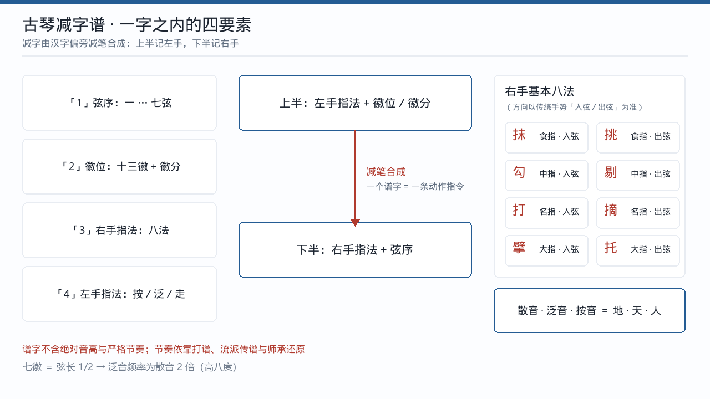

# 古琴减字谱：从“破译天书”到“涵养琴韵”

## README · 导览

### README_1 本库定位与能力边界

减字谱是古琴独有的、高度凝练的**指法谱**：它由汉字偏旁减笔合成，一个谱字即一条完整的动作指令，写明左右手指法、弦序与徽位，却几乎不写绝对音高与严格节奏。它的“精通”因此不在技巧堆叠，而在对“韵”（走手音、吟猱）与琴曲意境的体悟——把动作指令还原为有呼吸、有语气、有文化语境的音乐。

其能力结构按谱字破译、韵腔生成、琴风养成三层展开；节奏与气韵由打谱和师承补回谱面未编码之处。

| 能力层 | 认知对象 | 可交付输出 | 典型失效表现 |
| :--- | :--- | :--- | :--- |
| 辨识 | 谱字部件 | 拆出指法、弦序、徽位 | 把谱字当整体图形死记 |
| 解码 | 动作序列 | 规范手型下弹出音位 | 指法对、手型错、音色散 |
| 表意 | 走手音与吟猱 | 带语气与音高变化的乐句 | 每个音弹成孤立直音 |
| 成韵 | 琴曲整体 | 有气韵的演绎或个人化打谱 | 技巧娴熟却无意境 |

适用对象：古琴初学者与进阶琴人、打谱与琴学研究参与者、传统记谱法整理人员、需要把减字谱与简谱／五线谱互译的音乐学者。前置要求：具备基本音高概念，能分辨散、泛、按三种音色。

治理信息（版本／修订记录／图版规范／待修登记）集中见 `../../music_notation_process/_meta/版本与图版规范.md`。

### README_2 三阶进阶总览

| 阶段 | 核心任务 | 知识域 | 跃迁条件 | 达标信号 |
| :--- | :--- | :--- | :--- | :--- |
| 入门 | 破译“汉字密码”，规范基本指法 | 构造逻辑、右手基本八法、左手按音与泛音、开指小曲 | 任一谱字能拆成可执行动作 | 独立弹通《仙翁操》《秋风词》 |
| 进阶 | 在小曲中体会“韵”与“气” | 《湘妃怨》《酒狂》《阳关三叠》；走手音、吟猱绰注、呼吸与气韵 | 能把音位连成有语气的线条 | 一曲之内有明显的虚实与留白 |
| 精通 | 进入中大型琴曲，形成个人琴风 | 《平沙落雁》《潇湘水云》《流水》；文化背景、流派风格、个人体会的演绎 | 技巧与表现力可同时调度 | 完成有依据的打谱或个性化演绎 |

```text
[「1」拆解谱字部件] --> [「2」左右手基本指法] --> [「3」开指小曲巩固手型]
                                                          |
                                                          v
[「6」中大型琴曲与流派风格] <-- [「5」气韵与句读] <-- [「4」走手音／吟猱绰注]
                    |
                    v
        [「7」打谱与个人化琴风]
```

三阶段的推进不是“认得更多谱字”，而是**解码单位的三次放大**：由一个动作，到一条带韵的音线，再到一首有文化语境的琴曲。

### README_3 体例与符号约定

- 序号一律使用「1」「2」「3」或“第1步”形式；章节层级为 `README_N`、`板块0`–`板块10` 与 `N_M`，`0_M` 为读前说明子节。
- 「1」「2」等序号在三种语境出现：README_2 流程图步骤、训练序列序号、实操工作流步骤；引用时写全语境，如“板块 4 工作流第 1 步”。
- 减字谱的合体字属生僻字形，本库以**部件分解**方式表述（上半／下半、指法／弦序／徽位），不依赖特定字体渲染，亦便于入库检索与复核。
- 徽位用“某徽”、徽分用“某徽某分”表述；泛音与按音的音高关系用数学块给出，流程用 ASCII 代码块重建。
- 图片统一归档于 `images` 子文件夹，正文以相对路径引用；本库路径均相对各文件所在目录，治理文件路径 `../../music_notation_process/_meta/` 需向上跳两层再横向进入 process 目录；曲目名沿用通行写法。
- 每阶段末尾设“达标自检”，指标附测量方法，用于训练验收与知识库审计。

## 板块0 · 读前说明与检索路径

### 0_1 前置要求与术语门槛

本板块把正文隐含的阅读门槛显性化。若某项未满足，按“补足位置”直达对应板块，无须从头通读。

| 门槛 | 最低要求 | 补足位置 |
| :--- | :--- | :--- |
| 音高概念 | 能分辨散音、泛音、按音三种音色 | 板块2 的 2_1 |
| 音名记号 | 科学音高记号，中央 C 记作 C4；音组随实际音名判定，不随谱式改变 | 板块8 的 8_1 |
| 计数口径 | 自检数字＝对应表行数／训练项数，计数范围见表下注 | 各阶段达标自检表 |
| 方法路径 | 换算口径见 8_1，异说条目见 7_2，实务应用见译谱与曲目实例 | 板块7、板块8～10 |

### 0_2 任务—板块速查

| 读者任务 | 直达板块 | 验收入口 |
| :--- | :--- | :--- |
| 认符号、建立第一层对应 | 板块2 | 2_3 达标自检 |
| 学规则、进入进阶 | 板块3 | 3_4 达标自检 |
| 练视奏／分析／精通 | 板块4 | 4_3 达标自检 |
| 查错纠偏 | 板块5 | 5_1 误区对照 |
| 查术语与速查卡 | 板块6 | 6_1／6_2 |
| 查结论口径与异说 | 板块7 | 7_1／7_2 |
| 查音名、音组与换算接口 | 板块8 | 8_1／8_2 |
| 查打谱与节奏实务 | 板块9 | 9_1／9_2 |
| 查曲目实例与应用 | 板块10 | 10_1／10_2／10_3／10_4 |

### 0_3 徽位换算口径

减字谱读谱前须明确以下换算约定：

- 徽位标的是弦长位置而非音名；同一徽位在不同弦上音高不同。
- 十三徽弦长比自一徽 1/8 至十三徽 7/8，七徽为 1/2；泛音序 k 由节点分母决定，与分子是否整除无关（六徽、八徽的弦长比为 2/5、3/5，分母均为 5，故 k＝5）。
- 读徽分一律自分值较小的徽起算、向数值较大者推进；同一区间内越靠近大徽音越低。

以上口径是 8_1 徽位表的基础；原谱连写与本库排印的对应见 8_2。

## 板块1 · 指法谱本体与琴学坐标

### 1_1 记谱原理与信息编码

如图 1-1 所示，减字谱把“汉字偏旁部首的组合”当作结构化字段：上半记左手指法与徽位（含徽分），下半记右手指法与弦序，减笔后合成一字。读谱即把这一字拆回四个字段，再还原为一次发声动作。



图 1-1　减字谱一字之内的四要素与右手八法。本库绘制；四要素结构依据减字谱通行拆字法。

$$\text{减字}=\underbrace{(\text{左手指法},\ \text{徽位／徽分})}_{\text{上半}}\ \oplus\ \underbrace{(\text{右手指法},\ \text{弦序})}_{\text{下半}}$$

```text
[上半：左手指法 + 徽位／徽分] --+
                               +--> [一个减字 = 一条完整动作指令]
[下半：右手指法 + 弦序] -------+
```

| 编码维度 | 载体 | 解码结果 | 常见误读 |
| :--- | :--- | :--- | :--- |
| 弦序 | 下半的数字或减笔 | 第几弦 | 把弦序当成音名 |
| 徽位／徽分 | 上半的数字 | 按弦或触弦位置 | 把徽位当成固定音名 |
| 右手指法 | 下半的指法减笔 | 拨弦手指与方向 | 只记名称不辨入弦出弦 |
| 左手指法 | 上半的指法减笔 | 按、泛、走、吟猱 | 忽略左手造成的音高变化 |
| 节奏与气韵 | 谱面基本不编码 | 由打谱、传谱与师承还原 | 把谱字间距当成时值 |

三种基本音色构成琴乐的音响底色：

| 音色 | 发声方式 | 传统对应 | 听感 |
| :--- | :--- | :--- | :--- |
| 散音 | 空弦拨响，左手不按 | 地 | 沉厚、余韵长 |
| 泛音 | 左手轻触徽位不按实 | 天 | 清亮、颗粒分明 |
| 按音 | 左手按实取音，可走手 | 人 | 细腻、可连成韵 |

十三徽按弦长比例设置，自一徽至十三徽依次为：

| 徽位 | 一 | 二 | 三 | 四 | 五 | 六 | 七 | 八 | 九 | 十 | 十一 | 十二 | 十三 |
| :--- | :--- | :--- | :--- | :--- | :--- | :--- | :--- | :--- | :--- | :--- | :--- | :--- | :--- |
| 弦长比 | 1/8 | 1/6 | 1/5 | 1/4 | 1/3 | 2/5 | 1/2 | 3/5 | 2/3 | 3/4 | 4/5 | 5/6 | 7/8 |
| 对应泛音序 k | 8 | 6 | 5 | 4 | 3 | 5 | 2 | 5 | 3 | 4 | 5 | 6 | 8 |

六徽（2/5）、八徽（3/5）与三徽（1/5）、十一徽（4/5）同为五次谐波的四个节点，轻触得 k＝5 的泛音，音色较薄；倍频数由节点分母 n 决定，与分子是否整除无关。

七徽位于弦长二分之一处，轻触即得二次谐波，比散音高一个八度：

$$f_{\text{泛音}}=k\,f_{\text{散音}},\qquad k=2,3,4,\dots;\qquad L_{7\text{徽}}=\frac{1}{2}L\Rightarrow k=2$$

按音则不取泛音节点，而以按弦位置改变有效弦长；升高 $\Delta$ 个半音时，所需弦长比为：

$$\frac{L'}{L}=2^{-\Delta/12}$$

为在两徽之间精确取音，谱面用“徽分”细分，如“七徽九分”指七徽至八徽间的十分之九处。计分一律自分值较小的徽起算、向数值较大的徽推进；同一区间内越靠近八徽，音越低。原谱通行作两位数字（如“七九”即七徽九分），本库读法与原谱写法对照列于徽分写法小节。徽位是减字谱中唯一近似“音高坐标”的字段，但它标注的是**位置**而非音名，同一徽位在不同弦上音高不同。

### 1_2 工具属性与能力边界

减字谱属于奏法／指法指导体系，且是指法谱中凝练度最高的一类。它以极简符号锁定动作，把节奏、速度、力度与音高细节留给“打谱”与师承口传心授，因而同一份谱在不同流派、不同琴人手中会呈现不同面貌。

| 记谱体系 | 主要记录对象 | 自带信息 | 节奏信息 | 主要缺口 |
| :--- | :--- | :--- | :--- | :--- |
| 减字谱 | 弦序、徽位、指法 | 动作指令 | 基本不编码 | 绝对音高、严格节奏、力度 |
| 五线谱 | 绝对音高 + 时值 | 音名与节拍 | 明确 | 指法与音色细节 |
| 简谱 | 首调唱名 + 时值 | 调内关系 | 明确 | 指法与多声部 |
| 吉他 TAB | 弦序与品格 | 动作位置 | 弱 | 音名与和声功能 |
| 工尺谱 | 谱字与板眼 | 首调框架 | 板眼编码 | 指法与润腔细节 |

减字谱记录动作而非音高，须借弦长比与泛音序还原：工尺谱以润腔与口传分层，简谱以首调换算；徽位对应的弦长比与泛音序是换算依据。

能力边界须明确：谱字不写“这是什么音”，只写“在哪里、用哪只手、怎么发声”；谱字间距不代表时值比例；吟猱的幅度与频率、走手音的快慢、句读的呼吸都不在符号之内。把这些未编码项当作谱面已给出，或用固定节奏硬套，是减字谱解读中最根本的偏差。

### 1_3 「精通」的可观测判据

精通指技法与**琴韵、意境**的融合，并形成个人化的打谱／演绎。为可验收，拆为可测指标。

| 指标 | 入门 | 进阶 | 精通 | 测量方法 |
| :--- | :--- | :--- | :--- | :--- |
| 谱字拆解 | 需对照表 | 可独立拆解 | 即时拆出四字段并预判音色 | 随机抽 20 个谱字 |
| 手型与发力 | 时有杂音 | 规范稳定 | 音色随意图可控 | 逐音录音检查 |
| 韵的生成 | 直音为主 | 能作吟猱绰注 | 走手音成线、虚实有度 | 单乐句盲听比对 |
| 节奏依据 | 跟录音模仿 | 能说明句读理由 | 能独立完成打谱并陈述依据 | 提交打谱稿 |
| 文化语境 | 不了解 | 知道曲目背景 | 能结合流派风格作取舍 | 口头说明 + 演绎对比 |
| 个人琴风 | 无 | 偶有偏好 | 有可辨识且自洽的处理 | 同一曲两段演绎对比 |

精通的标志因此不是“认得更多天书”，而是**从动作指令进入音乐表达**：技法已退为背景，琴韵与意境成为可主动设计、可复核的对象。

## 板块2 · 入门：破译“汉字密码”，规范基本指法

### 2_1 知识单元清单

| 单元 | 内容 | 验收要求 |
| :--- | :--- | :--- |
| 构造逻辑 | 偏旁部首组合代表左右手指法、弦序、徽位；上下半分工 | 任给谱字拆出四个字段 |
| 右手基本八法 | 勾、挑、抹、剔、托、擘、打、摘的规范手型与发力 | 逐法示范且方向正确 |
| 左手基本 | 按音、泛音的触弦与取音 | 散、泛、按三音可分辨 |
| 开指小曲 | 《仙翁操》《秋风词》 | 完整弹通、谱字与动作对应 |

右手基本八法（方向以传统手势“入弦／出弦”为准）：

| 指法 | 用指 | 方向 | 发声要点 |
| :--- | :--- | :--- | :--- |
| 抹 | 食指 | 入弦 | 指肉着力，音色含蓄 |
| 挑 | 食指 | 出弦 | 指甲外弹，音色清亮 |
| 勾 | 中指 | 入弦 | 中锋入弦，为常用基础音 |
| 剔 | 中指 | 出弦 | 向外剔出，与勾成对 |
| 打 | 名指 | 入弦 | 名指力度弱，需单独练 |
| 摘 | 名指 | 出弦 | 与打成对，避免虚音 |
| 擘 | 大指 | 入弦 | 大指向内，多用于低音 |
| 托 | 大指 | 出弦 | 大指向外，音色饱满 |

八法可按“指 × 方向”归并记忆：食指抹挑、中指勾剔、名指打摘、大指擘托，四组各一对入弦与出弦动作。这一归并比逐个死记更不易混淆。

左手基本技法：

| 技法 | 动作 | 用途 |
| :--- | :--- | :--- |
| 按音 | 按实取音，可移动 | 主要旋律音与走手音基础 |
| 泛音 | 轻触徽位、弹后即离 | 清亮的点缀性音色 |
| 大指按弦 | 侧按，常带绰注 | 常用按弦指 |
| 名指按弦 | 指端按弦 | 与走手音配合 |

开指小曲《仙翁操》《秋风词》的作用不在曲目本身，而在把“拆解—手型—发声”串成闭环：每个谱字先口述四字段，再落指，最后听辨音色是否属于散、泛、按中的预期一类。

### 2_2 训练序列

「1」先拆后弹。每个谱字按“上半／下半”口述左手指法、徽位、右手指法、弦序，未拆清不落指。

「2」八法分组。按“四指 × 两方向”分组练习，每组先慢速空弦发单音，确认入弦与出弦音色差异。

「3」手型与发力校准。逐法检查触弦点、发力关节与余音长度，消除杂音与虚音，不追求音量。

「4」三音分辨。同一弦上分别弹出散音、七徽泛音、按音，闭眼听辨并说出音色类别。

「5」徽位定位。在七徽、五徽、九徽、四徽、十徽轻触泛音，验证 1_1 的弦长比与倍频关系。

「6」短句连缀。把 3 至 5 个谱字连成短句，保持指法衔接不中断、音色类别不串。

「7」开指小曲整合。完整弹通《仙翁操》与《秋风词》，逐字复核“谱字—动作—实际音色”三者一致。

### 2_3 阶段达标自检

| 检查项 | 合格线 | 复核方式 |
| :--- | :--- | :--- |
| 谱字四字段拆解 | 20 字错 ≤2 | 随机抽查 |
| 右手八法方向与名称 | 8 项全对 | 口头 + 示范 |
| 散／泛／按三音 | 闭眼听辨全对 | 盲听测试 |
| 手型与音色 | 无杂音、无虚音 | 逐音录音检查 |
| 徽位泛音 | 5 个徽位准确发声 | 校音或听辨八度关系 |
| 两首开指小曲 | 完整弹通、逐字可复核 | 录音按谱字核对 |

入门达标的实质是**破译无歧义**：任意谱字都能唯一地落到弦、徽、指法与方向，且手型不成为音色的额外变量。

## 板块3 · 进阶：在小曲中体会“韵”与“气”

### 3_1 知识单元清单

| 单元 | 内容 | 验收要求 |
| :--- | :--- | :--- |
| 经典入门曲目 | 《湘妃怨》《酒狂》《阳关三叠》；《关山月》作为流派代表短曲 | 前三曲完整、句读清楚；《关山月》能说明流派取舍 |
| 走手音 | 左手按弦移动带出连续音高变化 | 能弹出成线的音而非孤立点 |
| 吟、猱、绰、注 | 音高变化与语气感 | 四法可区分、可按需控制幅度 |
| 呼吸与气韵 | 琴曲的句读、留白、虚实 | 一段之内有可听的起承转合 |

进阶的核心转变是：从“机械执行指法”转向“理解琴乐的表达逻辑”。减字谱不编码节奏与语气，恰是因为这些内容本就由左手走手与呼吸承担。

琴歌《阳关三叠》亦在本单元“经典入门曲目”之列：琴歌的腔词关系与句读留白由唱词与呼吸决定，叠奏是同一曲调的反复与变化；其对读口径见 10_3（10_4 案例回指本节）。

### 3_2 规则关系与推导

左手四类技法的区分要点：

| 技法 | 动作方向 | 幅度与频率 | 语气作用 | 常见混淆 |
| :--- | :--- | :--- | :--- | :--- |
| 绰 | 由低向本音上滑 | 一次性滑进 | 上扬、起句 | 与走手音混同 |
| 注 | 由高向本音下滑 | 一次性滑进 | 收束、落句 | 与绰反向记反 |
| 吟 | 本音附近往复摇动 | 幅度小、频率较快 | 细微波动、鲜活 | 与猱混同 |
| 猱 | 本音附近往复摇动 | 幅度较大、频率较慢 | 苍劲、深沉 | 幅度失控成滑音 |
| 走手音 | 按弦沿弦移动跨多个音位 | 连续 | 把点连成线，形成“韵” | 移动过速成经过音 |

吟与猱同为摇动，差别在幅度与频率而非方向；绰与注同为滑进，差别在起始音高于还是低于本音。把这四项按“一次性滑进／持续摇动／连续移动”三类归并，可避免逐字死记。

走手音之所以是“韵”的载体，在于它让音高在发声后仍连续变化，而减字谱只记起止位置、不记中间过程：

$$\frac{L'}{L}=2^{-\Delta/12},\qquad \Delta=12\log_2\frac{L}{L'}$$

即左手每移动一段距离，音高按弦长比连续改变；谱面给出的是位置，音乐给出的是轨迹。演奏者的取舍在于移动速度、力度衰减与留白，这三者共同构成气韵。

气韵的可操作定义为三项：**句读**（何处断、断多长）、**虚实**（走手音与实按音的比例）、**留白**（余音自然衰减而不被下一音打断）。《酒狂》的跌宕、《阳关三叠》的层层递进、《湘妃怨》的婉转，都可在同一套谱字上通过这三项的配比差异实现。

### 3_3 训练序列

「1」单法分练。绰、注、吟、猱各取一个谱字反复练，先求动作形态准确，再求幅度可控。

「2」对比听辨。同一音分别用直音、绰、注、吟、猱弹出，录音后盲听排序，验证语气差异可辨。

「3」走手成线。取两个相邻徽位之间的走手音，放慢至能听清音高连续变化，避免弹成两个孤立音。

「4」句读标注。在《阳关三叠》一段中标出所有断处与余音保留处，说明每处取舍理由。

「5」虚实配比。同一乐句分别用“多实按”与“多走手”各弹一遍，比较气韵差异并记录偏好。

「6」三曲整合。完整弹通《湘妃怨》《酒狂》《阳关三叠》，另以《关山月》作流派短曲对照，逐曲检查走手音、吟猱与句读是否服务于整体语气。

「7」回谱复核。把演绎中自行加入的速度与留白标回谱面旁注，区分“谱字所给”与“打谱所加”。

### 3_4 阶段达标自检

| 检查项 | 合格线 | 复核方式 |
| :--- | :--- | :--- |
| 吟猱绰注区分 | 4 法动作与语气全对 | 示范 + 盲听 |
| 走手音成线 | 10 处中 ≥8 处可听出连续音高 | 录音逐处核对 |
| 曲目完整度 | 三首进阶曲无中断、句读清楚；《关山月》可说明流派依据 | 录音回听 |
| 气韵三项标注 | 句读、虚实、留白均有说明 | 书面旁注 |
| 谱字与自加内容 | 能明确区分 | 谱面旁注复核 |

进阶达标的实质是**动作让位于线条**：不再以“每个谱字都弹到了”为完成标准，而以“这一句是否有语气与呼吸”为标准。

## 板块4 · 精通：进入中大型琴曲，形成个人琴风

### 4_1 能力构成与分化路径

| 能力项 | 输入 | 输出 | 依赖的前置能力 |
| :--- | :--- | :--- | :--- |
| 中大型曲目驾驭 | 《平沙落雁》《潇湘水云》《流水》等 | 技巧与表现力并重的完整演绎 | 八法、走手音、气韵 |
| 文化背景理解 | 曲目题解、诗词与典故 | 演绎意图与速度布局 | 进阶阶段的语气设计 |
| 流派风格辨析 | 传谱、师承与录音 | 吟猱幅度、节奏疏密、音色取舍 | 全部前置能力 |
| 打谱 | 未附录音的谱本 | 有依据的节奏与韵腔还原 | 谱字拆解 + 气韵 + 流派知识 |
| 个人琴风 | 以上综合 | 可辨识且自洽的演绎 | 全部前置能力 |

精通阶段“不完全是学谱”，而是在熟练驾驭减字谱的基础上结合文化背景与流派风格，形成具有个人体会的演绎。打谱正是这一能力的集中体现：它要求把谱面未编码的节奏、速度、吟猱幅度逐项补回，且每项都能给出依据。

常见流派的风格倾向（概括为通行描述，实际以传谱与师承为准）：

| 流派 | 风格倾向（通行说法） | 可听辨特征 | 演绎取舍重点 |
| :--- | :--- | :--- | :--- |
| 虞山派 | 清微淡远 | 吟猱幅度小、留白长、速度偏慢 | 节制吟猱、留白多、力度内敛 |
| 广陵派 | 跌宕多变、刚柔相济 | 速度对比明显、段落起伏大 | 速度对比与段落起伏 |
| 浙派 | 疏畅清越 | 走手音连贯、少顿挫 | 线条流畅、走手音连贯 |
| 川派（蜀派） | 气势宏阔、奔放 | 走手幅度大、动态对比强 | 大幅走手与强烈动态 |
| 岭南派 | 古朴清淡 | 音色纯净、节奏舒缓、装饰少 | 音色纯净、节奏舒缓 |
| 梅庵派 | 流畅绮丽、吟猱丰富 | 吟猱频次高、句法分明 | 韵腔细腻、句法分明 |
| 九嶷派 | 苍劲坚实 | 按音扎实、吟猱有骨力、少柔化 | 按音扎实、吟猱有骨力 |

以上为通行概括，另有异说；实际取舍须以所据传谱与师承录音为准。

流派不是可随意叠加的装饰：同一曲在吟猱幅度、走手速度、句读疏密上的取舍须自洽，否则会形成风格混杂而失去琴韵的统一。

### 4_2 实操工作流

打谱工作流：

```text
[「1」通读谱本，逐字拆四字段] --> [「2」定弦序／徽位，核散泛按音色]
                                          |
                                          v
[「3」查题解与同曲异本传谱] --> [「4」划句读、定段落与速度布局]
                                          |
                                          v
[「7」定稿并标注每项依据] <-- [「6」回放比对，修正不自洽处] <-- [「5」补吟猱幅度、走手速度与留白]
```

演绎设计工作流：

```text
[「1」明确曲目意境与文化语境] --> [「2」选流派参照并列出风格取舍]
                                          |
                                          v
[「3」按段落设计虚实与力度曲线] --> [「4」标注个人处理处并说明理由]
                                          |
                                          v
                            [「5」整体回放：技法无痕、琴韵统一]
```

两条工作流的共同点是**每项补回的内容都可追溯**：节奏依据来自句读与传谱，吟猱幅度来自流派与意境，留白来自余音与呼吸。无法给出依据的处理属于随意，不构成个人琴风。

### 4_3 阶段达标自检

| 检查项 | 精通合格线 | 测量方法 |
| :--- | :--- | :--- |
| 中大型曲目 | 《平沙落雁》《潇湘水云》《流水》三首完整，技巧与表现力均无短板 | 录音逐段复核 |
| 谱字即时拆解 | 随机 20 字全对且能预判音色 | 抽查 |
| 打谱 | 未见过的谱段独立完成，附节奏与韵腔依据 | 提交打谱稿 |
| 文化背景 | 能说明曲目题解与演绎意图的关联 | 口头说明 |
| 流派辨析 | 至少辨识三种流派的处理差异 | 盲听比对 |
| 个人琴风 | 同一曲两段演绎有可辨识且自洽的差异 | 双版本对比 |
| 技法无痕 | 听感上不显指法切换与用力痕迹 | 盲听评价 |

精通验收必须包含“未见过的谱段”与“依据可陈述”两个条件；在已背熟曲目上的熟练演绎不计入判据。

## 板块5 · 常见误区与纠偏

### 5_1 误区—成因—纠偏对照

| 误区 | 成因 | 纠偏动作 | 复核指标 |
| :--- | :--- | :--- | :--- |
| 把减字谱当音高谱 | 误以为徽位即音名 | 每次读谱先报“弦 + 徽 + 指法” | 四字段拆解正确率 |
| 把谱字间距当时值 | 用五线谱习惯硬套 | 明确节奏由打谱与传谱补回 | 打谱依据完整度 |
| 徽位当成固定音名 | 忽略同徽不同弦音高不同 | 按 1_1 弦长比逐弦验证 | 音高换算正确率 |
| 忽略徽分 | 只看整数徽位 | 徽分作为精确取音字段单独训练 | 按音音准 |
| 入弦出弦不分 | 八法按名称死记 | 按“四指 × 两方向”归并练习 | 八法方向正确率 |
| 吟猱混为一谈 | 只看“都在摇” | 按幅度与频率对比听辨 | 盲听区分率 |
| 绰注方向记反 | 未绑定起音高低 | 用“由低上滑／由高下滑”反复对照 | 方向判定正确率 |
| 走手音弹成孤立点 | 移动过快 | 放慢至可听连续音高变化 | 成线率 |
| 重指法轻气韵 | 以弹全谱字为完成标准 | 强制标注句读、虚实与留白 | 气韵三项标注 |
| 堆砌流派特征 | 把风格当装饰叠加 | 先定基调再统一取舍 | 演绎自洽性评价 |
| 以背熟曲目冒充打谱 | 验收材料无陌生度约束 | 强制使用未见过的谱段 | 打谱稿依据可陈述性 |

### 5_2 跨阶段衔接检查

| 衔接 | 放行条件 | 未达标时的回退动作 |
| :--- | :--- | :--- |
| 入门 → 进阶 | 谱字拆解无歧义、手型不影响音色 | 回到 2_2 的八法分组与三音分辨 |
| 进阶 → 精通 | 走手音成线、气韵三项可标注 | 回到 3_3 的成线与句读训练 |
| 精通 → 个人琴风 | 打谱依据可陈述、演绎自洽 | 交替执行 4_2 两条工作流 |

阶段放行采用全项合格制；任一检查项未达标即不放行，避免以技巧熟练掩盖气韵与文化语境的缺口。

## 板块6 · 术语索引与速查

### 6_1 术语对照

| 中文 | 英文／说明 | 要点 |
| :--- | :--- | :--- |
| 减字谱 | Jianzipu / reduced-character notation | 由汉字偏旁减笔合成的指法谱 |
| 上半／下半 | Upper / lower component | 上半记左手与徽位，下半记右手与弦序 |
| 弦序 | String number | 一弦至七弦，非音名 |
| 徽位 | Hui position | 琴面十三个按弦参照点 |
| 徽分 | Hui fraction | 两徽之间的十分细分，用于精确取音 |
| 散音 | Open-string tone | 空弦音，传统对应“地” |
| 泛音 | Harmonic tone | 轻触徽位，传统对应“天” |
| 按音 | Stopped tone | 按实取音，传统对应“人” |
| 右手八法 | Eight right-hand techniques | 抹挑勾剔打摘擘托，四指各分入出 |
| 绰 | Chuo（上滑进） | 由低向本音滑进 |
| 注 | Zhu（下滑进） | 由高向本音滑进 |
| 吟 | Yin | 小幅较快摇动 |
| 猱 | Nao | 幅度较大、较慢摇动 |
| 走手音 | Gliding tone | 按弦移动形成连续音高变化，是“韵”的载体 |
| 打谱 | Dapu / score realization | 把谱字还原为有节奏与韵腔的演奏方案 |
| 气韵 | Breath and resonance | 句读、虚实、留白三项的综合 |
| 流派 | Qin school | 传谱与师承形成的风格体系 |
| 琴风 | Personal interpretation | 有依据、可辨识且自洽的个人演绎 |

### 6_2 速查卡

```text
一个减字 = 上半（左手指法 + 徽位／徽分） + 下半（右手指法 + 弦序）
右手八法：食 抹(入) 挑(出) ｜ 中 勾(入) 剔(出) ｜ 名 打(入) 摘(出) ｜ 大 擘(入) 托(出)
三音：散音 空弦(地) ｜ 泛音 轻触徽位(天) ｜ 按音 按实(人)
十三徽弦长比：1/8 1/6 1/5 1/4 1/3 2/5 1/2 3/5 2/3 3/4 4/5 5/6 7/8
七徽 = 1/2 弦长 → 泛音为散音 2 倍频（高八度）
左手四类：绰 上滑进 ｜ 注 下滑进 ｜ 吟 小幅快摇 ｜ 猱 大幅慢摇 ｜ 走手音 连续移动
气韵三项：句读 ｜ 虚实 ｜ 留白
曲目梯度：仙翁操／秋风词 → 湘妃怨／酒狂／阳关三叠（＋关山月作流派短曲） → 平沙落雁／潇湘水云／流水
```

$$\text{减字}=(\text{左手指法},\text{徽位})\oplus(\text{右手指法},\text{弦序}),\quad f_{\text{泛音}}=k f_{\text{散音}},\quad \frac{L'}{L}=2^{-\Delta/12}$$

| 待查问题 | 直接定位 |
| :--- | :--- |
| 这个谱字怎么弹 | 拆上半下半，取四字段 |
| 某徽是什么音 | 徽位是位置不是音名，须结合弦序与调弦 |
| 七徽为什么高八度 | 弦长 1/2，对应二次谐波 |
| 吟与猱怎么分 | 看幅度与频率，不看方向 |
| 绰与注怎么分 | 看起音在本音之下还是之上 |
| 节奏从哪里来 | 打谱、传谱与师承，不在谱字间距 |
| 精通是否达标 | 只看未见过谱段的打谱与依据可陈述性 |

## 板块7 · 文献、口径与异说

### 7_1 可核事实与依据分层

| 结论类别 | 本库取值 | 依据层级 |
| :--- | :--- | :--- |
| 十三徽弦长比 | 1/8 至 7/8 共 13 项 | 律学与琴学，通行共识 |
| 泛音倍频 | f = k·f0，七徽 k=2 | 声学，通行共识 |
| 按音弦长比 | L′/L=2^(−Δ/12) | 声学与律学，通行共识 |
| 徽分细分 | 两徽间十分细分 | 琴学记谱惯例，通行共识 |
| 右手八法 | 抹挑勾剔打摘擘托 | 琴学指法惯例，通行共识 |
| 三音对应 | 散＝地、泛＝天、按＝人 | 传统琴学表述，约定性 |
| 流派风格描述 | 清微淡远等七派 | 通行概括，存在异说 |
| 十三徽泛音序 k | 六徽、八徽与三徽、十一徽同属 1/5 节点族，k＝5 | 声学谐波节点，通行共识 |

### 7_2 分歧条目的异说标注

| 条目 | 通行说法 | 另有异说 | 本库处理 |
| :--- | :--- | :--- | :--- |
| 徽分记法 | 两位数字，如“七九”＝七徽九分 | 亦有写作“七徽九分”全称 | 补原谱写法与本库读法对照 |
| 徽分计分方向 | 自小徽向大徽计分，近八徽音低 | 部分谱本标法相反 | 统一计分起点与方向说明 |
| 流派划分口径 | 按琴派分（虞山、广陵、梅庵等） | 亦有按地域或按琴风（清微淡远／刚健激越）归类 | 以琴派为主并附可听辨特征，同派师承差异另行注明 |
| 曲目体量 | 《关山月》为梅庵派短曲 | 按篇幅或按流派地位归类，口径不一 | 按篇幅归进阶作流派短曲；精通阶段另列《流水》《潇湘水云》等中大型曲 |
| 六徽、八徽泛音 | 五次谐波节点（2/5、3/5），k＝5 | 有教材只列整数倍频节点（1/2、1/3、1/4…），不单列五次谐波 | 按弦长比计入 k＝5 五次谐波，与整数倍频节点并存 |

### 7_3 学习资源与找谱渠道

本节汇总可迁移的通用学习资源，并明确其边界。资源清单依据《乐谱来源说明》；该来源面向通用乐谱与乐理学习，**未列任何古琴或减字谱专门站点**，故此处不虚构古琴专用渠道，只标出可辅助听觉与乐理训练的通用平台。

| 站点 | 类别 | 核心定位（据来源重述） | 对本谱式的用途与边界 |
| :--- | :--- | :--- | :--- |
| 国家高等教育智慧教育平台 | 体系课程 | 可检索《乐理与视唱练耳》等国家级课程，含基础理论、识谱与听音训练 | 只用于练耳与基础乐理；不提供减字谱识读 |
| Musicca | 游戏化乐理 | 用互动练习掌握音符、节奏、音程等基础概念 | 辅助音程与节奏听辨；不涉及徽位与走手音 |
| Music Workbook | 系统化练习工具 | 把乐理、和声、曲式、视奏与听音整合为可读、可练、可复习的模块 | 辅助听觉与视奏训练；不含琴学内容 |
| 8notes | 综合学习站 | 分级谱之外附乐理教程、乐器技巧指南与在线节拍器 | 节拍器可用于气韵节奏的参照；非古琴技法来源 |

取用口径：站点定位来自《乐谱来源说明》，属对第三方站点的描述，会随运营变动，须以站点现况为准。来源未给出上述站点的网址或授权条款，本表不列链接、不作版权背书。要点：减字谱记动作而非绝对音高与严格节奏，打谱与流派对读仍须以传谱版本、琴学文献和师承录音为准（见 9_1、10_3），通用平台只能辅助听觉与乐理，不能替代琴学依据。来源在此谱式上存在明确的信息缺口，不据以推断存在专门的古琴在线站点。

### 7_4 公开琴学资料复核与补注

本节取琴家打谱文论与琴学文章复核正文口径。所引为一家之说与通行经验，须结合具体谱本、琴制与师承判断，不改变 7_1 的事实层级；具体音位仍以所据谱本核定。来源条目（MLA）附于本节末。

| 复核条目 | 正文口径 | 公开琴学资料表述 | 处理 |
| :--- | :--- | :--- | :--- |
| 明谱“七八”含义 | 明以前谱本多作“七八”一类模糊徽位（8_2） | 明代谱只记徽位不记徽分，写“七八”意即七徽八徽之间，弹者凭目光与听觉找到七徽六分 | 印证并细化，不改 |
| 徽位“名不符实” | 原未列具体例，现已补入 8_2 | 《西麓堂琴统》十一徽实按十徽八分（原注“十一徽微上”），八徽实按七徽九分；明谱约定俗成，靠空弦按音应和修正 | 补充，已写入 8_2 |
| 徽分记法起点 | 十分记法自明末清初《大还阁琴谱》通行（8_2） | 清初《大还阁琴谱》始记徽分，直书“十八”“七九”，不再含糊 | 印证，不改 |
| 按弦张力误差 | 原未列，现已补入 9_1 | 减字谱徽位按弦长比设定，未计按弦张力；按弦后张力增大发音偏高，下准误差极小、上准五徽四徽处渐大，泛音不按弦故无此误差 | 补充，已写入 9_1 |
| 听觉定音优先 | 打谱凭听觉修正音高（9_1） | 有音准辨别力者按音位主要靠耳不靠眼；此为徽分“名不符实”得以通行的原因 | 印证并强化，不改 |
| 徽序方向 | 原未说明与西洋记法方向，现已补入 8_1 | 古琴徽序自右向左、由高音向低音记，与西洋音程位置由低向高相反，故高音的“分数”比低音小 | 补充，已写入 8_1 |

来源条目（MLA）：

- 成公亮. “减字谱徽位、徽分在弹奏时的误差.” 广陵散社区（中国古琴论坛）, guanglingsan.com/thread-142-1.html, 访问 22 Nov. 2026.
- “你知道减字谱徽位、徽分在弹奏时的误差吗？” 国琴网, guoqinwang.com/news/11242.html, 访问 22 Nov. 2026.
- 松籁琴社. “从《按谱鼓曲奥义》谈闽派古琴的一些特点（1）.” guqinparis.com/?p=1042/, 访问 22 Nov. 2026.

## 板块8 · 音名、音组与换算接口

### 8_1 徽位—弦长比—泛音序对照

| 徽位 | 一 | 二 | 三 | 四 | 五 | 六 | 七 | 八 | 九 | 十 | 十一 | 十二 | 十三 |
| :--- | :--- | :--- | :--- | :--- | :--- | :--- | :--- | :--- | :--- | :--- | :--- | :--- | :--- |
| 弦长比 | 1/8 | 1/6 | 1/5 | 1/4 | 1/3 | 2/5 | 1/2 | 3/5 | 2/3 | 3/4 | 4/5 | 5/6 | 7/8 |
| 泛音序 k | 8 | 6 | 5 | 4 | 3 | 5 | 2 | 5 | 3 | 4 | 5 | 6 | 8 |

七徽位于弦长 1/2，轻触得二次谐波，比散音高八度。六徽、八徽属 1/5 节点族，泛音序 k＝5，与三徽、十一徽同类。

徽序方向与西洋记音方向相反：古琴徽位自右向左、由高音端向低音端编号，西洋记音通常以低音向高音为序，因此琴人中“高音侧分数小、低音侧分数大”的说法须按徽序本身理解，不可套用西洋方位直觉。

### 8_2 徽分写法与本库读法对照

| 原谱写法 | 本库读法 | 含义 |
| :--- | :--- | :--- |
| 七九 | 七徽九分 | 七徽至八徽间，自七徽起十分之九处 |
| 十·三（原谱常连写作“十三”，须与十三徽区分） | 十徽三分 | 十徽至十一徽间，自十徽起十分之三处 |
| 某徽整数 | 该徽整位 | 直接按该徽，不作细分 |

本库以间隔点标示徽分，原式多作两位连写；引用原式时按连写还原，勿把本库的排印处理当作原式。

读徽分一律自分值较小的徽起算、向数值较大者推进；同一区间内越靠近大徽音越低。徽位标的是位置不是音名，同一徽位在不同弦上音高不同。“几徽几分”的十分记法自明末清初虞山《大还阁琴谱》起通行，明以前谱本多作“七八”一类模糊徽位；“七九”“十·三”的具体音位须按所据谱本核定，本库读法为通行口径。

明谱徽位存在“名不符实”现象，是上述须按谱本核定的具体成因：据琴家研究，《西麓堂琴谱》所记十一徽实按十徽八分（原注“十一徽微上”），八徽实按七徽九分；明谱约定俗成，弹者靠空弦按音应和来修正。故本库读法给出的是通行位置，不是可直接照搬的绝对音位。

## 板块9 · 打谱与节奏实务

### 9_1 打谱的基本流程

减字谱记录指法与弦位，不记节奏与绝对音高。把它转化为可演奏的谱，即“打谱”，是减字谱读谱的终阶能力。

| 步骤 | 操作 | 依据 |
| :--- | :--- | :--- |
| 释谱 | 逐字译出指法、弦序、徽位 | 2_1 指法表、8_1 徽位表 |
| 定音 | 按散／泛／按音与徽位定相对音高，并以听觉修正 | 七徽 1/2 得高八度，泛音序见 8_1；按弦张力使发音偏高（下准误差极小、上准五徽四徽处渐大），泛音不按弦故无此误差 |
| 定板 | 依曲牌、句式与师承录音安排拍板 | 琴曲多散板，节奏有弹性 |
| 定韵 | 补吟猱绰注的幅度与时机 | 3_2 走手音规则 |
| 定稿 | 写成可复核的演奏谱并标注存疑处 | 4_2 工作流 |

打谱不是一次成型的翻译，而是“释谱—试奏—修订”的循环。同一减字谱在不同流派手中可有不同节奏处理，定稿须注明所据传本与师承。

### 9_2 节奏与气韵的拟定

琴曲节奏以“气韵”为核心，不能简单套用均分拍。处理原则如下：

| 情形 | 处理 | 理由 |
| :--- | :--- | :--- |
| 散板起句 | 自由节奏，按气息分句 | 琴曲常以散起 |
| 走手音密集处 | 放慢，音值随吟猱延长 | 韵在过程之中 |
| 泛音段落 | 拍位清晰，音色通透 | 泛音宜颗粒分明 |
| 入慢收尾 | 渐慢并留余韵 | 琴曲常以打圆、慢收作结 |

吟、猱、绰、注不只是装饰，而是改变音高轨迹与语气的行为。记谱时应标明“从何音绰上、向何音注下”，不能只写一个音名。

## 板块10 · 琴曲实例与研读应用

### 10_1 小曲精读示例

以《关山月》为例精读：先释谱，确认其流派归属与指法组合；再按句划段，标出每句落音与气口；最后体会吟猱在句尾的收束作用。

| 精读层 | 关注点 | 验收 |
| :--- | :--- | :--- |
| 字面 | 减字指法与徽位逐字可读 | 能口述每字含义 |
| 句法 | 分句与气口位置 | 能划出乐句结构 |
| 音韵 | 走手音的音高轨迹 | 能唱出韵的实际走向 |
| 风格 | 流派处理特征 | 能说明所据传本 |

小曲的价值在“以小见大”：篇幅短，便于把打谱流程完整走一遍，是进入中大型琴曲前的必要训练。

### 10_2 中大型琴曲的结构研读

《平沙落雁》《潇湘水云》《流水》等曲篇幅大、段落多，研读先从结构入手，不逐字硬啃。

| 结构层 | 做法 |
| :--- | :--- |
| 段落划分 | 依标题、反复与速度变化分大段 |
| 主题识别 | 找出主导动机在各段的变形 |
| 高潮定位 | 标出技巧与力度峰值所在段 |
| 收束方式 | 辨认打圆、泛音收尾等曲式手法 |

结构图先立，再逐段填指法与音韵，可避免“弹到后面忘了前面”的常见困境。

### 10_3 传谱对读与流派风格

同一琴曲的不同传谱常指法与徽位有别，对读时按“同中找异、异中求因”展开。

| 对读维度 | 比较内容 | 判断依据 |
| :--- | :--- | :--- |
| 徽位 | 同一音取徽是否不同 | 弦长比与定弦 |
| 指法 | 吟猱绰注的有无与幅度 | 流派审美 |
| 节奏 | 起句散板与收尾处理 | 师承录音 |
| 段落 | 段落增删与次序 | 传本源流 |

对读结论须以所据传谱与师承录音为准，不以词面概括代替听辨；存疑处保留两说，不强行统一。

琴歌的腔词关系见 3_1；本节对读只处理同一琴曲不同传谱之间的指法、徽位、段落差异，唱词与句读按 3_1 的“呼吸与气韵”单元核定（10_4《阳关三叠》案例回指本句）。

### 10_4 曲目实例：公版谱本案例

前三节的精读与对读方法须落到具体谱本。本节按公版谱本列案例，谱字按 README_3 的部件分解体例自录，不整页影印古籍。要点：古谱刊本年代久远、早已进入公有领域，但**打谱本不是公版谱本**——查阜西、吴景略等先生的打谱成果与现代《琴曲集成》排印页另有权利，可作对读文献，不作案例复制源。

| 案例 | 谱本 | 公版依据 | 本库呈现方式 | 配套训练入口 |
| :--- | :--- | :--- | :--- | :--- |
| 《酒狂》 | 《神奇秘谱》（1425，朱权） | 明代刊本，早已公版 | 逐字部件分解自录，标跌宕节奏 | 2_1／3_1／10_1 开指后第一支有气韵短曲 |
| 《阳关三叠》 | 《浙音释字琴谱》（1491） | 明代刊本 | 分解自录，标叠奏结构与句读 | 3_1 琴歌曲目与留白；10_3 传谱对读 |
| 《平沙落雁》 | 《古音正宗》（1634，通行说法） | 明末刊本 | 分段自录，标段落与流派差异 | 4_2／10_2 中大型曲段落划分 |
| 《梅花三弄》 | 《神奇秘谱》（1425） | 明代刊本 | 标主题循环段与泛音段 | 4_2／10_2 主题循环与泛音 |
| 《潇湘水云》 | 《神奇秘谱》（1425） | 明代刊本 | 分段自录，标情绪层次 | 4_1／10_2 长篇结构与层次 |
| 《流水》 | 《神奇秘谱》（1425） | 明代刊本 | 标走手音段与“七十二滚拂”段 | 4_1／10_2 走手音与大曲技巧 |
| 《秋风词》《关山月》 | 《梅庵琴谱》（1931，徐立孙编） | 编者卒 1969，2020 年起公版 | 两曲并列分解自录 | 2_1／3_1／10_1 开指小曲与流派对照 |

上表只回答“用哪首曲子”。减字谱的“调”不是西洋调号，而是**弦式（定弦法）与调意**：同一弦式下可弹多种调式。下表把每曲所用弦式与关键段落钉到具体小节，读者据此反查徽位与按音取音。

| 案例·段落 | 该段调子（弦式／调意口径） | 对应知识小节（去哪节查） | 依据与核定 |
| :--- | :--- | :--- | :--- |
| 《酒狂》全曲 | 正调定弦（宫音 F，一弦为徵）；三分损益律类 | 0_3 徽位换算；8_1 徽位—弦长比—泛音序 | 琴学研究列《酒狂》属三分律正调定弦一类 |
| 《流水》全曲 | 正调定弦（七弦 C D F G A c d）；走手音段依徽位取音 | 8_1 徽位—泛音序；8_2 徽分读法；9_1 打谱流程 | 琴学文献列《流水》为正调代表曲；泛音避三六八十一徽 |
| 《梅花三弄》泛音主题段 | 正调定弦；主题以泛音循环，取 7 徽 1/2 等节点 | 8_1 泛音序 k（七徽 k＝2）；0_3 徽位换算 | 文献列《梅花三弄》为正调定弦、主题循环泛音段 |
| 《平沙落雁》全曲 | 正调定弦；段落按散泛按音色分层 | 8_1 徽位—弦长比；10_2 段落划分 | 琴社资料列《平沙落雁》为正调代表曲 |
| 《潇湘水云》全曲 | 蕤宾调（紧五弦，宫音 B♭）；纯律 D 型定弦 | 8_1 泛音序；9_1 打谱定弦序 | 琴学研究列《潇湘水云》为蕤宾调、纯律类定弦 |
| 《阳关三叠》全曲 | 蕤宾调（紧五弦，宫音 B♭）；琴歌叠奏 | 9_1 打谱定弦序；3_1 琴歌与留白；10_3 传谱对读（见该节承接句） | 琴社资料列《阳关三叠》为蕤宾调代表曲 |
| 《秋风词》《关山月》全曲 | 《梅庵琴谱》常用正调；具体弦式须据该谱本核定 | 9_1 打谱定弦序；10_1 小曲精读 | 梅庵系曲目以正调为主，本库不据此写死，须据影印本核定 |

核定说明：《仙翁操》素材源于明代民间，曲成于清康熙十余年，又名《调弦入弄》，为散按相合的开指小曲。谱本已可定位——查阜西《琴曲集成》第六册收《文会堂琴谱》本、第十二册收《和文注音琴谱》（东皋琴谱）本；今人常弹的谱出自 1962 年《古琴初阶》（查阜西、沈草农、张子谦编）。曲名“仙翁操”为后起：晚清《琴学轫端》称“调弦仙翁指南”，此名至《古琴初阶》方定型，古谱原名作《调弦入弄》。本库谱字据《琴曲集成》影印自录，不复制 1962 年排印本版面。

权利标注（每条案例页脚统一一行）：公版依据为刊本年代或编者卒年，谱字为本库据古籍影印自录并作部件分解，非引用现代打谱本或排印页。乐谱公版不等于录音公版，配师承音频须单独核权。

来源条目（MLA）：

- “中华人民共和国著作权法（2020 年修正）.” 中国人大网, www.npc.gov.cn/c2/c30834/202011/t20201119_308796.html, 访问 25 Nov. 2026.
- “神奇秘谱（1425）.” 中国非物质文化遗产网, www.ihchina.cn/news_details/31456.html, 访问 25 Nov. 2026.
- “公版曲谱案例推荐（v1.0）.” WorkBuddy, 25 Nov. 2026, D:\.agent\music_notation_process\公版曲谱案例推荐（v1.0）.md.
- 喻辉.“《神奇秘谱》琴曲的调弦法.” 黄钟 (武汉音乐学院学报), 1994 年第 1 期; 转载于微信公众号, 访问 25 Nov. 2026.（正调三分律类含《流水》《酒狂》《梅花三弄》；蕤宾调含《潇湘水云》）
- “古琴十一种定弦一览: 弦式、相对音高与常见曲目.” 灵弦, lingxian.app/blog/guqin-dingxian-yilan, 访问 25 Nov. 2026.（正调 1＝F 七弦 C D F G A c d；蕤宾调紧五弦 1＝B♭）
- “学琴必藏——古琴常用定弦法.” 颐和琴社, www.yiheqinshe.com/2018/11/03/142942fb0d/, 访问 25 Nov. 2026.（正调代表曲《平沙落雁》《梅花三弄》《流水》；蕤宾调《阳关三叠》《潇湘水云》）
- “仙翁操.” 百度百科, baike.baidu.com/item/仙翁操/4473327, 访问 25 Nov. 2026.（素材源于明代，曲成康熙十余年；《琴曲集成》第六册《文会堂琴谱》、第十二册《和文注音琴谱》）
- “由调弦而成曲，操仙翁而和弦——琴曲仙翁操的流传和发展.” 微信公众号, mp.weixin.qq.com/s?__biz=MzAxMjc3MzU3NQ==&mid=2653538760, 访问 25 Nov. 2026.（谱本源流考：“仙翁操”名至《古琴初阶》始著录）
