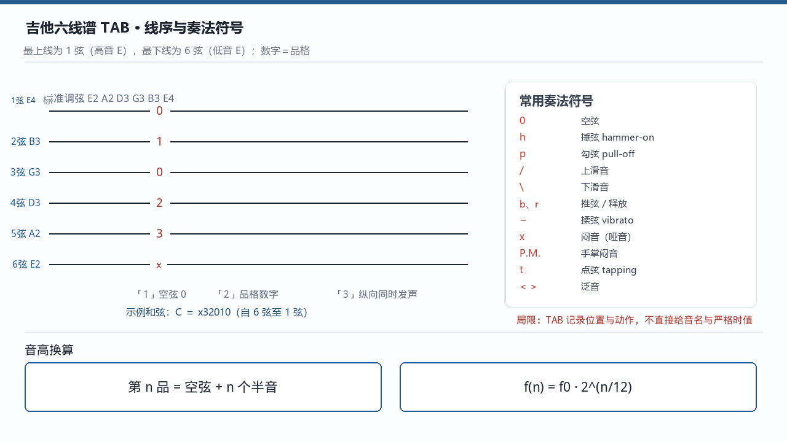

# 吉他六线谱（TAB）：从“指法地图”到“音乐表达”

## README · 导览

### README_1 本库定位与能力边界

六线谱是典型的**奏法谱**：它不告诉演奏者“是什么音”，只告诉“在哪根弦、哪个品格、用什么动作发声”。这一属性带来极低的上手门槛，也带来明确的天花板——只依赖 TAB，换调、换把位、与乐队配合时就会失语。因此精通必然要求超越 TAB，深入音名、和声与指板逻辑，把谱面从“指令”降格为“参考”。

其能力结构按指法解码、和弦组织、指板内化三层展开，每层都须补回谱面未编码的音名与和声信息。

| 能力层 | 认知对象 | 可交付输出 | 典型失效表现 |
| :--- | :--- | :--- | :--- |
| 辨识 | 线、数字、符号 | 报出弦序、品格、奏法 | 把最上线当成 6 弦 |
| 解码 | 指法序列 | 弹出单音旋律或和弦 | 按对位置却弹错节奏 |
| 结构化 | 和弦走向与音型 | 完成弹唱或指弹片段 | 会和弦却说不出和弦名与级数 |
| 内化 | 指板与和声 | 即兴 Solo、自主判断表达方式 | 离开 TAB 即无法演奏 |

适用对象：吉他初学者、弹唱与指弹演奏者、乐队吉他手、即兴与编曲学习者、需要把 TAB 与五线谱或简谱互译的记谱人员。前置要求：能持琴并拨响空弦，无需读谱基础。

治理信息（版本／修订记录／图版规范／待修登记）集中见 `../../music_notation_process/_meta/版本与图版规范.md`。

### README_2 三阶进阶总览

| 阶段 | 核心任务 | 知识域 | 跃迁条件 | 达标信号 |
| :--- | :--- | :--- | :--- | :--- |
| 入门 | 读懂指法地图，建立手感 | 六线与六弦对应、姿势、品格数字、奏法符号、节奏标记、C 大调 Mi 型音阶、单音旋律 | 见数字即落到弦与品，手型稳定不碰邻弦 | 独立弹通《小星星》类单音旋律 |
| 进阶 | 攻克和弦与节奏，实现弹唱／指弹 | C 调与 G 调开放和弦、1645 走向、大横按、分解与扫弦、指弹入门 | 和弦转换不中断、节奏型可独立保持 | 完整弹唱《童年》类曲目 |
| 精通 | 建立指板逻辑，走向自由表达 | CAGED 系统、全调式思维与五度圈、主音 Solo 构建、即兴演奏 | 能把任一和弦与音阶映射到全指板 | 不依赖 TAB 完成即兴与改编 |

```text
[「1」六线对六弦] --> [「2」品格数字与奏法符号] --> [「3」单音旋律与手感]
                                                          |
                                                          v
[「6」CAGED + 五度圈 + 调式] <-- [「5」和弦级数与和声走向] <-- [「4」开放和弦／横按／节奏型]
                    |
                    v
        [「7」主音 Solo 与即兴表达]
                    |
                    v
        [「8」TAB 降格为参考，自主判断表达]
```

三阶段的区别不在谱面复杂度，而在**信息源**：入门靠 TAB 给位置，进阶靠和弦与节奏组织位置，精通靠和声与指板逻辑自行生成位置。

### README_3 体例与符号约定

- 序号一律使用「1」「2」「3」或“第1步”形式；章节层级为 `README_N`、`板块0`–`板块10` 与 `N_M`，`0_M` 为读前说明子节。
- 「1」「2」等序号在三种语境出现：README_2 流程图步骤、训练序列序号、实操工作流步骤；引用时写全语境，如“板块 4 工作流第 1 步”。
- TAB 谱例用等宽代码块：自上而下六行依次为 1 弦至 6 弦，数字为品格，0 为空弦，同列数字表示同时发声，未标数字的弦不弹。
- 和弦指法以 6 弦至 1 弦顺序记写，x 表示不弹，0 表示空弦。
- 音名采用科学音高记号；图片统一归档于 `images` 子文件夹，正文以相对路径引用；本库路径均相对各文件所在目录，治理文件路径 `../../music_notation_process/_meta/` 需向上跳两层再横向进入 process 目录；可量化关系用数学块，流程用 ASCII 代码块重建。
- 每阶段末尾设“达标自检”，指标附测量方法，用于训练验收与知识库审计。

## 板块0 · 读前说明与检索路径

### 0_1 前置要求与术语门槛

本板块把正文隐含的阅读门槛显性化。若某项未满足，按“补足位置”直达对应板块，无须从头通读。

| 门槛 | 最低要求 | 补足位置 |
| :--- | :--- | :--- |
| 音高概念 | 能持琴拨响空弦，知道品格数决定音高 | 板块2 的 2_1 |
| 音名记号 | 科学音高记号，中央 C 记作 C4；音组随实际音名判定，不随谱式改变 | 板块8 的 8_1 |
| 计数口径 | 自检数字＝对应表行数／训练项数，计数范围见表下注 | 各阶段达标自检表 |
| 方法路径 | 换算口径见 8_1，异说条目见 7_2，实务应用见译谱与曲目实例 | 板块7、板块8～10 |

### 0_2 任务—板块速查

| 读者任务 | 直达板块 | 验收入口 |
| :--- | :--- | :--- |
| 认符号、建立第一层对应 | 板块2 | 2_3 达标自检 |
| 学规则、进入进阶 | 板块3 | 3_4 达标自检 |
| 练视奏／分析／精通 | 板块4 | 4_3 达标自检 |
| 查错纠偏 | 板块5 | 5_1 误区对照 |
| 查术语与速查卡 | 板块6 | 6_1／6_2 |
| 查结论口径与异说 | 板块7 | 7_1／7_2 |
| 查音名、音组与换算接口 | 板块8 | 8_1／8_2 |
| 查双谱对照与节奏实务 | 板块9 | 9_1／9_2 |
| 查曲目实例与应用 | 板块10 | 10_1／10_2／10_3／10_4 |

### 0_3 指板换算口径

六线谱读谱前须明确以下换算约定：

- 线序自上而下为 1～6 弦，空弦音按标准调弦为 E4、B3、G3、D3、A2、E2；音名一律大写。
- 品格音高按半音累加：第 n 品＝空弦音上移 n 个半音，频率 f(n)=f₀·2^(n/12)。
- 数字为品格序号，“0”为空弦；同一音可在不同弦、不同把位取得，指法选择不影响音高判定。

以上口径是 8_1 空弦—品格对照表的基础，跨体系换算见 8_2。

## 板块1 · 奏法谱本体与指板坐标

### 1_1 记谱原理与信息编码

如图 1-1 所示，TAB 的六条线不是音高坐标，而是**六根弦的投影**：最上线对应最细的 1 弦，最下线对应最粗的 6 弦。谱面上唯一的音高线索来自“弦的空弦音 + 品格数”，而这个换算必须由演奏者自己完成。



图 1-1　吉他六线谱线序、品格数字与奏法符号。本库绘制；线序与空弦音依据标准调弦。

| 编码维度 | 载体 | 解码结果 | 常见误读 |
| :--- | :--- | :--- | :--- |
| 弦 | 六条横线（上 1 弦、下 6 弦） | 发声弦序 | 把最上线当成 6 弦 |
| 位置 | 线上的数字（0 为空弦） | 品格 | 把数字当作音名或指法编号 |
| 奏法 | h、p、/、反斜线、b、~ 等 | 捶弦、勾弦、滑音、推弦、揉弦 | 把奏法符号当作装饰可省略 |
| 时间 | 节奏标记或配套五线谱／简谱 | 起奏点与时长 | 把 TAB 当作自带精确时值的谱 |
| 多声部 | 同列纵向对齐 | 同时发声的和弦或伴奏音 | 把同列数字读成先后顺序 |

标准调弦下，空弦音与线序固定：

| 线序 | 弦序 | 空弦音 | 第 n 品音高 |
| :--- | :--- | :--- | :--- |
| 第 1 线（最上） | 1 弦 | E4 | E4 + n 半音 |
| 第 2 线 | 2 弦 | B3 | B3 + n 半音 |
| 第 3 线 | 3 弦 | G3 | G3 + n 半音 |
| 第 4 线 | 4 弦 | D3 | D3 + n 半音 |
| 第 5 线 | 5 弦 | A2 | A2 + n 半音 |
| 第 6 线（最下） | 6 弦 | E2 | E2 + n 半音 |

$$P(n)=P_0+n\ \text{半音},\qquad f(n)=f_0\,2^{n/12}$$

由此可验证任何 TAB 位置的音名：2 弦 1 品为 B3 升 1 半音即 C4；1 弦 3 品为 E4 升 3 半音即 G4；1 弦 5 品为 A4。这一换算是把 TAB 从“动作指令”升级为“音高信息”的最小工具。

### 1_2 工具属性与能力边界

TAB 属于奏法／指法指导体系。它的优势是把抽象音高直接映射到可执行动作，几乎不需要乐理即可开始演奏；代价是音名、和声功能与严格时值都不在谱面之内。

| 记谱体系 | 主要记录对象 | 自带信息 | 换调成本 | 主要缺口 |
| :--- | :--- | :--- | :--- | :--- |
| 吉他 TAB | 弦序、品格、奏法 | 动作位置 | 中（需换把位或重排指法） | 音名、和声功能、严格时值 |
| 五线谱 | 绝对音高 + 时值 | 音名与节拍 | 高（重写谱面） | 指法与把位 |
| 简谱 | 首调唱名 + 时值 | 调内关系 | 低（改调号） | 指法与多声部 |
| 减字谱 | 弦序、徽位、指法 | 动作指令 | 不适用 | 绝对音高与节奏 |
| 工尺谱 | 谱字与板眼 | 首调框架 | 中 | 指法与润腔细节 |

TAB 的动作指令须还原为音高才有跨谱意义：五线谱给出绝对音高与音区，简谱给出首调与和弦框架；以空弦音加半音数即可换算为科学音高。

能力边界须明确：不记音名意味着无法直接与他人按和声沟通，不记严格时值意味着节奏须另由节奏标记、上方五线谱或音频参照补足，不记和声功能意味着同一串数字在不同和声上下文里意义不同。把这些缺口当作“谱已给出”，是进阶以后最普遍的结构性错误。

### 1_3 「精通」的可观测判据

精通指超越 TAB、建立指板逻辑与即兴表达能力，其核心转变是“TAB 从指令降格为参考”。为可验收，拆为可测指标。

| 指标 | 入门 | 进阶 | 精通 | 测量方法 |
| :--- | :--- | :--- | :--- | :--- |
| 位置报音名 | 不能 | 需换算 | 即时报出 | 随机指 20 个 TAB 位置 |
| 和弦说级数 | 不能 | 说得出和弦名 | 说出级数、功能与构成音 | 给和弦走向口述 |
| 换调演奏 | 需新 TAB | 用变调夹或横按部分解决 | 不依赖 TAB 在任意调重现 | 现场指定调演奏 |
| 指板映射 | 单一把位 | 开放和弦区 | 全指板 CAGED 与音阶 | 给根音写出五个把位 |
| 即兴表达 | 不能 | 套用固定音型 | 依和声构建乐句并作情感处理 | 随和声循环即兴一段 |
| 谱面依赖 | 完全依赖 | 主要依赖 | 仅作参考，能自行判断更优表达 | 撤去 TAB 后续奏 |

精通的标志因此是两项：**指板逻辑**与**即兴表达能力**；二者的共同前提是演奏者已经能自己判断“怎样更好地表达音乐”，而不再等待谱面给出位置。

## 板块2 · 入门：读懂指法地图，建立手感

### 2_1 知识单元清单

| 单元 | 内容 | 验收要求 |
| :--- | :--- | :--- |
| 六线与六弦 | 最上线为 1 弦、最下线为 6 弦；标准调弦 E2 A2 D3 G3 B3 E4 | 任意指出某线对应的弦与空弦音 |
| 持琴与手型 | 持琴姿势、左右手基本姿势、按弦靠近品丝、不碰邻弦 | 弹奏时无闷音与杂音 |
| 品格数字 | 0 为空弦，n 为第 n 品 | 见数字即落指 |
| 奏法符号 | h（捶弦）、p（勾弦）、/（上滑音）、反斜线（下滑音）及节奏标记 | 说出符号含义并示范 |
| 音阶 | C 大调 Mi 型音阶 | 在开放把位连续弹通 |
| 单音旋律 | 《小星星》类练习曲 | 完整、不中断、音位正确 |

常用奏法符号（进阶后继续扩充）：

| 符号 | 名称 | 动作 |
| :--- | :--- | :--- |
| 0 | 空弦 | 不按品直接拨响 |
| h | 捶弦 hammer-on | 左手手指用力落品发声，不二次拨弦 |
| p | 勾弦 pull-off | 左手手指勾离琴弦带出低音 |
| / | 上滑音 | 按弦沿指板向高品滑动 |
| 反斜线 | 下滑音 | 按弦沿指板向低品滑动 |
| b、r | 推弦与释放 | 横向推弦升高音高后复位 |
| ~ | 揉弦 | 音高作周期性微幅波动 |
| x | 闷音 | 不发声的节奏性拨弦 |
| P.M. | 手掌闷音 | 右手掌侧轻压琴桥附近 |
| t | 点弦 tap | 右手手指直接击品发声 |
| <> | 泛音 | 轻触泛音节点，标于品格数字上方 |

上表 11 项为基础记号。进阶读谱还会遇到以下异写与专项符号，未列入基础表以免改变符号计数口径：揉弦 `~` 亦写作 `v`；泛音中自然泛音用尖括号 `<>`、人工泛音用方括号 `[]`、击弦泛音的第二音加括号；另有 `t` 点弦、`tr` 颤音、`TP` 匹克震音、`Let Ring` 延音、`Rasgueado` 轮扫等。这些属演奏法细化，具体写法随谱本与流派而异，须按所用谱面的图例执行。

同列纵向对齐表示同时发声，这是 TAB 表达和弦的基本方式。以 C 和弦为例：

```text
e|---0---|   1弦 空弦 E4
B|---1---|   2弦 1品 C4
G|---0---|   3弦 空弦 G3
D|---2---|   4弦 2品 E3
A|---3---|   5弦 3品 C3
E|---x---|   6弦 不弹
    C 和弦 x32010
```

单音旋律练习（《小星星》起句，C 大调 1 1 5 5 6 6 5）按弦序与品格展开：

| 顺序 | 简谱 | 弦与品 | 实际音高 | 换算校验 |
| :--- | :--- | :--- | :--- | :--- |
| 「1」 | 1 | 2 弦 1 品 | C4 | B3 + 1 半音 |
| 「2」 | 1 | 2 弦 1 品 | C4 | 同上 |
| 「3」 | 5 | 1 弦 3 品 | G4 | E4 + 3 半音 |
| 「4」 | 5 | 1 弦 3 品 | G4 | 同上 |
| 「5」 | 6 | 1 弦 5 品 | A4 | E4 + 5 半音 |
| 「6」 | 6 | 1 弦 5 品 | A4 | 同上 |
| 「7」 | 5 | 1 弦 3 品 | G4 | E4 + 3 半音 |

C 大调 Mi 型音阶的价值不在记住一串品格，而在建立“开放把位内音名连续”的手感：把每个按弦位置同时读出音名，是后续脱离 TAB 的第一步。

### 2_2 训练序列

「1」先确认线序。每次看谱先自上而下口述“1 弦至 6 弦”，避免把最上线误读为 6 弦。

「2」空弦校准。依次拨响六根空弦并跟唱音名，建立弦与音高的听觉对应。

「3」品格换算。随机给出弦与品，用 1_1 的公式报出音名，再用校音器验证。

「4」单弦单音。只在 1 弦上按 0、1、3、5 品弹半音与全音关系，感受品格间距与音高差。

「5」双手姿势固化。按弦靠近品丝而不压在品丝上，逐弦检查是否碰邻弦产生闷音。

「6」奏法符号分项。把 h、p、上滑音、下滑音各做一段两音练习，确认发声不依赖二次拨弦。

「7」整合练习。用 2_1 的《小星星》起句表完整弹通，再过渡到 C 大调 Mi 型音阶，全程口报音名。

### 2_3 阶段达标自检

| 检查项 | 合格线 | 复核方式 |
| :--- | :--- | :--- |
| 线序与空弦音 | 6 项全对 | 口头复述 |
| 弦品换算音名 | 20 个位置错 ≤2 | 校音器比对 |
| 姿势与音色 | 无闷音、无杂音 | 录音回听 |
| 奏法符号 | 11 项可示范（含 0 与 <> 泛音） | 现场演示 |
| 单音旋律 | 7 音起句完整无中断 | 节拍器下演奏 |
| Mi 型音阶 | 连续弹通且能报音名 | 逐音核对 |

入门达标不要求速度，只要求**位置—动作—音名三者闭环**：看到数字即落指，落指同时知道弹的是什么音。

## 板块3 · 进阶：攻克和弦与节奏，实现弹唱／指弹

### 3_1 知识单元清单

| 单元 | 内容 | 验收要求 |
| :--- | :--- | :--- |
| 开放和弦 | C 调、G 调基础开放和弦 | 默写指法并干净转换 |
| 和弦走向 | 1645 等常用走向 | 说出级数并能换调 |
| 大横按 | F、Bm | 六弦或五弦清晰发声，无闷音 |
| 分解和弦 | 固定音型（如 5 3 2 3 1 3 2 3） | 保持音型不断拍 |
| 扫弦节奏型 | 下扫、上扫及其组合 | 与节拍器稳定对齐 |
| 弹唱应用 | 《童年》《你知道我在等你吗》等曲目 | 完整弹唱，唱与奏不互相干扰 |
| 指弹方向 | 接触五线谱、伴奏音与圆滑音技巧 | 能读简单双声部织体 |

### 3_2 规则关系与推导

开放和弦指法（6 弦至 1 弦顺序，x 为不弹）：

| 和弦 | 指法 | 根音 | C 调级数 | 和弦性质 |
| :--- | :--- | :--- | :--- | :--- |
| C | x32010 | C | I | 大三 |
| Am | x02210 | A | vi | 小三 |
| F | 133211 | F | IV | 大三（大横按） |
| G | 320003 | G | V | 大三 |
| G7 | 320001 | G | V7 | 大小七 |
| Em | 022000 | E | iii | 小三 |
| Dm | xx0231 | D | ii | 小三 |
| E | 022100 | E | 借用 | 大三 |
| A | x02220 | A | 借用 | 大三 |
| D | xx0232 | D | 借用 | 大三 |
| Bm | x24432 | B | 借用 | 小三（大横按） |

1645 走向即 I–vi–IV–V，在 C 调为 C–Am–F–G；在 G 调为 G–Em–C–D。走向的价值在于把四个和弦归并为“主—中介—下属—属”的功能循环，而非四组孤立的指法。换调时只需整体平移级数，不必重记指法顺序。

大横按的本质是**可移动和弦形**：E 型（022100）整体上移 1 品并用食指横按，即得 F（133211）；Am 型（x02210）上移 2 品并横按，即得 Bm（x24432）。因此横按不是孤立难点，而是 CAGED 可移动逻辑的第一次出现。

$$\text{根音}(n\text{品})=\text{根音}(0\text{品})+n\ \text{半音},\qquad f(n)=f_0\,2^{n/12}$$

分解与扫弦音型（以四拍一小节为例）：

```text
分解 5-3-2-3-1-3-2-3   数字为弦序，每音八分音符，八音均分一小节（4/4）
分解 5-3-2-1-2-3       六拍循环，常用于慢速抒情
扫弦 ↓  ↓↑  ↑↓↑        下扫与上下扫组合，箭头为拨弦方向
切分 ↓  -↓↑  -↑↓↑      横线为不拨弦的保持拍位
```

节奏型的训练要点是**右手独立保持**：左手换和弦时右手音型不中断、拍位不漂移。指弹方向在进阶阶段引入伴奏音与圆滑音，并须接触五线谱或简谱以补足 TAB 缺失的时值信息，否则双声部织体无法准确还原。

### 3_3 训练序列

「1」和弦指法默写。按 3_2 表逐个写出 C 调与 G 调和弦指法，并标出根音所在弦。

「2」两两转换。把 1645 的相邻和弦两两组合，慢速反复转换，记录每次杂音来源。

「3」横按分解。先只按横按食指检查六弦发声，再逐指加入，避免一次性求全。

「4」音型独立。右手固定一个分解音型，左手在同一和弦上保持，用节拍器校准到不断拍。

「5」扫弦与唱分离。先只扫不说，再加哼唱，最后加歌词，确认唱与奏互不拖慢。

「6」走向换调。把 1645 从 C 调移到 G 调，用级数而非指法记忆推导新和弦。

「7」双声部谱例读解。取一段含旋律声部与伴奏声部的五线谱／简谱，逐音换算为 TAB 位置并核对节奏对齐，再完整弹出。

「8」曲目整合。完整弹唱《童年》类曲目与《你知道我在等你吗》类曲目各一首，录音后按“和弦—节奏—唱”三项分别复核。

### 3_4 阶段达标自检

| 检查项 | 合格线 | 复核方式 |
| :--- | :--- | :--- |
| 开放和弦指法 | 11 组全对（含 3 组借用和弦） | 闭卷书写 |
| 1645 换调 | C 调与 G 调均可推导 | 口头说级数与和弦 |
| 大横按 | F、Bm 各弦清晰发声 | 逐弦拨响检查 |
| 分解音型 | 节拍器下连续 8 小节不断拍 | 录音回听 |
| 双声部谱例读解 | 旋律与伴奏两声部位置、节奏均正确 | 谱例逐音对照 |
| 扫弦节奏型 | 3 种音型稳定对齐 | 节拍器校验 |
| 完整弹唱 | 两首曲目完整、无明显中断 | 录音按三项复核 |
计数口径：奏法符号按 2_1 符号表 11 行计（0、h、p、/、反斜线、b、r、~、x、P.M.、t、<>）；训练序列 3_3 共 8 项，序号「7」为双声部、「8」为曲目整合，与 3_4 表行序一致。

进阶达标的实质是**组织能力**：能把品格数字归并为和弦、把和弦归并为走向、把走向与节奏型并行保持。

## 板块4 · 精通：建立指板逻辑，走向自由表达

### 4_1 能力构成与分化路径

| 能力项 | 输入 | 输出 | 依赖的前置能力 |
| :--- | :--- | :--- | :--- |
| CAGED 系统 | 任一和弦名 | 五个可移动把位上的和弦形 | 开放和弦、横按、根音定位 |
| 全调式思维与五度圈 | 调名与和声进行 | 全指板音阶与调式选择 | 音名换算、和弦级数 |
| 主音 Solo 构建 | 和声循环 | 有乐句逻辑的独奏 | 音阶、目标音、节奏与动态 |
| 即兴演奏 | 实时和声 | 即时生成的旋律 | 以上三项综合 |
| 表达自主判断 | 谱面或音频 | 更优的把位、音色与力度方案 | 全部前置能力 |

CAGED 系统把五个开放和弦形（C、A、G、E、D）视为可移动的模板，任意大三和弦都可在指板上找到五个对应把位，相邻把位通过共用弦与根音位置衔接。由此整个指板成为一张可移动的和弦／音阶地图，而不再是若干孤立把位的集合。

| 型 | 开放和弦 | 根音主要位置 | 平移后用途 |
| :--- | :--- | :--- | :--- |
| C 型 | C x32010 | 5 弦 3 品、2 弦 1 品 | 高把位和弦与和弦音分解 |
| A 型 | A x02220 | 5 弦、3 弦 2 品 | 横按类小和弦与大和弦 |
| G 型 | G 320003 | 6 弦 3 品 | 低把位与节奏和弦 |
| E 型 | E 022100 | 6 弦、4 弦 2 品 | 大横按体系的基础 |
| D 型 | D xx0232 | 4 弦 | 中间声部与和弦内音 Solo |

五度圈用于快速判定调号、关系调与属方向：

```text
        C
     F      G
  Bb          D
  Eb          A
  Ab          E
   Db      B
      Gb/F#
        (回到 C)
```

顺时针每次上行纯五度，逆时针每次下行纯五度；相邻调仅差一个变化音，是转调与和声走向推导的速查结构。

Solo 构建的四个要素：

| 要素 | 可选口径 | 作用 |
| :--- | :--- | :--- |
| 音阶选择 | 大调五声、小调五声、自然大调、多利亚、混合利底亚、布鲁斯音阶 | 定色彩与可用音 |
| 目标音 | 和弦根音、三音、五音、七音及延伸音 | 让乐句落在和声上而非“跑调” |
| 乐句发展 | 重复、模进、问答、留白、节奏位移 | 形成可听的结构 |
| 情感处理 | 动态、揉弦、推弦、滑音、音色与音符密度 | 把正确音变成有语气的表达 |

精通阶段的角色转变可归纳为：入门时 TAB 是唯一指令，进阶时 TAB 是主要依据，精通时 TAB 只是参考——演奏者能自己判断如何更好地表达音乐，甚至在 TAB 给出的把位不合理的场合主动改写。

### 4_2 实操工作流

从和声进行到 Solo 的工作流：

```text
[「1」读和声进行与调性] --> [「2」按级数判定每个和弦的可用音]
                                     |
                                     v
[「3」用 CAGED 定把位与指板分区] --> [「4」选调式音阶并标目标音]
                                     |
                                     v
[「7」回放修正：目标音命中率／乐句呼吸] <-- [「6」加入动态与情感处理] <-- [「5」按重复与模进生成乐句]
```

把 TAB 参考化的工作流：

```text
[「1」读 TAB 位置] --> [「2」逐位置换算音名] --> [「3」归并成和弦与和声进行]
                                                        |
                                                        v
[「6」自主改写把位／指法／音型] <-- [「5」判断原把位是否最优] <-- [「4」对照五度圈确认调性]
```

两条工作流的共同点是**先补回 TAB 未编码的信息**（音名、和声、时值），再做判断。缺少这一步，即兴会退化成品格记忆的复述。

### 4_3 阶段达标自检

| 检查项 | 精通合格线 | 测量方法 |
| :--- | :--- | :--- |
| 位置报音名 | 随机 20 个位置即时报出 | 校音器比对 |
| CAGED 五把位 | 给定根音写出五个把位 | 指板图或指法表 |
| 五度圈与转调 | 说出任意调的属方向关系调 | 口述并推导 |
| 音阶与调式选择 | 按和声选出合适音阶并说明理由 | 现场指定和声 |
| 即兴 Solo | 随未预告的和声循环完成 8 小节，目标音命中率高 | 录音并逐小节标注 |
| 撤谱续奏 | 撤去 TAB 后按和声继续演奏不中断 | 现场抽撤 |
| 表达自主判断 | 至少改写 2 处把位或音型并说明更优理由 | 口头说明 + 演奏对比 |

精通验收必须包含“撤去 TAB”与“未预告和声”两个条件；在背熟的固定曲目上达成的高完成度不能作为判据。

## 板块5 · 常见误区与纠偏

### 5_1 误区—成因—纠偏对照

| 误区 | 成因 | 纠偏动作 | 复核指标 |
| :--- | :--- | :--- | :--- |
| 把最上线当成 6 弦 | 线序与弦序方向混淆 | 每次看谱自上而下口述 1 至 6 弦 | 线序判定正确率 |
| 把品格数字当音名 | 未做空弦音 + 品格换算 | 用 1_1 公式逐位置报音名 | 位置报音名成绩 |
| 把 TAB 当自带精确时值 | 忽略节奏信息缺口 | 配套五线谱／节奏标记或音频参照 | 节奏还原准确度 |
| 节奏型随换和弦中断 | 右手未独立 | 右手音型单独保持训练 | 节拍器连续小节数 |
| 横按只练手指力量 | 未理解为可移动和弦形 | 从 E 型与 Am 型平移推导 F 与 Bm | 换调推导正确率 |
| 只会指法说不出和弦级数 | 结构化能力缺失 | 每个和弦补标根音、级数与功能 | 走向口述完整度 |
| 换调必须找新 TAB | 未建立级数与可移动把位 | 用 1645 在两个调上反复推导 | 现场换调演奏 |
| Solo 只跑音阶不落和弦音 | 缺目标音意识 | 每小节先标目标音再生成乐句 | 目标音命中率 |
| 把 TAB 位置当作唯一正确解 | 未形成表达自主判断 | 执行 4_2 的参考化工作流 | 主动改写次数与理由 |
| 以背熟曲目冒充即兴 | 验收材料无陌生度约束 | 强制使用未预告和声循环 | 撤谱续奏成绩 |

### 5_2 跨阶段衔接检查

| 衔接 | 放行条件 | 未达标时的回退动作 |
| :--- | :--- | :--- |
| 入门 → 进阶 | 位置、动作、音名三者闭环且无闷音 | 回到 2_2 的换算与姿势固化 |
| 进阶 → 精通 | 能说和弦级数、能换调推导走向 | 回到 3_3 的换调与走向训练 |
| 精通 → 自由表达 | 撤谱续奏与未预告和声即兴同时达标 | 交替执行 4_2 两条工作流 |

阶段放行采用全项合格制；任一检查项未达标即不放行，避免以单曲熟练掩盖指板逻辑缺口。

## 板块6 · 术语索引与速查

### 6_1 术语对照

| 中文 | 英文／缩写 | 要点 |
| :--- | :--- | :--- |
| 六线谱 | TAB / Tablature | 奏法谱，记位置与动作而非音名 |
| 品格 | Fret | 数字 n 表示第 n 品，0 为空弦 |
| 空弦 | Open string | 未按压的弦，音高由调弦决定 |
| 捶弦 | Hammer-on（h） | 左手落品发声 |
| 勾弦 | Pull-off（p） | 左手勾离带出低音 |
| 滑音 | Slide（/ 与反斜线） | 沿指板滑动改变音高 |
| 推弦 | Bend（b） | 横向推弦升高音高 |
| 大横按 | Barre chord | 食指横压多弦形成可移动和弦形 |
| 分解和弦 | Arpeggio / Fingerpicking pattern | 按固定弦序依次发声 |
| 扫弦 | Strumming pattern | 按方向组合的拨弦节奏型 |
| 开放和弦 | Open chord | 含空弦的低把位和弦 |
| 和弦走向 | Chord progression | 按级数组织的功能循环，如 1645 |
| CAGED 系统 | CAGED system | 五个开放和弦形的可移动指板映射 |
| 五度圈 | Circle of fifths | 调号、关系调与属方向的速查结构 |
| 目标音 | Chord tone targeting | 让乐句落在和弦音上的手法 |
| 即兴演奏 | Improvisation | 依实时和声即时生成旋律 |
| 圆滑音 | Legato / slur | 靠左手动作连成的音，减少二次拨弦 |

### 6_2 速查卡

```text
线序（上→下）：1弦 E4 ｜ 2弦 B3 ｜ 3弦 G3 ｜ 4弦 D3 ｜ 5弦 A2 ｜ 6弦 E2
音高换算：第 n 品 = 空弦 + n 半音 ｜ f(n) = f0 · 2^(n/12)
C 调 1645：C - Am - F - G      G 调 1645：G - Em - C - D
开放和弦：C x32010 ｜ Am x02210 ｜ G 320003 ｜ Em 022000 ｜ Dm xx0231
           E 022100 ｜ A x02220 ｜ D xx0232 ｜ F 133211 ｜ Bm x24432
横按推导：E 型 +1 品 → F ｜ Am 型 +2 品 → Bm
CAGED：C 型 根音 5弦 ｜ A 型 根音 5弦 ｜ G 型 根音 6弦 ｜ E 型 根音 6弦 ｜ D 型 根音 4弦
奏法：h 捶 ｜ p 勾 ｜ / 上滑 ｜ 反斜线 下滑 ｜ b 推 ｜ ~ 揉 ｜ x 闷音 ｜ P.M. 掌闷
```

$$P(n)=P_0+n\ \text{半音},\qquad f(n)=f_0\,2^{n/12},\qquad \text{根音}(n\text{品})=\text{根音}(0\text{品})+n\ \text{半音}$$

| 待查问题 | 直接定位 |
| :--- | :--- |
| 这根线是哪根弦 | 自上而下 1 至 6 弦，最上最细 |
| 这个数字是什么音 | 空弦音加品格数，按半音换算 |
| 同列多个数字怎么弹 | 同时发声，检查和弦指法表 |
| 1645 换到别的调 | 保持 I–vi–IV–V 级数整体平移 |
| F 与 Bm 为什么难 | 它们是可移动和弦形的首次横按应用 |
| 任意和弦有几个把位 | 按 CAGED 给出五个可移动把位 |
| 精通是否达标 | 只看撤去 TAB 与未预告和声条件下的表现 |

## 板块7 · 文献、口径与异说

### 7_1 可核事实与依据分层

| 结论类别 | 本库取值 | 依据层级 |
| :--- | :--- | :--- |
| 品格音高 | P(n)=P0+n 半音 | 乐理与声学，通行共识 |
| 频率换算 | f(n)=f0·2^(n/12) | 声学，通行共识 |
| 标准调弦空弦音 | E2 A2 D3 G3 B3 E4 | 通行标准，按乐器定弦 |
| 关键位置 | 2 弦 1 品=C4、1 弦 3 品=G4、1 弦 5 品=A4 | 由空弦音加半音推出 |
| 五度圈邻调顺序 | C→G→D→A→E→B→F♯/G♭… | 通用乐理，通行共识 |
| 顺阶和弦功能 | I/ii/iii/IV/V/vi/vii° | 通用和声学，通行共识 |
| 开放和弦指法表 | 11 组（含 3 组借用和弦） | 约定性指法，存在替代按法 |
| 自检计数与训练序号 | 符号 11 项；3_3 训练 8 项且「7」先于「8」 | 本库表行数与训练序列，内部一致性 |

### 7_2 分歧条目的异说标注

| 条目 | 通行说法 | 另有异说 | 本库处理 |
| :--- | :--- | :--- | :--- |
| 和弦命名体系 | 按固定唱名记写（C、G 等） | 亦有按级数命名（I–VII）的体系 | 主表用固定唱名，附级数对照便于移调 |
| 闷音技巧区分 | x（及点）为左手按品闷音、相邻弦一串 x 为切音；P.M. 为右手掌侧闷音 | 亦有把各类闷音统称 x、或以点代 x 的写法 | 两者是不同的闷音技巧而非同一记法异写，2_1 已分列，按谱面记号执行 |
| 定弦口径 | 标准定弦 E4/B3/G3/D3/A2/E2（1 弦 E4、6 弦 E2） | 降全音、开放 G 等另类定弦下空弦音随之改变 | 本表按标准定弦（与 0_3、1_1、2_1、8_1 一致）；他用定弦须另行换算空弦音 |
| 节奏标记方式 | 数字上方加时值标记 | 亦有另附五线谱记节奏、TAB 只记指法一派 | 兼用时值标记与文字说明，不依赖单一记法 |

### 7_3 学习资源与找谱渠道

本节按“吉他谱源”与“乐理／技巧补充”两类归档通用资源，并标出与三阶进阶的适配关系。站点信息依据《乐谱来源说明》，只作导航，不替代前述可核事实与异说口径。

| 站点 | 类别 | 核心定位（据来源重述） | 适配阶段 |
| :--- | :--- | :--- | :--- |
| 中国乐谱网（cnscore.com） | 中文曲谱站 | 提供吉他谱、钢琴谱、简谱、二胡谱等，流行歌曲资源较多 | 入门／进阶：中文流行曲吉他谱 |
| MuseScore | 社区谱库 | 流行、影视、动漫游戏类改编谱丰富，支持在线试听确认旋律节奏 | 入门／进阶：改编谱与试听核对 |
| free-scores | 免费谱库 | 覆盖独奏、重奏、合唱，可按乐器、难度、风格筛选 | 入门：按难度与风格找谱 |
| 8notes | 综合学习站 | 分级谱之外附乐理教程、乐器技巧指南与在线节拍器 | 入门／进阶：技巧指南与节奏训练 |
| Dave Conservatoire | 视频课程 | 上百个分级教学视频，学完可自测 | 入门／进阶：自定进度的课程补充 |
| THE SHED | 专项训练 | 旋律、节奏等理论课程与针对性训练 | 进阶：节奏与旋律专项 |
| Musicca | 游戏化乐理 | 用互动练习掌握音符、节奏、音程等基础概念 | 入门：音名与音程起步 |
| Music Workbook | 系统化练习工具 | 把乐理、和声、曲式、视奏与听音整合为可读、可练、可复习的模块 | 进阶／精通：和声与指板逻辑补修 |

取用口径：站点定位来自《乐谱来源说明》，属对第三方站点的描述，会随运营变动，须以站点现况为准。来源给出 cnscore.com 域名，其余站点未给网址或授权条款，本表不列链接、不作版权背书。TAB 只记指法，节奏与音高须另据谱面或五线谱补足（见 9_1／9_2）；来源未列专门针对指弹或指板逻辑训练的站点，该缺口不据以推断。

### 7_4 公开资料复核与补注

本节用公开吉他谱资料复核正文口径，并据多来源一致的说明矫正闷音条目。所引多为演奏约定，会随谱本与流派变化，以所用谱面与教材为准；不改变 7_1 的事实层级。来源条目（MLA）附于本节末。

| 复核条目 | 正文口径 | 公开资料表述 | 处理 |
| :--- | :--- | :--- | :--- |
| x 与 P.M. | 7_2 原记为“同一闷音的两种记法” | 数字下方 x 或点为左手按品闷音；相邻弦一串 x 为切音；P.M. 是右手掌侧闷音，靠拨弦手掌侧轻压琴弦 | 矫正 7_2：两技巧不同，非同一记法异写 |
| 推弦与释放 | b 推弦、r 释放，统一作“b、r”（2_1、9_1） | 两音间 b 表推弦，r 表推后回落的音；亦有括号标注目标音 | 印证，不改 |
| 击弦／勾弦／滑弦 | h 捶弦、p 勾弦、／与反斜线为上下滑音（2_1） | h 为上行连音（锤击），p 为勾弦，／上滑、反斜线下滑；亦有以“^”兼表击勾 | 印证，不改 |
| 揉弦 | ~ 为揉弦（2_1） | “~”或“v”均表揉弦（颤音） | 补充异写 v，已写入 2_1 符号表下补注 |
| 泛音记号 | <> 为泛音，标于品格数字上方（2_1） | 自然泛音用尖括号，人工泛音用方括号，击弦泛音第二音加括号 | 补充，已写入 2_1 符号表下补注 |
| 其他奏法符号 | 原未列，现已补注 | t 点弦、tr 颤音、TP 匹克震音、Let Ring 延音、Rasgueado 轮扫 | 补充，已写入 2_1 符号表下补注 |

来源条目（MLA）：

- “吉他六线谱 15 个特殊符号详解！” 吉他世界, guitarworld.com.cn/wxnews/334, 访问 22 Nov. 2026.
- “六线谱易懂符号太难记，吉他六线谱 15 个特殊符号详解！” 飞鱼吉他论坛, bbs.freefish.cn/thread-8493-1-2.html, 访问 22 Nov. 2026.
- “吉他谱的各种符号图解——Harm H P S C B 代表什么.” 吉他之家, m.798com.com/article-34767-1.html, 访问 22 Nov. 2026.

## 板块8 · 音名、音组与换算接口

### 8_1 空弦—品格—科学音高对照

科学音高记号的大小写即音名大小写：1 弦空弦写作 E4，不写作 e4。

| 线序 | 弦序 | 空弦音 | 音组 | 第 1 品 | 第 3 品 | 第 5 品 |
| :--- | :--- | :--- | :--- | :--- | :--- | :--- |
| 第 1 线（最上） | 1 弦 | E4 | 小字一组 e1 | F4 | G4 | A4 |
| 第 2 线 | 2 弦 | B3 | 小字组 b | C4 | D4 | E4 |
| 第 3 线 | 3 弦 | G3 | 小字组 g | G♯3 | A♯3 | C4 |
| 第 4 线 | 4 弦 | D3 | 小字组 d | D♯3 | F3 | G3 |
| 第 5 线 | 5 弦 | A2 | 大字组 A | A♯2 | C3 | D3 |
| 第 6 线（最下） | 6 弦 | E2 | 大字组 E | F2 | G2 | A2 |

换算式：P(n)=P0+n 半音，f(n)=f0·2^(n/12)。读 TAB 时先把“弦 + 品”换算为科学音高，再按需转成简谱唱名或五线谱音位。

### 8_2 跨篇换算接口

TAB 不记音名，必须经 8_1 补回音高，再进入其他体系：转简谱时先定首调主音再写得数；转五线谱时按科学音高落到线间位置。三处大小写与八度必须一致。

## 板块9 · 双谱对照与节奏实务

### 9_1 TAB 与五线谱的对照读法

六线谱编码“怎么按”，五线谱编码“是什么音”，两者互补。对照读谱时，以五线谱定音高与时值，以 TAB 定把位与指法。

| 对照维度 | 五线谱给出 | TAB 给出 | 换算方法 |
| :--- | :--- | :--- | :--- |
| 音高 | 线间位置 | 弦序 + 品格 | 空弦音加品格半音，见 8_1 |
| 时值 | 符头／符尾形状 | 不直接编码 | 需另配节奏谱，或在品格数字上方加时值标记 |
| 指法 | 不直接编码 | 数字即品位 | 同一音可按不同弦位，指法不唯一 |
| 奏法 | 记号系统 | h／p／/／b、r／~ 等 | 依 2_1 符号表逐项对应 |

以 1 弦 3 品为例：空弦 E4 上移 3 个半音得 G4，在五线谱上是第 2 线；在 TAB 上写作“1 弦 3 品”。反查时先定音名，再在指板上找所有可取位置，按前后音的把位连续性择一。

对照读谱的训练顺序：先双谱并列读单音，再读音阶片段，最后读含奏法记号的乐句。

### 9_2 节奏记谱的补足方法

TAB 的固有短板是节奏信息弱。补配有三种做法，按场景选择：

| 方法 | 做法 | 适用场景 |
| :--- | :--- | :--- |
| 五线谱协奏 | TAB 上方并列五线节奏谱 | 合奏、正式出版 |
| 时值标记 | 在品格数字上／下方加符干与符尾 | 独奏、练习谱 |
| 文字节拍 | 以“每拍几个音”分组注明 | 简易教学谱 |

无论采用哪种，都要先定拍号与速度，再标强拍位置；奏法符号（如推弦 b、r、揉弦 ~）落在弱拍还是强拍，会显著改变听感，须在谱面明确。计数口径与符号表见 2_1、2_3。

## 板块10 · 曲目实例与演奏应用

### 10_1 弹唱曲目的读解

弹唱读谱要把“和弦标记”与“歌唱旋律”分开处理，再合并到同一拍格。

1. **定调**：按歌者音域选调，TAB 的和弦图随之换指型。
2. **拆和弦**：标出每小节的和弦与更换拍位，先只弹和弦骨架，确认节奏稳定。
3. **加旋律**：把歌唱旋律按拍位填入，注意旋律音与和弦音的协和关系。
4. **合手**：慢速合并，先求拍位对齐，再求音色平衡（伴奏音量低于歌唱）。

常见问题：和弦更换抢拍（提前半拍换）与扫弦节奏不稳。对策是用节拍器只练换和弦的那一拍，不练整段。

### 10_2 指弹曲目的声部拆解

指弹曲同时承载旋律、低音与伴奏，读谱时先按声部拆开，再合成。

| 声部 | TAB 位置 | 读谱要点 |
| :--- | :--- | :--- |
| 旋律 | 高音弦（1～3 弦） | 连线与推弦处保持时值 |
| 低音 | 低音弦（4～6 弦） | 标出每拍根音，作为和声锚点 |
| 伴奏 | 中音弦交替 | 与旋律错开拍位，避免抢音 |

拆声部后逐声部练熟，再按“低音—旋律—伴奏”顺序合成。双声部读解的训练项见 3_3、3_4。

复调织体与把位规划（10_4 案例回指本节与 9_1）：复调即旋律、低音、伴奏三声部各自成线又相互咬合，仍按上表拆解，先定低音声部的和声锚点，再找旋律声部可唱的把位；同一音在指板上有多个位置，取舍依前后音的把位连续性，音名换算见 9_1，四声部以上的原作调性须回到五线谱判定、不由 TAB 反推。

### 10_3 排练与录音中的谱面标记

演出用谱与练习用谱不同：前者重“提示”，后者重“完整”。演出谱应精简到只需扫视即可唤起的信息。

| 标记类型 | 记法 | 作用 |
| :--- | :--- | :--- |
| 段落标签 | A／B／C 与反复记号 | 快速定位结构 |
| 指法提示 | 把位数字、换弦标记 | 减少现场决策 |
| 力度与音色 | 强弱记号、P.M.、泛音 | 控制表现层次 |
| cue 点 | 与他人进入的拍位 | 合奏同步 |

标记越少越有效：只标“容易出错”与“需要提示”的位置，其余留给已内化的读谱能力。

### 10_4 曲目实例：公版曲谱案例

TAB 案例的价值在“指法可执行”，但现成 TAB 几乎都是他人改编作品，改编权多在保护期内。本节的取用规则是：以公版原作（多为古典吉他与鲁特琴曲）为源，本库自行据音高与把位制 TAB，用等宽代码块给出六线数字，页脚写明“据公版原作自制 TAB”。不直接采用流行歌曲 TAB、教材 TAB 或通行改编版。

| 案例 | 作者（卒年） | 公版依据 | 本库呈现方式 | 配套训练入口 |
| :--- | :--- | :--- | :--- | :--- |
| 索尔《月光》Op.35 No.22 | 索尔（1839） | 卒年逾 50 年 | 据原作自制六线数字，标圆滑音与把位移动 | 2_2／3_3 单音旋律与圆滑音 |
| 卡尔卡西《练习曲》Op.60 选首 | 卡尔卡西（1853） | 卒年逾 50 年 | 自制 TAB，分解音型逐音对齐 | 3_1／3_3 分解和弦与右手独立 |
| 朱利亚尼《120 首右指练习》Op.48 选段 | 朱利亚尼（1829） | 卒年逾 50 年 | 自制 TAB，标指法序列 | 2_2／3_3 琶音型与指法序列 |
| 塔雷加《泪》《阿德丽塔》 | 塔雷加（1909） | 卒年逾 50 年 | 自制 TAB，旋律与伴奏分行 | 3_3／10_2 声部分离与力度层次 |
| 巴赫《鲁特琴组曲》BWV 996 前奏曲 | 巴赫（1750） | 原作公版，改编须自做 | 据原作自制 TAB，标目标音与把位规划 | 10_2／9_1 复调声部拆解与把位换算（见 10_2 承接句） |

上表只回答“用哪首曲子”。TAB 的“调”有两层：**原作调性**（须回到五线谱判定）与**本曲定弦下的空弦音**（须回到 0_3／8_1 换算）。下表把每段音高钉到具体小节，读者据此反查把位与音高。本表按 7_2 订正后的标准定弦 E4/B3/G3/D3/A2/E2 口径。

| 案例·段落 | 该段调子（核对口径） | 对应知识小节（去哪节查） | 依据与核定 |
| :--- | :--- | :--- | :--- |
| 索尔《月光》Op.35 No.22 A 段（前 8 小节） | b 小调，3/4；主音 b 落在 2 弦空弦 B3 | 8_1 空弦—品格—科学音高；0_3 定弦换算 | 资料记 b 小调练习曲、3/4、每 8 小节一段共六段 |
| 同曲中段（调性变化处） | 主调 b 小调的关系大调 D 大调方向；确切调名待据所据谱本核定 | 3_2 关系大小调；9_1 TAB 与五线谱对照读法 | 资料仅述“中段调性对比”，未确指调名；关系大调方向按 3_2 判调口径推得，不写死 |
| 卡尔卡西 Op.60 第 3 首 全曲 | A 大调；分解和弦以空弦与低把位为主 | 0_3 定弦换算；8_1 空弦—品格对照 | 教程资料记第 3 号 A 大调；本库案例取“选首”须标明第几首 |
| 塔雷加《泪》A 段（第 1–8 小节） | E 大调，3/4；主音 E 落在 1 弦空弦 E4、6 弦空弦 E2 | 8_1 空弦—品格—科学音高；0_3 定弦换算；3_2 E 大调判定 | IMSLP 与维基百科均记本曲调 E 大调，A 段（前 8 小节）E 大调 |
| 同曲 B 段（第 9–16 小节） | 转同主音 e 小调，3/4 | 3_2 同主音大小调；9_1 TAB 与五线谱对照 | 维基百科记 B 段转同主音 e 小调；ABA 结构，再现回 E 大调 |
| 塔雷加《阿德丽塔》A 段 | e 小调，3/4 玛祖卡；主音 e 落在 1 弦空弦 E4、6 弦 E2 | 8_1 空弦—品格；3_2 e 小调判定；2_1 滑音记号 | 琴谱资料记 A 段 e 小调、3/4，速度 Lento／Andante，高音部滑音 |
| 同曲 B 段 | 转同主音 E 大调，3/4 | 3_2 同主音大小调；9_1 TAB 与五线谱对照 | 琴谱资料记 B 段转 E 大调，再现段回 e 小调；单三部曲式 |
| 巴赫 BWV 996 前奏曲（原作） | e 小调（原作鲁特琴组曲 BWV 996 调性），2/2；TAB 主音 e 落在 1 弦空弦 E4 | 10_2 三声部拆解与把位规划（见该节承接句）；9_1 音名换算；3_2 e 小调判定 | 维基百科与钢琴曲典记 BWV 996 为 e 小调组曲、前奏曲 Presto；原作公版，TAB 为本库自制 |

权利标注（每条案例页脚统一一行）：公版依据为作者卒年，TAB 为本库据公版原作自制，非引用他版改编或教材 TAB。《爱的罗曼史》通行编配归叶佩斯（卒 1997），改编权未到期，不作案例；近十年出版物的扫描页含版式设计专有权，不截取。乐谱公版不等于录音公版，配音频须单独核权。

来源条目（MLA）：

- “中华人民共和国著作权法（2020 年修正）.” 中国人大网, www.npc.gov.cn/c2/c30834/202011/t20201119_308796.html, 访问 25 Nov. 2026.
- “公版曲谱案例推荐（v1.0）.” WorkBuddy, 25 Nov. 2026, D:\.agent\music_notation_process\公版曲谱案例推荐（v1.0）.md.
- “b 小调练习曲（月光）.” 百度百科, baike.baidu.com/item/b小调练习曲/5353062, 访问 25 Nov. 2026.（索尔 Op.35 No.22、b 小调、3/4、每 8 小节一段共六段）
- “古典吉他自学教程.” 吉他网, www.j961.com/j/867.html, 访问 25 Nov. 2026.（卡尔卡西 Op.60 第 3 首 A 大调；塔雷加《泪》二段体 16 小节）
- “Lágrima (Tárrega).” 维基百科, en.wikipedia.org/wiki/Lágrima_(Tárrega), 访问 25 Nov. 2026.（E 大调、A-B-A、A 段 E 大调 B 段 e 小调、16 小节）
- “Lágrima (Tárrega, Francisco).” IMSLP, imslp.org/wiki/Lágrima_(Tárrega,_Francisco), 访问 25 Nov. 2026.（调 E major、1891–92）
- “Adelita (Mazurka).” Leyenda, leyendadb.com/pieces/tarrega/adelita-mazurca/, 访问 25 Nov. 2026.（Em/E、3/4）
- “Francisco Tárrega - Maria, Isabel, Rosita, Marieta & Adelita.” LikeFM, likefm.org/video/TCGHwe6ZYEk, 访问 25 Nov. 2026.（Adelita 玛祖卡 e 小调，1902）
- “Lute Suite in E minor, BWV 996.” 维基百科, en.wikipedia.org/wiki/Lute_Suite_in_E_minor,_BWV_996, 访问 25 Nov. 2026.
