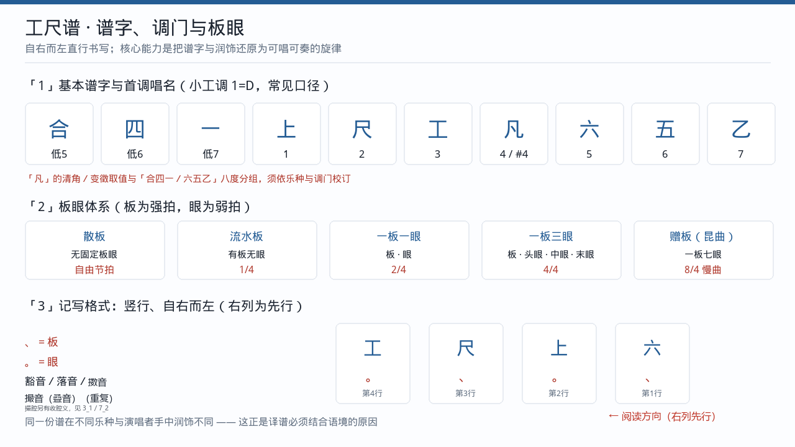

# 工尺谱：从“辨识符号”到“译谱与传承”

## README · 导览

### README_1 本库定位与能力边界

工尺谱是中国传统记谱法，以“上、尺、工、凡、六、五、乙”等谱字记录首调音高框架，以板眼记录节拍骨架，自右而左直行书写。它的精通往往与特定乐种（昆曲、江南丝竹、西安鼓乐等）的传承深度绑定，核心能力不是“认得符号”，而是**译谱**——把谱字、板眼与润饰还原为可唱的旋律或可奏的指法，并说明还原所依据的乐种口径。

其能力结构按符号辨识、板眼解读、乐种译谱三层展开；润腔与腔词关系构成译谱时必须交代的语境。

| 能力层 | 认知对象 | 可交付输出 | 典型失效表现 |
| :--- | :--- | :--- | :--- |
| 辨识 | 谱字、调门、格式 | 报出唱名与书写顺序 | 把“上”当成绝对音高 |
| 解读 | 板眼与润饰符号 | 节拍骨架与装饰处理 | 把板眼等同于小节线 |
| 译谱 | 乐种语境 | 简谱或五线谱稿、首调演唱演奏 | 按 1=C 硬译，删去润饰 |
| 传承 | 腔词关系与审美风格 | 附口径说明与存疑标注的定稿 | 用一种乐种口径套所有谱 |

适用对象：昆曲与器乐从业者、传统音乐研究者、非遗与传谱整理人员、需要把工尺谱译为简谱或五线谱的记谱人员。前置要求：具备首调概念，能按唱名关系视唱。

治理信息（版本／修订记录／图版规范／待修登记）集中见 `../../music_notation_process/_meta/版本与图版规范.md`。

### README_2 三阶进阶总览

| 阶段 | 核心任务 | 知识域 | 跃迁条件 | 达标信号 |
| :--- | :--- | :--- | :--- | :--- |
| 入门 | 掌握音高符号与格式 | 谱字与简谱唱名对应、以小工调为主的七个调、自右而左直行书写 | 任一调门下能报出谱字唱名 | 顺读一段直行谱字 |
| 进阶 | 解读节奏与“润饰” | 散板、流水板、一板一眼、一板三眼；撮音（叠音）、豁音、落音、擞音 | 能识别板眼并把润饰纳入演唱 | 一段谱可击板唱出骨架 |
| 精通 | 译谱实践与乐种深耕 | 昆曲、江南丝竹、西安鼓乐语境下的译谱；腔词关系、润腔规律、审美风格 | 能按乐种口径定调、补润腔并标注存疑 | 提交可复核的译谱定稿 |

```text
[「1」谱字与唱名] --> [「2」七调与调门] --> [「3」直行书写格式]
                                                   |
                                                   v
[「6」乐种语境校订] <-- [「5」润饰符号与活态处理] <-- [「4」板眼体系与节拍换算]
            |
            v
[「7」译为简谱／五线谱或直接首调演唱演奏]
            |
            v
[「8」腔词关系与审美风格 → 活态传承]
```

三阶段的关键转折在进阶末尾：工尺谱记录的是**骨架**而非成品，同一份谱在不同乐种或演唱者手中会有不同的润饰处理。承认并处理这一“活态性”，才可能进入精通阶段的译谱。

### README_3 体例与符号约定

- 序号一律使用「1」「2」「3」或“第1步”形式；章节层级为 `README_N`、`板块0`–`板块10` 与 `N_M`，`0_M` 为读前说明子节。
- 「1」「2」等序号在三种语境出现：README_2 流程图步骤、训练序列序号、实操工作流步骤；引用时写全语境，如“板块 4 工作流第 1 步”。
- 谱字用汉字原字表述；低八度组以“低 5”等方式标注，避免依赖生僻组合字形；调门写作 1=X 形式以便与简谱对齐。
- 板眼符号在等宽代码块与表格中给出；节拍换算与谱字映射用数学块，流程用 ASCII 代码块重建。
- 图片统一归档于 `images` 子文件夹，正文以相对路径引用；本库路径均相对各文件所在目录，治理文件路径 `../../music_notation_process/_meta/` 需向上跳两层再横向进入 process 目录。
- 每阶段末尾设“达标自检”，指标附测量方法，用于训练验收与知识库审计。

## 板块0 · 读前说明与检索路径

### 0_1 前置要求与术语门槛

本板块把正文隐含的阅读门槛显性化。若某项未满足，按“补足位置”直达对应板块，无须从头通读。

| 门槛 | 最低要求 | 补足位置 |
| :--- | :--- | :--- |
| 音高概念 | 能跟随唱名哼唱简单旋律 | 板块2 的 2_1 |
| 音名记号 | 科学音高记号，中央 C 记作 C4；音组随实际音名判定，不随谱式改变 | 板块8 的 8_1 |
| 计数口径 | 自检数字＝对应表行数／训练项数，计数范围见表下注 | 各阶段达标自检表 |
| 方法路径 | 换算口径见 8_1，异说条目见 7_2，实务应用见译谱与曲目实例 | 板块7、板块8～10 |

### 0_2 任务—板块速查

| 读者任务 | 直达板块 | 验收入口 |
| :--- | :--- | :--- |
| 认符号、建立第一层对应 | 板块2 | 2_3 达标自检 |
| 学规则、进入进阶 | 板块3 | 3_4 达标自检 |
| 练视奏／分析／精通 | 板块4 | 4_3 达标自检 |
| 查错纠偏 | 板块5 | 5_1 误区对照 |
| 查术语与速查卡 | 板块6 | 6_1／6_2 |
| 查结论口径与异说 | 板块7 | 7_1／7_2 |
| 查音名、音组与换算接口 | 板块8 | 8_1／8_2 |
| 查译谱与润腔实务 | 板块9 | 9_1／9_2 |
| 查曲目实例与应用 | 板块10 | 10_1／10_2／10_3／10_4 |

### 0_3 调门与板眼换算口径

工尺谱读谱前须明确以下换算约定：

- 谱字在小工调（1=D）下对应 上＝1、尺＝2、工＝3、凡＝4（或升 4）、六＝5、五＝6、乙＝7；低八度组合四一记作低 5、低 6、低 7。
- 七个调门以曲笛筒音与孔位定音：筒音所当的工尺谱字随调门而变（如小工调筒音作 5、正工调作 2、乙字调作 1、尺字调作 6、六字调作 3），这是记谱层面的相对关系；正工、乙字、尺字、小工四调指法最便、实吹调高稳定，凡字、六字、上字三调虽可按上述谱字关系推出筒音，实际调高仍随孔位与指法技术而异，须按具体曲笛与师承核定。调门换算改变谱字的绝对音高，不改变其相对音级关系。
- 板眼记节奏：流水板 1/4、一板一眼 2/4、一板三眼 4/4、赠板 8/4；赠板按一板七眼计，不可硬套 4/4。

以上口径是 8_1 谱字—音高对照表的基础；有异说处见 7_2，译谱时须按所据乐种与传谱校订。

## 板块1 · 传统谱式本体与译谱坐标

### 1_1 记谱原理与信息编码

如图 1-1 所示，工尺谱以四类符号完成编码：谱字给首调唱名，调门给绝对音高锚点，板眼给节拍骨架，补充符号给重复与润饰。书写格式为竖行、自右而左，右列为先行。



图 1-1　工尺谱谱字、调门与板眼。本库绘制；谱字、七调与板式依据常见昆曲口径。

| 编码维度 | 载体 | 解码结果 | 常见误读 |
| :--- | :--- | :--- | :--- |
| 音高 | 上 尺 工 凡 六 五 乙（及低八度合 四 一） | 首调唱名与八度分组 | 把谱字当作绝对音名 |
| 调门 | 以小工调为主的七个调 | 1 所对应的绝对音高 | 忽略调门直接按 1=C 译 |
| 节拍 | 板眼符号（板为强、眼为弱） | 拍位与板式 | 把板眼等同于小节线 |
| 润饰 | 撮音（叠音）、豁音、落音、擞音等 | 重复与装饰性腔音 | 把润饰当可删的附加物 |
| 格式 | 竖行、自右而左 | 阅读顺序 | 按横排左起顺序误读 |

直行书写示意（右列为先行）：

```text
阅读方向：← 自右而左（第1行在最右、先行）
      第4行    第3行    第2行    第1行
      +----+  +----+  +----+  +----+
      | 工 |  | 尺 |  | 上 |  | 六 |
      | 。 |  | 、 |  | 。 |  | 、 |
      +----+  +----+  +----+  +----+
       眼       板       眼       板
       阅读方向：自右而左（右列为先行）
```

谱字与唱名的基本映射（以小工调 1=D 的常见口径为例）：

$$\text{小工调}:\ 1=D,\qquad (\text{上},\text{尺},\text{工},\text{凡},\text{六},\text{五},\text{乙})\mapsto(1,2,3,4,5,6,7)$$

$$(\text{合},\text{四},\text{一})\mapsto(\underset{\cdot}{5},\underset{\cdot}{6},\underset{\cdot}{7})$$

“凡”在不同乐种与调门中可对应清角 4 或变徵升 4，“合四一”与“六五乙”的八度分组亦随谱式与乐器音域处理；这些取值须在译谱前按乐种口径校订，不是可默认固定的常量。

### 1_2 工具属性与能力边界

工尺谱属于传统音高／节奏记录体系。它给出首调框架与板式骨架，把润腔细节留在口传心授之中，因而同一谱本可衍生不同唱法与奏法——这不是记谱缺陷，而是活态传承的设计。

| 记谱体系 | 主要记录对象 | 节奏信息 | 润饰信息 | 主要缺口 |
| :--- | :--- | :--- | :--- | :--- |
| 工尺谱 | 谱字 + 板眼 | 板眼编码 | 部分编码，其余口传 | 绝对音高、润腔细节、多声部 |
| 五线谱 | 绝对音高 + 时值 | 明确 | 靠记号与术语 | 腔词关系、乐种风格 |
| 简谱 | 首调唱名 + 时值 | 明确 | 靠装饰记号 | 润腔规律、乐种语境 |
| 减字谱 | 弦序、徽位、指法 | 基本不编码 | 靠打谱与师承 | 绝对音高、严格节奏 |
| 吉他 TAB | 弦序与品格 | 弱 | 靠奏法符号 | 音名与和声功能 |

工尺谱的首调框架须结合润腔与口传才能定稿：简谱以首调换算，减字谱以打谱分层还原节奏与音高；音组与科学音高以公共换算表对齐。

能力边界须明确：谱字不写绝对音高，调门不写具体唱法，板眼不写速度，润饰符号不写幅度与频率；散板与赠板更无法直接套用小节线概念。把这些未编码项当作谱面已给出，或用某一个乐种的口径硬套所有谱本，是译谱中最根本的偏差。

### 1_3 「精通」的可观测判据

精通指在具体乐种语境中的**准确译谱**与**活态传承**能力：不仅认识符号，更理解该乐种的腔词关系、润腔规律和审美风格。为可验收，拆为可测指标。

| 指标 | 入门 | 进阶 | 精通 | 测量方法 |
| :--- | :--- | :--- | :--- | :--- |
| 谱字顺读 | 需对照表 | 顺读无误 | 任意调门即时报唱名 | 随机抽 20 个谱字 |
| 定调 | 不能 | 认得调门名 | 按乐种口径确定 1=X 并说明依据 | 给谱本定调 |
| 板眼还原 | 不能 | 识别板式 | 散板、赠板亦可给出节拍方案 | 击板唱出骨架 |
| 润饰处理 | 忽略 | 能标注符号 | 能补出乐种特有的润腔并标注依据 | 演唱或译稿比对 |
| 译谱产出 | 不能 | 逐字直译 | 简谱／五线谱稿附存疑标注 | 提交定稿 |
| 腔词与风格 | 不了解 | 知道乐种名 | 能说明字调、润腔与审美的关联 | 口头说明 |

精通的标志因此不是“把谱字换成数字”，而是**在正确的乐种语境里把骨架还原成音乐**，并把无法从谱面确定的部分诚实标注出来。

## 板块2 · 入门：掌握音高符号与格式

### 2_1 知识单元清单

| 单元 | 内容 | 验收要求 |
| :--- | :--- | :--- |
| 音高符号 | 上、尺、工、凡、六、五、乙及其与简谱唱名的对应关系 | 报出七个谱字的唱名 |
| 八度分组 | 合、四、一为低八度组；高八度组的谱式处理 | 标出任一谱字的音组 |
| 调号体系 | 以小工调为主的七个调 | 说出各调门对应的 1=X |
| 记写格式 | 自右而左、直行书写 | 按正确顺序顺读一段谱 |

基本谱字与首调唱名对照：

| 谱字 | 合 | 四 | 一 | 上 | 尺 | 工 | 凡 | 六 | 五 | 乙 |
| :--- | :--- | :--- | :--- | :--- | :--- | :--- | :--- | :--- | :--- | :--- |
| 简谱（小工调口径） | 低 5 | 低 6 | 低 7 | 1 | 2 | 3 | 4 或升 4 | 5 | 6 | 7 |
| 音组 | 低八度组 | 低八度组 | 低八度组 | 中音组 | 中音组 | 中音组 | 中音组 | 中音组 | 中音组 | 中音组 |

高八度组对照（本库读法）：

| 音组 | 原谱写法举例 | 小工调简谱 |
| :--- | :--- | :--- |
| 低八度组 | 合、四、一 | 低 5、低 6、低 7 |
| 中音组 | 上、尺、工、凡、六、五、乙 | 1 2 3 4 5 6 7 |
| 高八度组 | 仩、伬、仜（文献亦作加圈或加撇写法） | 高 1、高 2、高 3（其余类推） |

高八度写法随谱式与乐种而异，上表给出可识别的常见写法；遇到异写先定调门再判断音组。

定调的物理依据：以 D 调曲笛为基准，筒音作 5、第三孔作 1，此即“小工调＝1=D”。改调门靠更换按孔指法实现，故同一支曲笛可奏七调。七个调门以小工调为基准，按曲笛笛色与常见昆曲传承口径可对应如下；不同乐种与地区存在异名或半音差异，译谱前须以该乐种实际定调校验。

| 调门 | 常见 1=X | 相对小工调 |
| :--- | :--- | :--- |
| 尺字调 | 1=C | 低一大二度 |
| 小工调 | 1=D | 基准 |
| 凡字调 | 1=降 E | 高一小二度 |
| 六字调 | 1=F | 高小三度 |
| 正工调（正宫调） | 1=G | 高纯四度 |
| 乙字调 | 1=A | 高纯五度 |
| 上字调 | 1=降B | 高小六度 |

书写格式的实操要点：竖行书写，先读最右一行；谱字右侧或下方附板眼符号；同一行内自上而下为先后顺序。把横排左起习惯带入，会造成整段旋律倒序。

### 2_2 训练序列

「1」先定调门再读谱字。每条练习先口述“某调、1=某音”，再报谱字唱名。

「2」谱字双向互译。由谱字报唱名，由唱名写谱字，覆盖七个基本字与低八度组三字。

「3」八度分组专项。把“合四一”与“六五乙”成对听唱，确认相差一个八度；再认读“仩、伬、仜”等高八度写法并唱出对应音高。

「4」调门换算。在小工调与尺字调、六字调之间，把同一串谱字分别报出实际音名，确认唱名不变而音高整体平移。

「5」直行顺读。取一段四行直行谱，按自右而左顺序读出，再倒序读一遍作对照，验证顺序无误。

「6」板眼位置辨认。仅标出谱中板与眼的位置，暂不击拍，确认符号与谱字的附着关系（符号形制见 3_1，可先按图例识别）。

「7」整段整合。顺读一段含调门、谱字与板眼的短谱，口述“调门—唱名序列—板眼位置”三项。

### 2_3 阶段达标自检

| 检查项 | 合格线 | 复核方式 |
| :--- | :--- | :--- |
| 七谱字唱名 | 7 项全对 | 口头速答 |
| 八度组识别 | 低八度三字与高八度写法各 3 项全对 | 书面标注 |
| 七调门 1=X | 7 项全对（按所列口径） | 闭卷填写 |
| 调门换算 | 两组调门下唱名不变、音名正确 | 口头报音名 |
| 直行顺读 | 四行谱顺序全对 | 现场顺读 |
| 板眼位置 | 10 处错 ≤1 | 书面圈注 |

入门达标的实质是**符号与顺序无歧义**：任意谱字都能落到唱名与音组，任意一段谱都能按正确方向读通。

## 板块3 · 进阶：解读节奏与“润饰”

### 3_1 知识单元清单

| 单元 | 内容 | 验收要求 |
| :--- | :--- | :--- |
| 板眼体系 | 散板、流水板、一板一眼、一板三眼及其节拍含义 | 说出各板式的强弱结构 |
| 板眼符号 | 板（强拍）与眼（弱拍）的记法 | 在谱上标出板眼 |
| 重复类符号 | 撮音（叠音；“撮腔”在昆曲腔格中另指收腔类装饰，须按传谱区分） | 先判断所指对象，不默认同音重复 |
| 装饰类符号 | 豁音、落音、擞音（颤音类）等 | 分类并说明润饰作用 |
| 活态润饰 | 同一份谱在不同乐种或演唱者手中处理不同 | 举出两例差异并说明原因 |

板眼符号形制（本库约定）：“、”为板（强拍），“。”为眼（弱拍）；散板不标板眼，赠板于眼位另加赠号。

板眼体系与节拍换算（强拍为板，弱拍为眼）：

| 板式 | 结构 | 常见对应 | 说明 |
| :--- | :--- | :--- | :--- |
| 散板 | 无固定板眼 | 自由节拍 | 节奏由语气与句读决定 |
| 流水板 | 有板无眼 | 1/4 | 每拍皆板，速度较快 |
| 一板一眼 | 板 · 眼 | 2/4 | 一强一弱 |
| 一板三眼 | 板 · 头眼 · 中眼 · 末眼 | 4/4 | 一强三弱 |
| 赠板（昆曲南曲慢曲，北曲无） | 一板七眼 | 8/4 | 由一板三眼扩充一倍而成：中眼升为板，第五拍的板为额外赠板；小节线以虚线表示。慢曲加赠，不可按 4/4 硬套 |

$$\text{一板一眼}\to\frac{2}{4},\qquad \text{一板三眼}\to\frac{4}{4},\qquad \text{流水板}\to\frac{1}{4},\qquad \text{赠板}\to\frac{8}{4}$$

补充符号按功能归为两类，避免零散记忆：

| 类别 | 符号 | 作用 | 处理要点 |
| :--- | :--- | :--- | :--- |
| 重复类 | 撮音（叠音；昆曲“撮腔”另有收腔义，须按传谱区分） | 重复前一音或前一组音 | 先核传谱语境，再确认重复范围与次数 |
| 装饰类 | 豁音 | 出口上扬的装饰性腔音 | 与字调、出口相关 |
| 装饰类 | 落音 | 下行收束的装饰性腔音 | 与收音、落句相关 |
| 装饰类 | 擞音（擞腔，文献亦作撒音） | 颤音类润饰 | 幅度与频率依乐种 |
| 装饰类 | 带音、垫音等 | 连接或细碎装饰 | 同名异实，依师承 |
| 腔格（十一类，出自《粟庐曲谱》） | 撮、带、垫、叠、啜、滑、擞、豁、嚯、顿、顿挫腔 | 昆曲唱腔的成套装饰分类 | 此处仅列名词供检索，不复制谱例；《粟庐曲谱》编者权利未过期，不作案例影印 |

符号名称与实际奏法在不同乐种、不同地区存在同名异实或异名同实，故本表以功能分类为准，具体唱法须结合乐种与传谱校订。

活态润饰是进阶阶段最关键的认知：谱面给出的是可共享的骨架，润腔则是传承中的变量。删掉润饰符号等于把“活”的部分抹去，译出的只是干瘪的骨架；而把某一家的润腔当作唯一正解，又会把变量误当成常量。

### 3_2 规则关系与推导

译谱的最小映射是“调门 + 谱字 + 板眼”三者的合成：

$$\text{译谱}=(1=X)\ \oplus\ (\text{谱字}\to\text{唱名})\ \oplus\ (\text{板眼}\to\text{拍位})\ \oplus\ (\text{润饰}\to\text{腔音})$$

其中前三项可由谱面确定，第四项部分编码、部分依赖口传。因此同一谱本在不同乐种下可得到不同译稿，差异合法且须在译稿中标注口径。

板眼与小节线不可等同，理由有三：散板无板眼节奏框架，赠板为八拍一板而非四拍，板眼落在字位而非必然落在小节首拍。把板眼直接画成小节线，会破坏腔词关系与句读。

润饰符号的处理顺序建议固定为：先确定重复范围，再判断装饰方向（上扬／下行／颤动），最后依乐种决定幅度与速度。顺序固定可避免把“重复”误唱成“装饰”，或把“装饰”漏记为“经过音”。

### 3_3 训练序列

「1」板式辨认。给出五段谱例，判断散板、流水板、一板一眼、一板三眼与赠板，说明判据。

「2」击板唱骨架。暂不唱润饰，仅按板眼击拍唱出谱字骨架，确保强弱位置稳定。

「3」符号分类。把一段谱中的补充符号逐一分入重复类或装饰类，并写出处理假设。

「4」润饰对比。同一段谱分别按“全删润饰”与“加入润饰”各唱一遍，录音比对语气差异。

「5」活态差异。取同一谱本按两个乐种口径各唱一遍，列出差异点并说明各自依据。

「6」标注存疑。把无法从谱面确定的幅度、速度与重复次数单独标注，与确定项分栏记录。

「7」整段整合。取一段含板眼与润饰的谱，击板唱出完整版本，并口头说明每处润饰的处理理由。

### 3_4 阶段达标自检

| 检查项 | 合格线 | 复核方式 |
| :--- | :--- | :--- |
| 五种板式辨认 | 5 段错 ≤1 | 书面判定 |
| 板眼位置标注 | 20 处错 ≤2 | 谱面圈注 |
| 符号功能分类 | 10 处全对 | 书面分类 |
| 击板唱骨架 | 强弱稳定、无抢拍 | 录音回听 |
| 润饰对比 | 能说明两版本的语气差异 | 双版本盲听 |
| 存疑标注 | 确定项与存疑项分栏清楚 | 译稿复核 |

进阶达标的实质是**承认骨架与润腔的分层**：既能把可确定的板眼与谱字稳定还原，又能把不可确定的润饰作为变量显式管理。

## 板块4 · 精通：译谱实践与乐种深耕

### 4_1 能力构成与分化路径

| 能力项 | 输入 | 输出 | 依赖的前置能力 |
| :--- | :--- | :--- | :--- |
| 定调与译写 | 谱本 + 乐种口径 | 简谱或五线谱稿 | 调门、谱字、板眼 |
| 首调演唱演奏 | 谱本 | 直接唱奏的旋律 | 板眼与润饰处理 |
| 腔词关系 | 曲词 + 谱字 | 依字行腔的处理方案 | 字调、出口与收音 |
| 润腔规律 | 乐种传谱与录音 | 该乐种特有的装饰规则 | 活态润饰认知 |
| 审美风格 | 乐种整体 | 速度、力度与音色取舍 | 以上全部 |

精通须落到具体乐种（昆曲、江南丝竹、西安鼓乐）的语境中，并能译为简谱或五线谱，或直接用首调概念演唱演奏。三个乐种的译谱口径差异显著：

| 乐种 | 谱式与板式特点 | 润腔重点 | 译谱校订要点 |
| :--- | :--- | :--- | :--- |
| 昆曲 | 曲笛笛色定调、赠板慢曲、水磨腔 | 依字行腔、豁音落音、字头字腹字尾 | 须结合曲词字调与板式，不可按均匀拍硬译 |
| 江南丝竹 | 器乐传谱，骨架谱加花演奏 | 加花、叠音、支声式润饰 | 同一骨架在不同乐器上润饰不同，须分声部校订 |
| 西安鼓乐 | 谱字系统与工尺谱有亲缘，坐乐与行乐、鼓段结构 | 谱字读法与节奏口诀依赖口传 | 须依该乐种实际读谱法与师承校订 |

腔词关系是昆曲一路的核心：汉字字调（平仄）影响旋律走向，依字行腔要求旋律贴合字调；一字之内又分字头、字腹、字尾，对应出口、行腔与收音。译谱若忽略曲词，只把谱字换成数字，会把“腔”丢掉，只留下“调”。

精通者因此是传统音乐传承链条中的关键一环：其产出不只是译稿，还应包含**口径说明**（用了哪个调门、哪个乐种、哪份传谱）与**存疑标注**（哪些润饰由口传补入、哪些取值仍待考），使后人可复核、可续修。

### 4_2 实操工作流

译谱工作流：

```text
[「1」确认谱本来源与乐种] --> [「2」定调门，写 1=X 并说明依据]
                                        |
                                        v
[「3」按自右而左顺序抄出谱字序列] --> [「4」判板式，把板眼换成拍位]
                                        |
                                        v
[「7」加口径说明与存疑标注] <-- [「6」依腔词与润腔规律补润饰] <-- [「5」处理重复类与装饰类符号]
                    |
                    v
        [「8」输出简谱／五线谱稿或首调唱奏版本]
```

乐种校订工作流：

```text
[「1」列出该乐种传谱与录音参照] --> [「2」比对同一谱本的异本差异]
                                          |
                                          v
[「5」定稿并保留异文记录] <-- [「4」标记不可确定项] <-- [「3」提取该乐种润腔规律]
```

两条工作流的共同约束是**可追溯**：调门来自笛色或师承，板式来自板眼符号，润腔来自传谱比对，凡不能追溯者一律进存疑栏，不以“惯例”之名写成确定结论。

### 4_3 阶段达标自检

| 检查项 | 精通合格线 | 测量方法 |
| :--- | :--- | :--- |
| 定调 | 按乐种口径给出 1=X 并陈述依据 | 给未注调门的谱本定调 |
| 译谱完整度 | 谱字、板眼、润饰三类无遗漏 | 译稿逐项核对 |
| 板式处理 | 散板与赠板亦给出合理节拍方案 | 击板演示 |
| 腔词关系 | 能说明字调与旋律走向的关联 | 结合曲词口头分析 |
| 乐种差异 | 至少两个乐种的译稿体现口径差异 | 双版本对照 |
| 口径说明与存疑标注 | 两项齐备、可复核 | 译稿附件检查 |
| 首调演唱演奏 | 直接依谱唱奏，不依赖译稿 | 现场演示 |

精通验收必须包含“未见过的谱本”与“口径可陈述”两个条件；在已熟唱曲目上的复现不计入判据。

## 板块5 · 常见误区与纠偏

### 5_1 误区—成因—纠偏对照

| 误区 | 成因 | 纠偏动作 | 复核指标 |
| :--- | :--- | :--- | :--- |
| 把“上”当绝对音高 | 混淆首调谱字与音名 | 每次读谱先口述调门 | 调门换算正确率 |
| 忽略调门直接按 1=C 硬译 | 把小工调当默认常量 | 建立“定调为译谱第一步”的检查项 | 定调依据完整度 |
| 把板眼画成小节线 | 用五线谱节拍概念套用 | 单独训练散板与赠板 | 板式判定正确率 |
| 赠板按 4/4 处理 | 未识别一板七眼 | 按 8/4 慢曲专项击板 | 拍位还原准确度 |
| 删掉润饰只译骨架 | 把补充符号当可省装饰 | 强制分类并写出处理假设 | 润饰标注覆盖率 |
| 把一家润腔当唯一正解 | 未区分骨架与活态变量 | 用两个乐种口径各译一遍 | 异文记录完整度 |
| 重复类与装饰类混淆 | 未按功能分类 | 按 3_1 两类表逐项归类 | 符号分类正确率 |
| 按横排左起顺序读谱 | 忽略直行自右而左格式 | 用四行直行谱反复顺读 | 顺读顺序正确率 |
| 忽略腔词关系只换数字 | 把译谱等同于字符替换 | 结合曲词分析字调与出口收音 | 腔词分析可陈述性 |
| 以熟唱曲目冒充译谱能力 | 验收材料无陌生度约束 | 强制使用未见过的谱本 | 译稿口径可复核性 |

### 5_2 跨阶段衔接检查

| 衔接 | 放行条件 | 未达标时的回退动作 |
| :--- | :--- | :--- |
| 入门 → 进阶 | 谱字、调门、直行顺序三项无歧义 | 回到 2_2 的调门换算与顺读练习 |
| 进阶 → 精通 | 骨架稳定、润饰作为变量显式管理 | 回到 3_3 的击板与润饰对比 |
| 精通 → 传承产出 | 译稿、口径说明、存疑标注三项齐备 | 交替执行 4_2 两条工作流 |

阶段放行采用全项合格制；任一检查项未达标即不放行，避免以符号熟练掩盖乐种语境与活态传承的缺口。

## 板块6 · 术语索引与速查

### 6_1 术语对照

| 中文 | 英文／说明 | 要点 |
| :--- | :--- | :--- |
| 工尺谱 | Gongche notation | 以谱字与板眼记录首调框架的传统记谱法 |
| 谱字 | Gongche characters | 上尺工凡六五乙等，记唱名关系 |
| 合四一 | Low-register characters | 低八度组，对应低 5、低 6、低 7 |
| 小工调 | Xiaogong diao | 七调基准，常见 1=D |
| 调门／笛色 | Key / flute color | 决定 1=X 的绝对音高锚点 |
| 板眼 | Ban-yan | 板为强拍，眼为弱拍 |
| 散板 | Free rhythm | 无固定板眼 |
| 流水板 | Ban-only | 有板无眼，常见 1/4 |
| 一板一眼 | One ban one yan | 常见 2/4 |
| 一板三眼 | One ban three yan | 常见 4/4 |
| 赠板 | Added ban | 昆曲慢曲，一板七眼，常见 8/4 |
| 撮音（叠音；“撮腔”另义见 7_2） | Repetition marks | 重复前一音或前一组音 |
| 豁音 | Rising ornament | 出口上扬的装饰性腔音 |
| 落音 | Falling ornament | 下行收束的装饰性腔音 |
| 擞音（擞腔，亦作撒音） | Trill-like ornament | 颤音类润饰 |
| 润腔 | Vocal ornamentation | 活态传承中的腔音处理 |
| 依字行腔 | Text-tone melodic shaping | 旋律贴合字调平仄 |
| 字头字腹字尾 | Onset / nucleus / coda | 对应出口、行腔与收音 |
| 译谱 | Transcription to numbered or staff notation | 在乐种语境中还原为可唱可奏的旋律 |
| 活态传承 | Living transmission | 谱为骨架、口传为变量 |

### 6_2 速查卡

```text
谱字（小工调）：合 四 一 → 低5 低6 低7 ｜ 上 尺 工 凡 六 五 乙 → 1 2 3 4 5 6 7
七调（常见口径）：尺字调 1=C ｜ 小工调 1=D ｜ 凡字调 1=降E ｜ 六字调 1=F ｜ 正工调 1=G ｜ 乙字调 1=A ｜ 上字调 1=降B
书写：竖行、自右而左，右列为先行
板式：散板 自由 ｜ 流水板 1/4 ｜ 一板一眼 2/4 ｜ 一板三眼 4/4 ｜ 赠板 8/4
符号：重复类 撮音（叠音；“撮腔”另义见 7_2） ｜ 装饰类 豁音／落音／擞音（颤音类）
乐种：昆曲 依字行腔／赠板 ｜ 江南丝竹 加花与支声 ｜ 西安鼓乐 谱字与口传读法
```

$$(\text{上},\text{尺},\text{工},\text{凡},\text{六},\text{五},\text{乙})\mapsto(1,2,3,4,5,6,7),\qquad \text{一板一眼}\to\frac{2}{4},\qquad \text{一板三眼}\to\frac{4}{4}$$

$$\text{译谱}=(1=X)\oplus(\text{谱字}\to\text{唱名})\oplus(\text{板眼}\to\text{拍位})\oplus(\text{润饰}\to\text{腔音})$$

| 待查问题 | 直接定位 |
| :--- | :--- |
| 这个谱字唱什么 | 先定调门，再按谱字—唱名表 |
| 1 等于什么音 | 查七调表，并以乐种实际定调校验 |
| 板眼怎么换拍号 | 按板式换算表，散板与赠板不可套小节线 |
| 润饰符号怎么处理 | 先分重复类与装饰类，再依乐种定幅度 |
| 同一谱为何唱法不同 | 谱是骨架，润腔是活态变量 |
| 译稿还缺什么 | 口径说明与存疑标注 |
| 精通是否达标 | 只看未见过谱本的译稿与口径可陈述性 |

## 板块7 · 文献、口径与异说

### 7_1 可核事实与依据分层

| 结论类别 | 本库取值 | 依据层级 |
| :--- | :--- | :--- |
| 七调相对音程 | 尺字调低大二、凡字调高小二、六字调高小三、正工调高纯四、乙字调高纯五、上字调高小六 | 曲笛笛色与昆曲传承口径 |
| 定调物理依据 | D 调曲笛、筒音作 5、第三孔作 1 | 乐器与乐种惯例 |
| 板眼与拍号 | 流水板 1/4、一板一眼 2/4、一板三眼 4/4、赠板 8/4 | 乐种惯例，存在异说 |
| 谱字与唱名 | 上尺工凡六五乙对应 1 2 3 4 5 6 7（小工调口径） | 乐种惯例，通行共识 |
| 润饰术语 | 撮音、擞音、豁音、落音等 | 昆曲腔格术语，同名异实现象普遍 |
| 八度分组 | 合四一为低八度组；仩伬仜为高八度组 | 谱式惯例，写法随乐种而异 |
| 撮音／撮腔 | 撮音＝叠音（同音重复）；昆曲“撮腔”另有收腔义 | 昆曲腔格术语，存在同名异实 |

### 7_2 分歧条目的异说标注

| 条目 | 通行说法 | 另有异说 | 本库处理 |
| :--- | :--- | :--- | :--- |
| 赠板拍数 | 一板七眼，按 8/4；由一板三眼扩充一倍、中眼升板、第五拍加赠板，小节线用虚线（3_1） | 亦有按 4/4 加赠的处理；北曲无赠板，只用于南曲 | 标注“不可按 4/4 硬套”，译稿须说明口径；范围限定与构成已写入 3_1 |
| 凡字取值 | 清角 4 | 部分乐种作变徵升 4 | 译谱前按乐种口径校订，不设默认常量 |
| 擞音与撒音 | 同一颤音类润饰的异写，通行写作“擞音” | 文献亦作“撒音”，用字随传本而异 | 统一作“擞音（擞腔）”，括注“亦作撒音”以存异写检索 |
| 撮音与撮腔 | “撮音（叠音）”表同音重复；“撮腔”多指收腔类装饰 | 昆曲文献中两义常被混用，含义随乐种与传本而异 | 两义分列不并条：重复义作“撮音（叠音）”，收腔义作“撮腔”，均须按传谱核 |
| 高八度写法 | 仩、伬、仜或加圈／加撇 | 写法随谱式与乐种而异 | 补原谱写法与本库读法对照 |
| 直行阅读顺序 | 自右而左，右列先行 | 易被按横排左起误读 | 示意块加“← 阅读方向”箭头 |

### 7_3 学习资源与找谱渠道

本节汇总可迁移的通用学习资源，并明确其边界。资源清单依据《乐谱来源说明》；该来源面向通用乐谱与乐理学习，**未列工尺谱或具体乐种（昆曲、丝竹、鼓乐）的专门站点**，故此处只标出可辅助译谱后视唱与听觉校对的通用平台，不虚构工尺专门渠道。

| 站点 | 类别 | 核心定位（据来源重述） | 对本谱式的用途与边界 |
| :--- | :--- | :--- | :--- |
| 国家高等教育智慧教育平台 | 体系课程 | 可检索《乐理与视唱练耳》等国家级课程，含基础理论、识谱与听音训练 | 辅助译谱后的视唱与听音；不含工尺原谱 |
| Musicca | 游戏化乐理 | 用互动练习掌握音符、节奏、音程等基础概念 | 辅助音程与节奏听辨；不涉及谱字与板眼 |
| 8notes | 综合学习站 | 分级谱之外附乐理教程、乐器技巧指南与在线节拍器 | 节拍器可作板眼速度的参照；非工尺节奏依据 |
| MuseScore | 社区谱库 | 流行、影视、动漫游戏类改编谱丰富，支持在线试听 | 仅用于译稿旋律的试听对照；不提供工尺原谱 |

取用口径：站点定位来自《乐谱来源说明》，属对第三方站点的描述，会随运营变动，须以站点现况为准。来源未给出上述站点的网址或授权条款，本表不列链接、不作版权背书。要点：工尺谱的板眼与润腔依赖具体乐种与传本，通用平台只能辅助译谱结果的视唱与听觉校对，不能替代传本与录音（见 9_1、9_2、10_1～10_3）。来源在此谱式上存在明确的信息缺口，不据以推断存在专门的工尺谱在线站点。

### 7_4 公开曲学资料复核与补注

本节取昆曲工尺谱讲座与曲学文章复核正文口径。所引为昆曲一隅的经验，工尺谱通用于多乐种，南曲北曲与各地谱式有别，须按所据曲谱与传本判断，不改变 7_1 的事实层级。来源条目（MLA）附于本节末。

| 复核条目 | 正文口径 | 公开曲学资料表述 | 处理 |
| :--- | :--- | :--- | :--- |
| 赠板拍数与范围 | 赠板按 8/4，现已补“南曲独有”限定 | 赠板由一板三眼扩充一倍，形式由八拍组成；只用于南曲，北曲不存在 | 印证 8/4，补充已写入 3_1／7_2 |
| 赠板构成 | 原未展开，现已补入 3_1／7_2 | 赠板把正板一板三眼的中眼升为板，第五拍的板为额外增加的赠板；小节线用虚线表示 | 补充，已写入 3_1／7_2 |
| 板眼类型 | 散板、流水板、一板一眼、一板三眼、赠板（3_1、7_1） | 昆曲五种板式即散板、流水板（1/4）、一板一眼（2/4）、一板三眼（4/4）、加赠板的一板三眼 | 印证，不改 |
| 腔格清单 | 原列撮音、擞音、豁音、落音等，现已补十一类 | 《粟庐曲谱》记写十一类：撮、带、垫、叠、啜、滑、擞、豁、嚯、顿、顿挫腔 | 补充，已写入 3_1（仅列名词，不复制谱例） |
| 擞音为颤音类 | 擞音属颤音类润饰（3_1、7_1） | 擞音即颤音，另有叠音（重复前音）、豁音（加较高短音）、落音（加较低音） | 印证并细化，不改 |
| 七调调名 | 小工调 1=D 口径，七调相对音程（8_1、7_1） | 七调近似对应：上字调降 B、尺字调 C、小工调 D、凡字调降 E、六字调 F、正宫调 G、乙字调 A | 印证小工调 D，补充余调近似对应，注明“近似”不可当精确等值 |

来源条目（MLA）：

- 陈超. “昆曲工尺谱入门.” 微信公众号 秋霞琴社, mp.weixin.qq.com/s?__biz=MzI5OTE1NjAxOQ==&mid=2674923934, 访问 22 Nov. 2026.
- “中国音乐史之：工尺谱.” 中音在线论坛, bbs.musiceol.com/news/html/2010-7/20107110222692766548.html, 访问 22 Nov. 2026.
- 张骁骅. “【每月一曲】认识昆曲工尺谱.” 微信公众号 苏州欣和昆习社, mp.weixin.qq.com/s?__biz=MzIwNTEwMjIwMA==&mid=2652142422, 访问 22 Nov. 2026.

## 板块8 · 音名、音组与换算接口

### 8_1 谱字—音组—科学音高对照（小工调 1=D 口径）

| 谱字 | 合 | 四 | 一 | 上 | 尺 | 工 | 凡 | 六 | 五 | 乙 |
| :--- | :--- | :--- | :--- | :--- | :--- | :--- | :--- | :--- | :--- | :--- |
| 简谱 | 低 5 | 低 6 | 低 7 | 1 | 2 | 3 | 4 或升 4 | 5 | 6 | 7 |
| 科学音高（小工调） | A3 | B3 | C♯4 | D4 | E4 | F♯4 | G4 或 G♯4 | A4 | B4 | C♯5 |
| 音组 | 低八度组 | 低八度组 | 低八度组 | 中音组 | 中音组 | 中音组 | 中音组 | 中音组 | 中音组 | 中音组 |

高八度组：仩、伬、仜分别对应高 1、高 2、高 3（小工调即 D5、E5、F♯5），文献亦作加圈或加撇写法。凡字取 4 或升 4 须按乐种口径校订。

### 8_2 跨篇换算接口

工尺谱不写绝对音高，须经“调门 + 谱字”两步换算到科学音高：先按 1=X 确定主音，再按谱字相对级数推出各音。上表以小工调 1=D 为例；换调门时整列平移，唱名不变、音名整体改变。与简谱的同宫系统、五线谱的科学音高记号可逐一对照：同宫系统对应相同的调号与音级关系，科学音高记号给出各谱字在具体调门下的绝对音高。

## 板块9 · 译谱与润腔实务

### 9_1 工尺谱到简谱／五线谱的译写

工尺谱记录骨架而非成品，译谱要先定调、再落谱字、最后补润腔。

| 步骤 | 操作 | 依据 |
| :--- | :--- | :--- |
| 定调 | 按乐种与笛色确定调门（如小工调 1=D） | 8_1 调门对照 |
| 落字 | 谱字依“谱字—唱名—数字”对应换写为简谱数字，低八度组加点 | 8_1 谱字—音高表 |
| 定板 | 板眼换拍号：流水 1/4、一眼 2/4、三眼 4/4、赠板 8/4 | 3_1 板眼表 |
| 补润 | 依乐种补撮、擞、豁、落等腔格 | 3_1 润饰术语 |
| 校订 | 标注存疑处与所据传谱 | 7_2 异说 |

译谱的关键在“凡字取值”与“赠板拍数”两处异说：前者按乐种定清角或变徵，后者不可硬套 4/4。译稿须写明口径，避免下游读者误读。

### 9_2 润腔的记写与还原

润腔是工尺谱活态性的集中体现，同一谱字在不同演唱者手中处理方式不同。

| 腔格 | 记写 | 还原要点 |
| :--- | :--- | :--- |
| 撮音（叠音） | 重复前一音或前一组音（同音重复为主体） | 与 3_1 定义一致，不等于收腔义的“撮腔” |
| 擞音 | 颤音类润饰 | 幅度与频率依乐种，亦作撒音 |
| 豁音 | 向上滑出的装饰 | 落点音高须按腔格确定 |
| 落音 | 向下滑入的装饰 | 起音与落音时值分明 |

记写时在译谱上方另加一行润腔标记，与骨架音分开，便于区分“谱面所有”与“演唱所加”。凡未确定者标“待校”，不臆断。

## 板块10 · 曲目实例与乐种应用

### 10_1 昆曲曲牌读解

昆曲曲谱以工尺谱记腔，板眼严谨、润腔繁复，读解分四层：

1. **定笛色**：确认调门与小工调的关系，定出绝对音高。
2. **击板**：按板眼符号击拍，先建立骨架节奏。
3. **依字行腔**：按唱字的四声与腔格确定润腔走向。
4. **合乐**：与曲笛、三弦等伴奏合，校对腔与词的对应。

昆曲读谱通行以“腔词关系”为核心：字决定腔的走向，腔不能脱离字而独立成立。此为昆曲唱腔的通行概括，具体腔词对应须按所据曲谱与录音核定；忽略腔词关系也是昆曲译谱最易失真之处。

### 10_2 丝竹与鼓乐的曲目应用

江南丝竹与西安鼓乐的工尺谱用法有别，译谱须按乐种调整。下列乐种特点为通行概括，具体谱式与润饰须按所据传本与录音核定。

| 乐种 | 谱式特点 | 译谱侧重 |
| :--- | :--- | :--- |
| 江南丝竹 | 强调支声复调与加花 | 标出主旋律与支声的关系 |
| 西安鼓乐 | 保留唐宋谱式痕迹，节奏复杂 | 板眼细读，不可按 4/4 简化（赠板为昆曲南曲概念，不用于此） |

昆曲的腔格与依字行腔已在 10_1 专述，不在本表重复。同一份谱在不同乐种中不可套用同一译法；先定乐种，再定口径，是译谱的基本纪律。

### 10_3 译谱定稿工作流

一份可复核的译谱定稿，须经过“初译—试唱—校订—标注”四步：

| 阶段 | 产出 | 检查点 |
| :--- | :--- | :--- |
| 初译 | 骨架音与板眼 | 调门、谱字、拍号无误 |
| 试唱 | 按译谱唱出 | 音高与节奏可唱、可记 |
| 校订 | 与传谱或录音对校 | 润腔与异说处逐一确认 |
| 标注 | 写明所据乐种、传本与存疑处 | 他人可据以复核 |

译谱定稿不是“把工尺字换成阿拉伯数字”，而是把一种活态传统转写为可流通的谱面，同时保留其不确定性。标注存疑不是缺陷，而是译谱专业性的体现。

### 10_4 曲目实例：公版谱本案例

前三节的译谱流程需落到具体谱本。本节按公版刊本列案例，谱字以直行表格自录，只呈现原谱骨架，不整页复制影印版面。特别提醒：《粟庐曲谱》（1953，俞振飞）不在公版范围（俞振飞卒 1993），可作文献引用与腔格名词出处（见 3_1 十一类腔格），不得复制谱页作案例。

| 案例 | 谱本 | 公版依据 | 本库呈现方式 | 配套训练入口 |
| :--- | :--- | :--- | :--- | :--- |
| 南曲正曲短牌（如【步步娇】一类） | 《九宫大成南北词宫谱》（1746，允禄等奉敕编） | 清代官刻，早已公版 | 直行表格自录谱字与板眼骨架 | 2_1／3_1 谱字顺读与单牌结构 |
| 《牡丹亭·游园》【皂罗袍】 | 《纳书楹曲谱》（1792，叶堂） | 汤显祖（1616）与叶堂均已公版 | 标赠板本 8/4 与通行清唱本 4/4 两种口径的腔格位置 | 3_1／4_1／10_1 昆曲腔格与依字行腔 |
| 折子戏选段（带白口） | 《遏云阁曲谱》（清同治年间，约 1870） | 清代刊本 | 戏宫谱片段自录，标腔词关系 | 4_1／10_1 戏宫谱与清宫谱对照 |
| 传奇选段（近代工尺谱范例） | 《集成曲谱》（1925，王季烈等编） | 王季烈卒 1952，2003 年起公版 | 直行自录，附译稿对照 | 7_2／10_3 近代排版与译谱定稿比较 |
| 寺院京音乐工尺谱抄本 | 智化寺京音乐清抄本（公开影印） | 清代抄本 | 抄本片段自录，标板眼 | 10_2 非昆曲乐种的工尺用法 |

上表只回答“用哪首曲子”。工尺谱的“调”有两层：**调门**（小工调 1＝D 等，定谱字绝对音高）与**板眼**（定节奏）。下表把每段调门与板眼钉到具体小节，读者据此反查谱字—音高换算。

| 案例·段落 | 该段调子（调门／板眼口径） | 对应知识小节（去哪节查） | 依据与核定 |
| :--- | :--- | :--- | :--- |
| 南曲正曲短牌（如【步步娇】） | 调门随牌定，须据所据谱本核定；板眼先定 | 0_3 七调门换算；8_1 谱字—音高对照 | 调门改变谱字绝对音高不改音级关系，具体调门以所据刊本核定，不写死 |
| 【皂罗袍】（《牡丹亭·游园》） | 小工调（1＝D），南仙吕宫；赠板本 8/4（全印本口径），通行清唱本 4/4 | 0_3 小工调换算（上＝1、尺＝2…）；8_1 小工调音高对照；3_1 赠板 | 台大论文记“仙吕宫相当于西乐 D 调”、赠板一板七眼；4/4 为通行清唱本口径，两说并存不写死 |
| 同曲务头“雨丝风片”“烟丝醉软” | 小工调（1＝D）不变，腔格依字行腔 | 3_1 十一类腔格；9_2 润腔还原 | 《曲苑缀英》载两处为务头，用掇腔／叠顿腔连擞腔／双揉腔 |
| 折子戏选段（带白口，《遏云阁》） | 戏宫谱调门依曲笛，须据所据折子核定 | 0_3 调门换算；8_1 谱字—音高对照 | 戏宫谱工尺与板眼齐备，调门随笛色，不据通行调写死 |
| 传奇选段（《集成曲谱》） | 近代排版，调门须据该本核定 | 7_2 异说标注；0_3 调门换算；10_3 译稿对照 | 合作编者须按最后去世者核定保护期，调门以该本为准 |
| 智化寺京音乐抄本 | 非昆曲乐种，调门依京音乐笛色，须据抄本核定 | 0_3 七调门换算；10_2 非昆曲乐种应用 | 寺院京音乐自成体系，不套昆曲小工调口径 |

合作编者须按最后去世者核定保护期，不能只按首位编者推算；《集成曲谱》入库前须完成这一核定。权利标注（每条案例页脚统一一行）：公版依据为刊本年代或编者卒年，谱字为本库据影印自录，非引用近十年出版物版面。乐谱公版不等于录音公版，配演唱录音须单独核权。

来源条目（MLA）：

- “中华人民共和国著作权法（2020 年修正）.” 中国人大网, www.npc.gov.cn/c2/c30834/202011/t20201119_308796.html, 访问 25 Nov. 2026.
- “新定九宫大成南北词宫谱（1746 殿刊本）.” 香港理工大学《九宫大成》电子版, wapp.lib.polyu.edu.hk/ninemodes/intro-zh.html, 访问 25 Nov. 2026.
- “纳书楹曲谱与遏云阁曲谱.” 中国国家图书馆, www.nlc.cn/upload/attachments/2026-04-30/6e507c9c.pdf, 访问 25 Nov. 2026.
- “公版曲谱案例推荐（v1.0）.” WorkBuddy, 25 Nov. 2026, D:\.agent\music_notation_process\公版曲谱案例推荐（v1.0）.md.
- “《牡丹亭》昆曲工尺谱全印本的探究.” 台大戏剧学系, theatre.ntu.edu.tw/journal/text/pdf/01/01-3.pdf, 访问 25 Nov. 2026.（仙吕宫【皂罗袍】相当于西乐 D 调；赠板一板七眼）
- “《牡丹亭·游园》曲谱及伴奏（曲苑缀英）.” 微信公众号, 访问 25 Nov. 2026.（小工调 1＝D、南仙吕宫【皂罗袍】，务头“雨丝风片”“烟丝醉软”）
