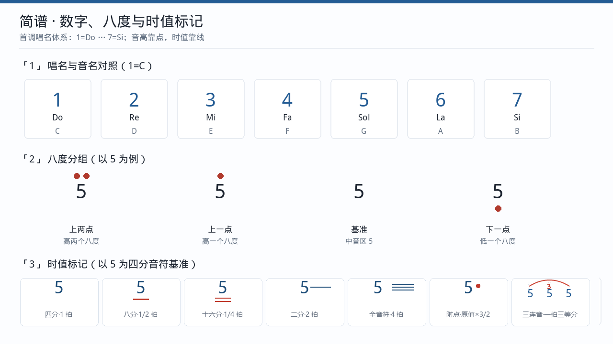

# 简谱：从“唱名工具”到“创作与编配”

## README · 导览

### README_1 本库定位与能力边界

简谱是**首调音高记录**体系：数字 1 至 7 记录的是调内唱名关系，不是绝对音高；只有写明 1=C、1=G 之类的调号，这层关系才锚定到具体音高。这一属性决定了它入门极快、移调极省，也决定了它在高级阶段会显著分化——同一套符号，一条路通向演奏与演唱的即时反应，另一条路通向创作与编配的结构性运用。

其能力结构按解码、规则、分化三层展开：前两层为共用底座，分化发生在高级阶段。

| 能力层 | 认知对象 | 可交付输出 | 典型失效表现 |
| :--- | :--- | :--- | :--- |
| 辨识 | 数字、点、线 | 报出唱名、八度与时值 | 把 1 当成固定音高 C |
| 解码 | 调号 + 旋律 | 按指定调唱出或奏出旋律 | 换调后仍按 C 调指法或唱名位置反应 |
| 结构化 | 音程、和弦、调式 | 标出顺阶和弦与功能连接 | 会唱旋律却配不出和弦 |
| 分化运用 | 旋律骨架或完整谱面 | 即兴伴奏、和声编配、改编与写作 | 只会照谱唱，无法生成或重组音乐 |

适用对象：声乐与视唱练耳学习者、民乐与群众音乐教学、即兴伴奏者、歌曲写作与编配者、需要把简谱与五线谱互译的记谱人员。前置要求：能识读数字与基本拍感，无需固定唱名基础。

治理信息（版本／修订记录／图版规范／待修登记）集中见 `../../music_notation_process/_meta/版本与图版规范.md`。

### README_2 三阶进阶总览

| 阶段 | 核心任务 | 知识域 | 跃迁条件 | 达标信号 |
| :--- | :--- | :--- | :--- | :--- |
| 入门 | 快速建立数字与音高的关联 | 唱名音名、八度点、时值线、拍号 | 任一调号下都能即时把数字换成唱名与实际音高 | 陌生单声部旋律慢速唱通 |
| 进阶 | 深入乐理与和声基础 | 半音全音、音程、和弦转位、调式、顺阶和弦与主属连接 | 能把旋律归并为调内和弦 | 看旋律即能给出和弦走向 |
| 精通 | 分化为演奏家或创作者 | 首调视唱与即兴伴奏；副属和弦、离调、旋律写作与曲式 | 能在两条路径中至少一条达成自如运用 | 直接产出伴奏、编配或完整改编 |

```text
[「1」数字与唱名] --> [「2」八度与时值] --> [「3」拍号与节奏型]
                                                  |
                                                  v
                              [「4」半音／音程／和弦／调式]
                                                  |
                                                  v
                                [「5」调号换算 + 顺阶和弦 + 主属功能]
                                                  |
                        +-------------------------+-------------------------+
                        |                                                   |
                        v                                                   v
        [「6A」首调视唱 · 配奏 · 即兴伴奏]              [「6B」和声编配 · 旋律写作 · 改编]
                        |                                                   |
                        +-------------------------+-------------------------+
                                                  v
                                    [「7」自如运用与作品产出]
```

前两阶段为两条路径共用底座，分化发生在精通阶段；因此进阶阶段的和声基本功不可按“将来走哪条路”而裁剪。

### README_3 体例与符号约定

- 序号一律使用「1」「2」「3」或“第1步”形式；章节层级为 `README_N`、`板块0`–`板块10` 与 `N_M`，`0_M` 为读前说明子节。
- 「1」「2」等序号在三种语境出现：README_2 流程图步骤、训练序列序号、实操工作流步骤；引用时写全语境，如“板块 4 工作流第 1 步”。
- 简谱谱例以等宽代码块或数学块呈现；上加点表高八度、下加点表低八度，减时线画在数字下方，增时线接在数字右侧。
- 调号统一写作 1=X 形式；变化音用升号与降号前置标记，还原号用于同小节内撤销。
- 音名采用科学音高记号，中央 C 记作 C4；简谱以中音区为基准，数字上方加一点升高一个八度、下方加一点降低一个八度，据此与科学音高组号对应。
- 图片统一归档于 `images` 子文件夹，正文以相对路径引用；本库路径均相对各文件所在目录，治理文件路径 `../../music_notation_process/_meta/` 需向上跳两层再横向进入 process 目录；可量化关系用数学块，流程用 ASCII 代码块重建。
- 每阶段末尾设“达标自检”，指标附测量方法，用于训练验收与知识库审计。

## 板块0 · 读前说明与检索路径

### 0_1 前置要求与术语门槛

本板块把正文隐含的阅读门槛显性化。若某项未满足，按“补足位置”直达对应板块，无须从头通读。

| 门槛 | 最低要求 | 补足位置 |
| :--- | :--- | :--- |
| 音高概念 | 能数拍并分辨 1 至 7 的唱名高低 | 板块2 的 2_1 |
| 音名记号 | 科学音高记号，中央 C 记作 C4；音组随实际音名判定，不随谱式改变 | 板块8 的 8_1 |
| 计数口径 | 自检数字＝对应表行数／训练项数，计数范围见表下注 | 各阶段达标自检表 |
| 方法路径 | 换算口径见 8_1，异说条目见 7_2，实务应用见译谱与曲目实例 | 板块7、板块8～10 |

### 0_2 任务—板块速查

| 读者任务 | 直达板块 | 验收入口 |
| :--- | :--- | :--- |
| 认符号、建立第一层对应 | 板块2 | 2_3 达标自检 |
| 学规则、进入进阶 | 板块3 | 3_4 达标自检 |
| 练视奏／分析／精通 | 板块4 | 4_3 达标自检 |
| 查错纠偏 | 板块5 | 5_1 误区对照 |
| 查术语与速查卡 | 板块6 | 6_1／6_2 |
| 查结论口径与异说 | 板块7 | 7_1／7_2 |
| 查音名、音组与换算接口 | 板块8 | 8_1／8_2 |
| 查译谱与编配实务 | 板块9 | 9_1／9_2 |
| 查曲目实例与应用 | 板块10 | 10_1／10_2／10_3／10_4 |

### 0_3 首调换算口径

简谱的核心是“关系内置、音高外加”，读谱前须明确以下换算约定：

- 调号 `1=X` 给出主音音名；加点数只改变八度，不改变音名。以 `1=C` 为例：1（无点）＝C4，1（上一点）＝C5，1（下一点）＝C3。
- 时值以数字本体为四分音符；下加一条减时线减半、右加一条增时线增一倍，附点乘 3/2。
- 音组由“对应音名 + 加点数”共同决定，与五线谱的谱表位置无关。

以上口径是 8_1 对照表与全篇视唱训练的共同基础；跨体系换算见 8_2。

## 板块1 · 首调编码本体与分化坐标

### 1_1 记谱原理与信息编码

如图 1-1 所示，简谱用四类符号完成编码：数字定唱名关系，上下点定八度，横线与附点定时值，调号定绝对音高锚点。理解“关系是内置的、音高是外加的”，是避免绝大多数误读的前提。



图 1-1　简谱数字、八度点与时值标记。本库绘制；时值关系依据简谱通行规则。

| 编码维度 | 载体 | 解码结果 | 常见误读 |
| :--- | :--- | :--- | :--- |
| 唱名关系 | 1 2 3 4 5 6 7 | 调内音级 | 把 1 当作绝对音高 C |
| 八度 | 数字上／下加点，点数累加 | 音组（大字组、小字组、小字一组等） | 忽略高音点导致整段低八度 |
| 时值 | 减时线、增时线、附点、连音线 | 起奏点与持续时间 | 增时线与减时线方向混淆 |
| 音高锚点 | 1=C、1=G 等调号 | 数字对应的实际音名 | 转调后沿用旧调号读谱 |
| 临时偏离 | 升号、降号、还原号 | 调外变化音 | 把变化音当作新调号 |

调号换算的本质是把首调唱名整体平移：

$$\text{1=C}:\ (1,2,3,4,5,6,7)\mapsto(C,D,E,F,G,A,B)$$

$$\text{1=G}:\ (1,2,3,4,5,6,7)\mapsto(G,A,B,C,D,E,\sharp F)$$

$$\text{1=F}:\ (1,2,3,4,5,6,7)\mapsto(F,G,A,\flat B,C,D,E)$$

同一串数字在不同调号下唱名不变、实际音高全变；这正是简谱便于移调、也容易养成“数字＝固定音”错觉的双重来源。

### 1_2 工具属性与能力边界

简谱属于首调音高记录体系。它记录的是调内关系而非绝对位置，因此视唱直接、移调成本低、对声乐与民歌记谱友好，且天然适合即兴伴奏与首调和弦思维。

| 记谱体系 | 音高表述 | 移调成本 | 多声部承载 | 主要缺口 |
| :--- | :--- | :--- | :--- | :--- |
| 简谱 | 首调唱名 + 调号 | 低（改调号即可） | 弱，需分层记写 | 绝对音高、复杂转调、精密多声部 |
| 五线谱 | 绝对线间位置 | 高（需重写谱面） | 强 | 首调直觉弱 |
| 吉他 TAB | 弦序与品格 | 中（需换把位） | 中 | 音名与和声功能 |
| 减字谱 | 弦序与徽位 | 不适用 | 不适用 | 绝对音高与节奏 |
| 工尺谱 | 谱字与调门 | 中（换调门） | 弱 | 润腔细节、绝对音高 |

首调记谱须与绝对音高体系区分：五线谱以科学音高定位，工尺谱以谱字板眼记首调框架；音组与科学音高的对应以公共换算表对齐。

能力边界须明确：简谱不擅长记录音高密集的多声部织体，变化音与频繁离调会使谱面升号降号堆叠而降低可读性；八度点在多于两点时辨识成本上升；节奏精度依赖减时线与连音线的规范书写。把这些缺口留给五线谱或分谱记写，是专业用法而非能力不足。

### 1_3 「精通」的可观测判据

精通指在**演奏／演唱**或**创作／编配**上的自如运用；路径分化是简谱高级阶段的结构特征。为可验收，需按两条路径分别设指标。

| 指标 | 入门 | 进阶 | 精通（演奏演唱） | 精通（创作编配） | 测量方法 |
| :--- | :--- | :--- | :--- | :--- | :--- |
| 换调视唱 | 需重新数唱名 | 略慢但正确 | 任意调号即时起唱 | 能按写作需要指定调 | 随机给调号限时起唱 |
| 旋律配和弦 | 不能 | 标出主属与顺阶和弦 | 边唱边配简单和弦并即兴伴奏 | 写出完整和声编配含离调 | 给未见过的旋律限时完成 |
| 结构判断 | 不能 | 分辨大调、小调、五声 | 听辨和声走向并预判 | 分析报告曲式与和声 | 书面标注 |
| 产出物 | 唱通旋律 | 和弦标注稿 | 完整即兴伴奏 | 编配稿、改编稿或原创片段 | 提交成果并复核 |

精通标志因此不是“认得更多符号”，而是**在同一套首调符号上既能即时发声、又能生成结构**。

## 板块2 · 入门：快速建立数字与音高的关联

### 2_1 知识单元清单

| 单元 | 内容 | 验收要求 |
| :--- | :--- | :--- |
| 唱名与音名 | 1=Do、2=Re、3=Mi、4=Fa、5=Sol、6=La、7=Si；音名 C D E F G A B | 报出指定调号下每个数字的音名 |
| 音的高低与分组 | 数字上加点为高八度、下加点为低八度，点数累加；大字组、小字组、小字一组等 | 标出任一音所属音组 |
| 时值标记 | 增时线、减时线、附点、连音线 | 默写时值标记表并计算拍数 |
| 节拍 | 拍号、小节线、常用节奏型 | 按拍号击拍并读出节奏型 |

以四分音符为 1 拍、数字 5 为基准的时值体系：

$$\underline{5}=\frac{1}{2},\qquad \underline{\underline{5}}=\frac{1}{4},\qquad \underline{\underline{\underline{5}}}=\frac{1}{8},\qquad 5\cdot=\frac{3}{2}\qquad(\text{单位：拍，增时线见下表})$$

$$t(n\text{条减时线})=\frac{1}{2^{n}},\qquad t(m\text{条增时线})=1+m,\qquad t(\text{附点})=t\times\frac{3}{2}$$

| 标记 | 名称 | 作用 | 与五线谱对应 |
| :--- | :--- | :--- | :--- |
| 数字本身 | 四分音符 | 1 拍基准 | 四分音符 |
| 数字下 1 条横线 | 单减时线 | 时值减半 | 八分音符 |
| 数字下 2 条横线 | 双减时线 | 时值再减半 | 十六分音符 |
| 数字右 1 条横线 | 增时线 | 增加 1 拍 | 二分音符 |
| 数字右 2 条横线 | 双增时线 | 增加 2 拍（共 3 拍） | 附点二分音符（3 拍） |
| 数字右 3 条横线 | 三增时线 | 增加 3 拍（共 4 拍） | 全音符（4 拍） |
| 数字右 5 条横线 | 五增时线 | 增加 5 拍（共 6 拍） | 附点全音符（6 拍） |
| 数字右小圆点 | 附点 | 原值 ×3/2 | 附点音符 |

简谱中附点通常只用于四分及更短时值；更长时值改以增时线表示，故附点二分写作两条增时线、附点全音符写作五条增时线，而不写成“音符加点”。
| 弧线连两同音 | 延音线 | 合并时值 | 同音连音线 |
| 弧线连异音 | 圆滑线 | 连奏、不换气 | 连音线 |
| 0 | 休止 | 静默拍位 | 休止符 |

常用节奏型（以四分音符为 1 拍）：

| 节奏型 | 写法（数字＋时值） | 拍位分配 |
| :--- | :--- | :--- |
| 均等型 | 5（四分） 5（四分） | 一拍一音 |
| 前八后十六 | 5（八分） 5（十六分） 5（十六分） | 一拍内前半一音＋后半两音 |
| 前十六后八 | 5（十六分） 5（十六分） 5（八分） | 一拍内前半两音＋后半一音 |
| 附点型 | 5（附点四分） 5（八分） | 一拍半＋半拍 |
| 切分型 | 5（八分） 5（四分） 5（八分） | 中间音跨拍位成重音 |
| 三连音 | 5 5 5（三数字上方连弧线并标“3”） | 一拍三等分 |

减时线画在数字下方，上表以括注时值代替横线，书写时须按 2_1 时值表把横线补回。

### 2_2 训练序列

「1」先报调号再唱数字。每条练习起唱前口述“1=某调”，建立“关系 + 锚点”的双层反应。

「2」数字与音名双向互译。给出 1=C、1=G、1=F 三组调号，逐个报出 1 至 7 的音名，再反向由音名报数字。

「3」八度点专项。以 5 为基准，分别唱基准、上一点、上两点、下一点，用键盘或音叉校验音高差为一个八度。

「4」时值线分离训练。同一串数字分别加 1 条、2 条减时线与 1 条、2 条增时线，击拍唱读，确认拍数变化只来自线、不来自数字。

「5」变化音定位。在 1=C 中插入升 4、降 7，说明其为调外音而非改调；再用还原号撤销。

「6」节奏型卡片化。把 2_1 列出的节奏型做成独立单元，见形即读。

「7」整段整合。取 8 小节陌生简谱，按“调号—拍号—音域—节奏难点”顺序口述，再慢速视唱并录音核对。

### 2_3 阶段达标自检

| 检查项 | 合格线 | 复核方式 |
| :--- | :--- | :--- |
| 三组调号音名互译 | 21 项全对 | 限时口答 |
| 八度点音组判定 | 10 项错 ≤1 | 书面标注 |
| 时值计算 | 11 项标记全对（其中时值类 8 项） | 闭卷计算 |
| 常用节奏型 | 6 类击拍准确 | 节拍器校验 |
| 8 小节视唱 | 音高错 ≤2、节奏错 ≤2 | 录音回听 |

计数口径：时值计算按 2_1 时值表 11 行计（数字本体、下加线 2、右加线 4、附点、连音线 2、休止），其中时值类为数字本体＋线类＋附点共 8 项；节奏型按 2_1 节奏型表 6 类计（均等、前八后十六、前十六后八、附点、切分、三连音）。

入门达标的实质是**首调关系与锚点分离**：换调号时唱名不变、音高随锚点整体平移，且不产生混淆。

## 板块3 · 进阶：深入乐理与和声基础

### 3_1 知识单元清单

| 单元 | 内容 | 验收要求 |
| :--- | :--- | :--- |
| 半音与全音 | 十二平均律的最小单位与音程累加 | 报出任意两音间半音数 |
| 音程 | 度数、音数、转位、协和性 | 给定两数字即时判定 |
| 和弦 | 三和弦、七和弦及其转位 | 写出构成音并标记低音位置 |
| 调式音阶 | 大调、小调、五声调式 | 在首调内写出各音阶并判调式 |
| 和声编配基础 | 顺阶和弦、主属和弦的功能与连接 | 给旋律配出和弦走向并说明功能 |
| 调号体系 | 结合 1=C、1=G 等理解调内关系 | 任意调号下写出音阶与顺阶和弦 |

进阶与五线谱的乐理相通，差别在于**所有推导都在首调框架内完成**：音程是数字间距，和弦是数字堆叠，调式是数字序列，因此同一套规则可直接迁移到任意调号。

### 3_2 规则关系与推导

十二平均律把八度等分为十二个半音，全音等于两个半音，相距 $n$ 个半音的两音频率比为：

$$\frac{f_2}{f_1}=2^{n/12},\qquad \text{全音}=2^{2/12},\qquad \text{八度}=2^{12/12}=2$$

大调音阶的唱名间距为“全全半全全全半”，小调（自然小调，以 6 为主音）为“全半全全半全全”：

| 调式 | 首调音列 | 相邻半音数序列 | 主音 |
| :--- | :--- | :--- | :--- |
| 大调 | 1 2 3 4 5 6 7 1 | 2 2 1 2 2 2 1 | 1 |
| 自然小调 | 6 7 1 2 3 4 5 6 | 2 1 2 2 1 2 2 | 6 |
| 和声小调 | 6 7 1 2 3 4 #5 6 | 2 1 2 2 1 3 1 | 6 |
| 五声宫调式 | 1 2 3 5 6 1 | 2 2 3 2 3 | 1 |
| 五声羽调式 | 6 1 2 3 5 6 | 3 2 2 3 2 | 6 |

同宫系统内五个五声调式共用 1 2 3 5 6 五个正音，仅主音不同：

| 调式 | 主音 | 音列（以同宫系统 1=C 为例） |
| :--- | :--- | :--- |
| 宫调式 | 1 | 1 2 3 5 6 |
| 商调式 | 2 | 2 3 5 6 1 |
| 角调式 | 3 | 3 5 6 1 2 |
| 徵调式 | 5 | 5 6 1 2 3 |
| 羽调式 | 6 | 6 1 2 3 5 |

偏音为 4（清角）、7（变宫）、升 4（变徵）、降 7（闰）；判读五声旋律时须先确认骨干音，再判断偏音是装饰还是转调信号。

大调顺阶三和弦及其功能（以 1=C 为例，数字同时表示和弦根音与级数）：

| 级数 | I | ii | iii | IV | V | vi | vii° |
| :--- | :--- | :--- | :--- | :--- | :--- | :--- | :--- |
| 构成音 | 1 3 5 | 2 4 6 | 3 5 7 | 4 6 1 | 5 7 2 | 6 1 3 | 7 2 4 |
| 和弦性质 | 大三 | 小三 | 小三 | 大三 | 大三 | 小三 | 减三 |
| 功能 | 主 T | 下属 S | 主／中介 | 下属 S | 属 D | 主／中介 | 属 D |

主属功能与连接是和声编配的骨架：主和弦（I）提供稳定感，下属（IV、ii）离开主，属（V、vii°）制造回归倾向，回归主和弦形成终止。常用走向如 1-4-5-1、1-6-4-5-1、1-5-6-4，以及 1645 类循环。功能连接的判定不看和弦名称，而看它在当前调内的级数。

转位只改变低音，不改变功能：三和弦第一转位以三音为低音，第二转位以五音为低音；七和弦可有第三转位。编配中优先用转位换取低音线条平稳。

调号换算表（常用调）：

| 调号 | 1 的音名 | 音阶（首调 1 至 7） | 调号内固定变化音 |
| :--- | :--- | :--- | :--- |
| 1=C | C | C D E F G A B | 无 |
| 1=G | G | G A B C D E 升 F | 升 F |
| 1=D | D | D E 升 F G A B 升 C | 升 F、升 C |
| 1=F | F | F G A 降 B C D E | 降 B |
| 1=降B | 降 B | 降 B C D 降 E F G A | 降 B、降 E |
| 1=A（A 大调，三升） | A | A B 升 C D E 升 F 升 G | 升 C、升 F、升 G |
| 6=a（a 小调，等价 1=C，零升降） | a（主音） | A B C D E F G（以 6=a 为主音） | 无 |

本表各行只对应一种口径：1=X 行按大调记法，6=X 行按小调记法，二者不可并入同一行。小调另有 6=a（等价 1=C、零升降）与 1=A（A 大调、三升）两种写法，指向两个不同的调。译谱与编配前必须先确认所用口径，否则整段和弦级数会系统性错位。

### 3_3 训练序列

「1」半音计数。任意给出两个唱名，报出间距的全音数与半音数，并与键盘位置核对。

「2」音程速判。在 1=C、1=G 两种调号下分别判定音程度数与协和性，确认结论与调号无关。

「3」和弦堆叠。以任意数字为根音写出大三、小三、大小七、小七的构成音，再写出第一、第二转位的低音。

「4」调式辨析。给出一段仅含五个正音的旋律，判断其宫系统与主音，说明判据是落音与骨干音而非音列顺序。

「5」顺阶和弦默写。在 1=G 内写出七个顺阶三和弦并标注级数与功能。

「6」旋律配和弦。取 8 小节简谱旋律，先标出每小节骨干音，再按“主—下属—属—主”配出和弦走向，说明每处选择的功能依据。

「7」连接校验。检查相邻和弦的低音进行是否跳跃过大，用转位改写三处并对比听感。

### 3_4 阶段达标自检

| 检查项 | 合格线 | 复核方式 |
| :--- | :--- | :--- |
| 半音数与音程 | 20 组错 ≤2 | 书面速判 |
| 和弦构成与转位 | 指定 4 类全对 | 闭卷书写 |
| 五声调式判定 | 5 段旋律错 ≤1 | 书面标注主音与宫系统 |
| 顺阶和弦（任意调号） | 七个全对 | 限时书写 |
| 8 小节配和弦 | 功能合理、无硬性冲突 | 逐小节复核功能标注 |

进阶达标的实质是**归并能力**：给一段从未见过的简谱旋律，能在不长于读谱的时间内说出调式、顺阶和弦与功能走向。

## 板块4 · 精通：分化为演奏家或创作者

### 4_1 能力构成与分化路径

| 维度 | 演奏／演唱方向 | 创作／编配方向 |
| :--- | :--- | :--- |
| 核心目标 | 首调唱名体系下的快速视唱；直接为旋律配奏简单或即兴和弦 | 和声编配、旋律写作、经典作品分析与改编再创作 |
| 主要输入 | 陌生简谱旋律、现场给定调号 | 旋律动机、歌词结构、既有作品的和声与曲式 |
| 主要输出 | 即时视唱、即兴伴奏、弹唱配合 | 编配稿、改编稿、完整曲式与和声设计 |
| 关键技巧 | 移调无需重学、和弦音型化、听唱同步 | 副属和弦、离调、动机发展、曲式结构 |
| 验收重心 | 反应速度与配合稳定度 | 结构合理性与可听性 |

两条路径共用板块3 的和声底座，差别在于**时间压力与产出形态**：演奏方向要求近乎实时的反应，创作方向允许反复推敲但要求结构完整。

副属和弦与离调是创作方向的分水岭。以 1=C 为例，V/V 为把 2 当作临时主音的属和弦（2 升 4 6），V/vi 为 3 升 5 7；它们把单一调内的功能连接短暂借用到某一级和弦上，形成离调色彩而不改变整体调号。使用前提是能清楚区分“临时变化音”与“真正转调”。

### 4_2 实操工作流

即兴伴奏工作流：

```text
[「1」确认调号与拍号] --> [「2」扫旋律骨干音与落音] --> [「3」定调式与段落]
                                                            |
                                                            v
[「6」随演唱调整密度与力度] <-- [「5」选伴奏音型：柱式／分解／半分解] <-- [「4」标每小节和弦级数]
```

编配与写作工作流：

```text
[「1」定调与曲式] --> [「2」写动机与乐句结构] --> [「3」铺顺阶和弦与终止式]
                                                        |
                                                        v
[「7」定稿并标注调号／变化音／八度] <-- [「6」润色低音线条与声部] <-- [「5」校验旋律与和弦冲突] <-- [「4」在关键位置加入副属和弦或离调]
```

旋律写作的常用发展手法：重复、模进、倒影、时值扩大或缩小、加花、变尾、换头。曲式层面按一段体、二段体 A+B、三段体 A+B+A 与起承转合组织；分析经典作品时须同时标出和声进行与曲式段落，二者不可只取其一。

变奏的写作与读解（10_4 案例回指本节）：上述重复、模进、倒影、时值增减、加花、变尾、换头即变奏的基本手法；看一首变奏体先定主题骨架与落音，再逐段核对调式、音区、织体三处变量，主题不变而变量更迭者为变奏，骨架全改者为新主题。

### 4_3 阶段达标自检

| 检查项 | 演奏／演唱方向合格线 | 创作／编配方向合格线 | 测量方法 |
| :--- | :--- | :--- | :--- |
| 任意调号视唱 | 随机给调号即时起唱，音高错 ≤2 | 能按写作意图选定并说明调号 | 限时抽查 |
| 旋律配和弦 | 边唱边配简单和弦，节拍不中断 | 写出完整编配含副属和弦与离调各 1 处 | 现场演示与稿件复核 |
| 即兴伴奏 | 柱式、分解、半分解三种音型各一段 | 能为改编稿设计音型与低音线条 | 录音／稿件 |
| 结构分析 | 听辨并口述和声走向 | 提交曲式与和声分析报告 | 书面标注 |
| 完整产出 | 完成一首弹唱配合 | 完成改编或原创片段不少于 16 小节 | 成果验收 |

精通验收必须使用**未见过的材料**（演奏方向）或**全新动机**（创作方向），在熟悉曲目上的熟练不计入判据。

## 板块5 · 常见误区与纠偏

### 5_1 误区—成因—纠偏对照

| 误区 | 成因 | 纠偏动作 | 复核指标 |
| :--- | :--- | :--- | :--- |
| 把 1 当成绝对音高 C | 混淆首调关系与调号锚点 | 每条谱起唱前强制口述调号 | 换调后音高正确率 |
| 换调后仍用旧指法或旧唱位 | 数字与音高未建立双层映射 | 同一旋律在三个调号下连续唱 | 限时换调成绩 |
| 增时线与减时线混淆 | 线的位置与方向记忆不清 | 用 2_1 时值表做分离训练 | 时值计算正确率 |
| 附点算成“加半拍” | 未按比例计算 | 统一按原值 ×3/2 | 计算题正确率 |
| 忽略高音点导致整段低八度 | 点数与音组未绑定 | 每次读谱先圈出所有带点音 | 音组标注正确率 |
| 同级数当作同一和弦 | 未区分调号与级数 | 顺阶和弦在多个调号下反复默写 | 任意调和弦表正确率 |
| 五声旋律硬套大调和声 | 未识别宫系统与偏音 | 先判骨干音与落音再配和弦 | 调式判定正确率 |
| 小调按 1 为主音配和弦 | 小调记谱口径未确认 | 读谱前确认“1=大调名”还是“6=小调主音” | 和弦级数无系统性错位 |
| 把变化音当成转调 | 未区分临时变化音与调号变更 | 标出每个变化音的功能归属 | 离调标注正确率 |
| 会唱不会配 | 进阶阶段裁剪了和声训练 | 回到 3_3 的配和弦训练 | 8 小节配和弦成绩 |

### 5_2 跨阶段衔接检查

| 衔接 | 放行条件 | 未达标时的回退动作 |
| :--- | :--- | :--- |
| 入门 → 进阶 | 任意调号下唱名、八度、时值三项无歧义 | 回到 2_2 的调号换算与时值分离练习 |
| 进阶 → 精通 | 能在读谱同时归并调式与顺阶和弦 | 回到 3_3 的顺阶默写与旋律配和弦 |
| 分化后放行 | 所选路径全部达标项合格，另一路径底座不退化 | 每周保留一次共用底座复训 |

分化不等于放弃另一条路径的底座：创作方向仍需保持基本视唱速度，演奏方向仍需能说明和弦功能，否则高阶运用会出现结构性盲区。

## 板块6 · 术语索引与速查

### 6_1 术语对照

| 中文 | 英文／缩写 | 要点 |
| :--- | :--- | :--- |
| 首调唱名 | Movable do | 1 随调号移动，唱名关系不变 |
| 固定唱名 | Fixed do | 1 恒为 C，与简谱口径不同 |
| 调号 | Key indication（1=X） | 把首调关系锚定到绝对音高 |
| 音组 | Octave register | 由上下加点数量确定 |
| 减时线 | Flags / beams 对应 | 每加一条时值减半 |
| 增时线 | Augmentation line | 每加一条增加 1 拍 |
| 顺阶和弦 | Diatonic chord | 由调内音级堆叠而成 |
| 主／下属／属 | T / S / D | 稳定、离开、回归三类功能 |
| 终止式 | Cadence | 乐句或段落的和声收束 |
| 副属和弦 | Secondary dominant | 临时借用某级和弦的属功能 |
| 离调 | Tonicization | 短暂强调非主和弦而不改调号 |
| 转调 | Modulation | 调号或主音发生实际改变 |
| 动机发展 | Motivic development | 重复、模进、倒影、变尾等手法 |
| 音型 | Accompaniment pattern | 柱式、分解、半分解等伴奏织体 |
| 同宫系统 | Same-gong system | 五个五声调式共用一组正音 |
| 偏音 | Non-core tones | 4、7、升 4、降 7 |

### 6_2 速查卡

```text
调号换算：1=C 无升降 ｜ 1=G 升 F ｜ 1=D 升 F 升 C ｜ 1=F 降 B ｜ 1=降B 降 B 降 E
大调间距：全 全 半 全 全 全 半     自然小调（6 起）：全 半 全 全 半 全 全
五声正音：宫 商 角 徵 羽 → 1 2 3 5 6    偏音：4 7 #4 b7
顺阶和弦：I 1-3-5 ｜ ii 2-4-6 ｜ iii 3-5-7 ｜ IV 4-6-1 ｜ V 5-7-2 ｜ vi 6-1-3 ｜ vii° 7-2-4
功能走向：T → S → D → T    常用：1-4-5-1 ｜ 1-6-4-5-1 ｜ 1-5-6-4
三和弦：大三 0-4-7 ｜ 小三 0-3-7 ｜ 减三 0-3-6 ｜ 增三 0-4-8
```

$$\underline{5}=\frac{1}{2},\quad \underline{\underline{5}}=\frac{1}{4},\quad 5\cdot=\frac{3}{2},\quad t(n\text{条减时线})=\frac{1}{2^{n}},\quad \frac{f_2}{f_1}=2^{n/12}$$

| 待查问题 | 直接定位 |
| :--- | :--- |
| 这个数字是什么音 | 先看调号，再按 1=C 序列整体平移 |
| 高音点几个算几个八度 | 一点一个八度，点数累加 |
| 这一拍有几个音 | 数减时线条数，每条减半 |
| 这段是什么调式 | 看骨干音与落音，判断主音与宫系统 |
| 这一小节配什么和弦 | 取骨干音查顺阶和弦表，再定功能 |
| 升号是离调还是转调 | 看调号是否变更、变化音是否只服务某一级和弦 |
| 精通是否达标 | 用未见过的材料或全新动机，按所选路径逐项验收 |

## 板块7 · 文献、口径与异说

### 7_1 可核事实与依据分层

| 结论类别 | 本库取值 | 依据层级 |
| :--- | :--- | :--- |
| 时值公式 | t(n减时线)=1/2^n，t(m增时线)=1+m | 通用乐理，通行共识 |
| 附点 | ×3/2 | 通用乐理，通行共识 |
| 十二平均律 | 全音=2半音，f2/f1=2^(n/12) | 声学与乐理，通行共识 |
| 大调音阶 | 全全半全全全半；自然小调全半全全半全全 | 通用乐理，通行共识 |
| 顺阶和弦 | I/ii/iii/IV/V/vi/vii° 性质与功能 | 通用和声学，通行共识 |
| 五声正音与偏音 | 1 2 3 5 6；偏音 4、7、升4、降7 | 中国乐理，通行共识 |
| 调号 1=X 换算 | 数字整体平移到目标调 | 记谱惯例，通行共识 |
| 音组命名 | 大字组、小字组、小字一组 | 乐理惯例，与科学音高有对应 |
| 自检计数口径 | 时值 11 项（时值类 8）、节奏型 6 类 | 本库表行数与自检项，内部一致性 |

### 7_2 分歧条目的异说标注

| 条目 | 通行说法 | 另有异说 | 本库处理 |
| :--- | :--- | :--- | :--- |
| 小调记谱口径 | 1=大调名、以 6 为主音；或 6=小调主音 | 两种写法指向不同的调 | 3_2 表拆为两行，不混写 |
| 双增时线 | 3 拍，即附点二分音符 | 与三增时线的全音符易混 | 双线只作附点二分，全音符须写 3 条增时线 |
| 三连音写法 | 数字上方连弧线并标“3” | 括号写法在简谱无定义 | 改为文字描述 |
| 减时线画法 | 横线画在数字正下方，线数即缩短的时值倍数 | 部分排版把横线略偏右下以避开数字下缘 | 以数字正下方为准，线位微调不改变读法 |
| 音组命名体系 | 大字组／小字组／小字一组 | 科学音高 C4／E2 体系 | 增板块 8 对照表，跨篇可对齐 |
| iii 级功能归类 | 含导音、可作中介，功能偏主（3_2、10_2 采此说） | 部分教材按含导音归入属功能组 | 主表统一标“主·中介”，并在 7_2 保留属功能一派，不两边混写 |
| 《二泉映月》调式 | 音乐学界多记 G 徵调式（维基百科、全历史等）；简谱常记 1＝G | 另有 G 宫调说（部分教材与曲式分析）、局部羽调式色彩说 | 两说并陈不裁定：1＝G 是记谱首调，G 徵／G 宫是调式归属，层次不同，不可混同；详见 10_4 |

### 7_3 学习资源与找谱渠道

本节按“中文曲谱”与“乐理／练耳”两类归档通用资源，并标出简谱两条分化路径的取用侧重。站点信息依据《乐谱来源说明》，只作导航，不替代前述可核事实与异说口径。

| 站点 | 类别 | 核心定位（据来源重述） | 适配路径 |
| :--- | :--- | :--- | :--- |
| 简谱网（jianpuw.com） | 中文曲谱站 | 专注简谱分享，中文流行歌曲与民族音乐曲谱更新较快 | 两条路径通用：简谱曲目与视唱材料 |
| 中国乐谱网（cnscore.com） | 中文曲谱站 | 提供简谱、钢琴谱、吉他谱、二胡谱等，流行歌曲资源较多 | 两条路径通用：简谱与民族器乐谱 |
| 8notes | 综合学习站 | 分级谱之外附乐理教程、乐器技巧指南与在线节拍器 | 演奏向：拍感与节奏训练 |
| MuseScore | 社区谱库 | 流行、影视、动漫游戏类改编谱丰富，支持在线试听确认旋律节奏 | 编配向：改编谱对照与试听 |
| Musicca | 游戏化乐理 | 用互动练习掌握音符、节奏、音程等基础概念 | 入门共底座：唱名与音程起步 |
| 音基100 | 考级应试 | 乐理与视唱练耳的在线练习、模拟考试与评分 | 入门共底座：考级刷题与题型熟悉 |
| 国家高等教育智慧教育平台 | 体系课程 | 可检索《乐理与视唱练耳》等国家级课程，含基础理论、识谱与听音训练 | 入门共底座：首调与练耳框架 |
| Music Workbook | 系统化练习工具 | 把乐理、和声、曲式、视奏与听音整合为可读、可练、可复习的模块 | 编配向：和声与曲式系统补修 |

取用口径：站点定位来自《乐谱来源说明》，属对第三方站点的描述，会随运营变动，须以站点现况为准。来源给出 jianpuw.com 与 cnscore.com 两个中文域名，其余站点未给网址或授权条款，本表不列链接、不作版权背书；来源未列出专门面向“创作／编配”的简谱站点，该方向的资源缺口不据以推断。

### 7_4 公开资料复核与补注

本节用公开乐理网页复核正文口径：核心时值换算获多来源印证，另补出正文未列的附点全音符写法与附点适用限制。所引均为通行表述，不改变 7_1 的事实层级；网页会变动，以正式乐理规范与所用谱面为准。来源条目（MLA）附于本节末。

| 复核条目 | 正文口径 | 公开资料表述 | 处理 |
| :--- | :--- | :--- | :--- |
| 双增时线＝附点二分 | 双增时线为 3 拍即附点二分，全音符须 3 条增时线（7_2、8_2） | 四分音符右侧加两条增时线为附点二分音符；大于四分音符的音符一般不加附点而用增时线表示，附点二分记作两条增时线而非“音符加点” | 多来源印证，不改 |
| 增时线计数 | 数字右侧每加一条增时线增加一个四分音符（8_2） | 每加一条增时线延长一个四分音符的时值 | 印证，不改 |
| 减时线计数 | 数字下方每加一条减时线时值减半（8_2） | 每加一条减时线缩短为原时值的一半 | 印证，不改 |
| 附点全音符 | 原未列，已补入 2_1、8_2 | 四分音符右侧加五条增时线为附点全音符 | 补充，已写入 2_1／8_2 |
| 附点适用范围 | 原未限定音符级别，已补入 2_1 | 线谱中任何音符可用附点；简谱中通常只有四分及小于四分的音符用附点，更大时值改用增时线 | 补充，已写入 2_1 |

来源条目（MLA）：

- “基本乐理 600 问.” 美术网, meishu.com/zsk/4/14/2019-09-18/21923.html, 访问 22 Nov. 2026.
- “简谱音符的时值，一节课学会节奏节拍.” 风华国韵, fhgy.cn/instrumentalknowledge/8985.html, 访问 22 Nov. 2026.
- “简谱符号完全指南.” 微信公众号, mp.weixin.qq.com/s?__biz=MzU0NTQxNzYyOA==&mid=2247487775, 访问 22 Nov. 2026.

## 板块8 · 音名、音组与换算接口

### 8_1 加点数—音组—科学音高对照

音组由“数字对应音名 + 加点数”共同决定：1=X 改变音名，加点数改变八度。以 1=C 为例，c1（小字一组 c）= C4。

| 简谱写法 | 音组 | 科学音高 | 说明 |
| :--- | :--- | :--- | :--- |
| 1（无点） | 小字一组 | C4 | 中央 C，等于五线谱高音谱表下加一线 |
| 1（上一点） | 小字二组 | C5 | 高八度 |
| 1（上两点） | 小字三组 | C6 | 高两个八度 |
| 1（下一点） | 小字组 | C3 | 低八度 |
| 1（下两点） | 大字组 | C2 | 低两个八度 |
| 6（无点，1=C） | 小字一组 | A4 | 音组按实际音名判定，不固定为 C |

### 8_2 时值与五线谱对照（同序）

| 简谱标记 | 拍数（四分=1） | 五线谱对应 |
| :--- | :--- | :--- |
| 数字本身 | 1 | 四分音符 |
| 数字下 1 条横线 | 1/2 | 八分音符 |
| 数字下 2 条横线 | 1/4 | 十六分音符 |
| 数字右 1 条横线 | 2 | 二分音符 |
| 数字右 2 条横线 | 3 | 附点二分音符 |
| 数字右 3 条横线 | 4 | 全音符 |
| 数字右 5 条横线 | 6 | 附点全音符（较长时值用增时线，不写成音符加点） |
| 数字后小圆点 | 原值 ×3/2 | 附点音符（通常仅四分及更短时值） |

## 板块9 · 译谱与编配实务

### 9_1 简谱与五线谱的双向译写

简谱译五线谱的核心是把“关系 + 外加锚点”还原为“绝对音高线位”；反向译写则把线位关系压回数字与加点。

| 译写方向 | 第一步 | 第二步 | 易错点 |
| :--- | :--- | :--- | :--- |
| 简谱 → 五线谱 | 写调号 1=X 与拍号 | 数字逐音定位到线间，加点换八度 | 把上一点一律写作高八度，忽略跨中央 C 的音组判定 |
| 五线谱 → 简谱 | 依调号定 1=X | 音名换数字，线间换加点，时值换横线 | 双增时线与附点混淆（全音符需 3 条增时线） |

以 `1=C` 为例：简谱 1（无点）＝C4＝高音谱表下加一线；5（无点）＝G4＝第 2 线；1（上一点）＝C5＝第 3 间。高音组与低音组的加点规则见 8_1。

译写校验采用“回译法”：把译稿译回原谱式，逐音比对数字、加点与时值，完全一致方为通过。

### 9_2 首调与固定调的换算应用

同一段音乐在首调（简谱）与固定调（五线谱）下读法不同：首调把主音读作 1，固定调按绝对音名读。移调时这一差别直接决定成本。

| 场景 | 首调做法 | 固定调做法 | 成本比较 |
| :--- | :--- | :--- | :--- |
| 移调演唱 | 改调号，唱名不变 | 全部音名平移 | 首调只需改锚点 |
| 移调乐器读谱 | 按实音换算指法 | 按谱面音名直接吹 | 固定调更直观 |
| 即兴伴奏 | 级数思维，和弦随调走 | 音名思维，需逐调记忆 | 首调级数迁移更快 |

换算口诀：调号 `1=X` 中的 X 是主音绝对音名；把数字整体平移到新调，就是“改锚点不改关系”。七调换算与曲笛定调的对应见工尺谱 8_1。

## 板块10 · 曲目实例与创作应用

### 10_1 旋律写作的调式与落音

旋律写作先定调式骨架，再安排落音。五声调式以 1、2、3、5、6 为正音，4、7 为偏音；偏音多作经过或辅助，少作长时间停留。

| 调式 | 正音 | 常见偏音 | 落音倾向 |
| :--- | :--- | :--- | :--- |
| 宫调式 | 1 2 3 5 6 | 4 | 落于 1 |
| 徵调式 | 5 6 1 2 3 | 7 | 落于 5 |
| 羽调式 | 6 1 2 3 5 | 4、7 | 落于 6 |
| 大调式 | 1 2 3 4 5 6 7 | — | 落于 1，属音 5 为半收束 |

乐句落音决定调式感：主音落点最稳定，属音落点制造继续感，偏音落点形成悬念。写作时先规划每句落音，再填充中间音，旋律轮廓自然清晰。

### 10_2 和声配置与伴奏音型

为旋律配和声从“骨架”入手：先给每小节定一个主和弦（T／S／D），再按落音与节拍细化。

| 旋律音 | 可用和弦 | 功能 | 用法 |
| :--- | :--- | :--- | :--- |
| 1 | I、vi | 主功能 | 起句与收句 |
| 4 | IV、ii | 下属 | 离开主和弦、推进乐句 |
| 5 | V、V7 | 属功能 | 半收束，导向主和弦 |
| 7 | V、iii | V 属／iii 主·中介 | 7 作导音时优先 V；iii 含导音可作中介，功能偏主，与 3_2 功能表一致（归类异说见 7_2） |

伴奏音型在简谱中用“数字 + 时值”记写：柱式和弦把三个音同拍写出，分解和弦按固定音型循环，记谱时标明循环起点，避免演奏者误判重音位置。

### 10_3 完整歌曲谱例精读

以一首 `1=C`、4/4 的短歌为例，精读按四层展开：

1. **调式层**：通读落音，判定是大调式还是五声调式，标出偏音出现位置。
2. **结构层**：按乐句划段（常用 4 小节一句），标出主歌与副歌的对比。
3. **和声层**：给每小节配骨架和弦，检查收句是否落到主和弦。
4. **表演层**：补力度、速度、断连记号，说明每处改动造成的听感差异。

四层读完，能同时回答“这是什么调、分几句、用什么和弦、怎么唱”，才算把谱例读透。

### 10_4 曲目实例：公版曲谱案例

前三节的调式、落音与配和声方法，需要落到可复核的曲目上。本节选列公版旋律，按 2_1 的数字＋加点体例重排；民歌属民间集体创作、无在保护期作者，近代作品按作者卒年逾 50 年判定。词曲分开核：词的作者未过保护期时，不复制词作，只作旋律案例。

| 案例 | 来源／作者（卒年） | 公版依据 | 本库呈现方式 | 配套训练入口 |
| :--- | :--- | :--- | :--- | :--- |
| 江苏民歌《茉莉花》 | 传统民歌，清乾隆年间《缀白裘》已载《鲜花调》 | 民间集体创作，无在保护期作者 | 按 1=C 重排数字谱，标徵调式骨干音 | 2_1／3_2／10_1 首调视唱与五声判调 |
| 河北民歌《小白菜》 | 传统民歌 | 同上 | 重排数字谱，标级进与小跳、落音 5 | 2_2／10_1 徵调式落音判调 |
| 学堂乐歌《送别》 | 词：李叔同（1942）；曲：奥德威（John P. Ordway，1824–1880） | 词曲作者卒年均逾 50 年 | 只重排旋律，词作按已公版范围引用 | 3_2／10_3 大调式与四句体 |
| 二胡曲《良宵》 | 刘天华（1932） | 卒年逾 50 年 | 重排主旋律，加花处另标 | 3_3／10_2 旋律写作与句法 |
| 二胡曲《二泉映月》 | 华彦钧（1950） | 卒于 1950，2001 年起公版 | 须据公开录音自行译谱，不采现成整理版 | 4_2／10_1 变奏手法与调式判定（见 4_2 承接句） |

上表只回答“用哪首曲子”。下表把**每段旋律的首调与调式钉到具体小节**：简谱的“调”即 `1=X` 的主音音名，段落内看落音判调式，读者据此反查换算与判调口径。

| 案例·段落 | 该段调子（核对口径） | 对应知识小节（去哪节查） | 依据与核定 |
| :--- | :--- | :--- | :--- |
| 《茉莉花》全曲（江苏民歌） | 1＝D，2/4；五声徵调式，骨干 5 6 1 2 3，落音 5 | 0_3 首调换算（1＝D 即 D 为 do）；10_1 徵调式落音倾向；8_1 加点数—音组对照 | 清华版教材载 1＝D、2/4 全谱，首句 3 2 3 5／6 5 1 6 为纯五声，未列变宫；不据他本补“偏音 7” |
| 《小白菜》全曲（河北民歌） | 五声徵调式，落音 Sol（5）；1＝♭A，5/4 与 4/4 混合，12 小节 | 10_1 徵调式落音倾向；0_3 首调换算（1＝♭A） | 通行教学谱分析为徵调式落音 5；原“羽调式落音 6”为异版说法，不采 |
| 《送别》全曲（李叔同词） | 大调式（1＝F 通行），4/4，四句体；词曲分开核 | 10_1 大调式落音；0_3 首调换算；10_3 词曲对位 | 曲源为奥德威《梦见家和母亲》（1824–1880），词曲权均已过期；1＝F 为常见记法，须据所据版本核定 |
| 《良宵》第一部分（第 1–32 小节） | 1＝D，2/4；五声骨干环绕级进，骨干音 1 6 5 3 2 | 0_3 首调换算（1＝D）；10_1 五声正音；10_2 加花与句法 | 作品解析载全曲 64 小节、D 调、2/4，前 32 小节平稳 |
| 《良宵》第二部分（第 33–64 小节） | 仍 1＝D；音区上移、抒情加强 | 0_3；10_1 落音与音区；10_2 旋律发展 | 同上，后 32 小节力度与把位上移 |
| 《二泉映月》引子（第 1–5 小节，第 6 小节为与主题 a 的交接） | 1＝G，4/4；G 徵调式（宫调说见 7_2），六音下行弱起 | 0_3 首调换算（1＝G）；10_1 徵调式落音 | 国图论文曲式表记调号 G、拍号 4/4；维基百科记全曲主要为 G 徵调式 |
| 《二泉映月》主题 a（第 6–14 小节） | 1＝G，G 徵调式（宫调说见 7_2）；a 句主题呈示 | 10_1 徵调式落音；4_2 变奏骨架辨认（见该节承接句） | 国图论文：第一段 A 为 a—b—c，引子与主题交接于第 6 小节；调式归属据维基百科 G 徵说 |
| 《二泉映月》五次变奏（第 14–89 小节） | 通篇 1＝G 不变，主题五次变奏展开 | 4_2 变奏三处变量与手法（见该节承接句）；10_1 调式稳定判定 | 论文列 A¹ 至 A⁵ 各段均 G 调、4/4，速度渐快；G 徵调式为音乐学界通说，G 宫调为部分教材记法，羽调式色彩为局部分析，见 7_2 |

《二泉映月》特别说明：现通行简谱多出自 20 世纪 50 年代的记谱整理本，整理者权利须单独核，故本库只据公开录音自译，页脚写“本库译谱，来源录音，非引用他人整理版”。编配示范可以《茉莉花》旋律为底稿，由本库自行写出 I–V–vi–IV 级数的伴奏音型，作为 10_2 的原创编配示例，产出物权利干净。下列对象不作案例：《黄河大合唱》（词作者卒 2002，词权未到期）、《沂蒙山小调》（归属存争议）。

权利标注（每条案例页脚统一一行）：公版依据为民歌集体创作或作者卒年，谱面为本库自录／自译，非引用他版整理本。乐谱公版不等于录音公版，配音频须单独核权。

来源条目（MLA）：

- “中华人民共和国著作权法（2020 年修正）.” 中国人大网, www.npc.gov.cn/c2/c30834/202011/t20201119_308796.html, 访问 25 Nov. 2026.
- “公版曲谱案例推荐（v1.0）.” WorkBuddy, 25 Nov. 2026, D:\.agent\music_notation_process\公版曲谱案例推荐（v1.0）.md.
- “第一章 和声与键盘.” 清华大学出版社, www.tup.com.cn/upload/books/yz/085260-01.pdf, 访问 25 Nov. 2026.（《茉莉花》1＝D、2/4 全谱与简线对照）
- “良宵（二胡曲）.” 搜狗百科, baike.sogou.com/v8215645.htm, 访问 25 Nov. 2026.（D 调、2/4、64 小节两段）
- “华彦钧《二泉映月》作品分析与诠释.” 台湾国家图书馆, tpl.ncl.edu.tw, 访问 25 Nov. 2026.（曲式表：G 调、4/4、引子与五次变奏小节数）
- “音乐（简谱）八年级上册.” 人民音乐出版社, 访问 25 Nov. 2026.（《二泉映月》1＝G、4/4）
- “著名骊歌《送别》之前世今生.” 中国社会科学院民族学与人类学研究所, iea.cssn.cn/xzzl/yjmb/hyly/202305/t20230512_5637615.shtml, 访问 25 Nov. 2026.（曲作者奥德威 1824–1880）
- “好一朵茉莉花.” 扬州日报, www.yzrb.com/yzrb2/pc/content/202307/10/content_187562.html, 访问 25 Nov. 2026.（清乾隆《缀白裘》载《鲜花调》）
- “二泉映月.” 维基百科, zh.wikipedia.org/wiki/二泉映月, 访问 25 Nov. 2026.（变奏曲式，主要为 G 徵调式）
- “二泉映月.” 全历史, m.allhistory.com/detail/5910546255b542257a01cf12, 访问 25 Nov. 2026.（变奏曲式、G 徵调式）
- “《二泉映月》[乐曲].” 360百科, baike.so.com/doc/5477537-5715449.html, 访问 25 Nov. 2026.（曲式划分两说；G 宫调说）
